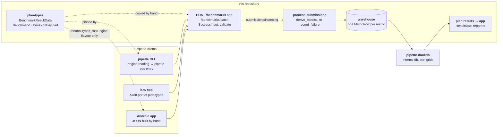

# Adding a metric

A warehouse row joins three things, beside its device and observation columns,
and adding a metric touches only one of them:

- **The benchmark** is what was asked for: a catalog entry whose
  `benchmark_id` (`prefill_throughput_256`) names a `benchmark_type` and its
  parameters ([benchmarks.md](benchmarks.md)). The type fixes the result fields
  a client submits and the metrics that can be scored from them. Every
  parameter lands on every row in `benchmark_params`, most also as a
  `parameter_*` column.
- **The model and runtime descriptors** are what ran: canonical JSON of the
  plan-types `Model` and `Runtime`, copied onto every row
  ([storage.md § descriptors](storage.md#model_descriptor--runtime_descriptor)),
  with the generation flags, load knobs and harness settings beside them as
  `model_flags`, `runtime_flags` and `benchmark_flags`.
- **A metric** is one figure: `metric`, `value`, `value_stddev` and `unit`. A
  scored submission becomes one row per metric, every row carrying the same
  benchmark, descriptors and device. A non-retriable failure becomes one row per
  metric the job intended, with no value and no device columns but
  `device_time_ms`; a retriable one writes no row.

The metric axis is a string column, so a new metric name needs no schema change.
A new **submitted field** is a wire change across this repository and
[pipette-clients](https://github.com/Liquid4All/pipette-clients),
along this path:



## 1. What are you adding?

| You want | Where it goes | Clients change? |
|----------|---------------|-----------------|
| A new figure computed from fields clients already send | The scorer only ([§4.4](#44-derive-the-metric)) | No |
| A new measured value, as a metric or an input to one | Wire field and validation ([§4.1](#41-the-clients-wire-type), [§4.2](#42-the-servers-wire-type)), scorer ([§4.4](#44-derive-the-metric)), then the clients ([§5](#5-pipette-clients)) | Yes |
| A fact about the run that is not a result (a memory peak the run held, a token count, a digest) | A wire field as for a metric, then an `observation_*` column in place of a metric ([§4.7](#47-an-observation-instead-of-a-metric)) | Yes |
| A reading you are not yet sure about | `client_extras`: stored as sent, never scored ([storage.md § `client_extras`](storage.md#client_extras)) | The `pipette` CLI only, on the desktop and in its Android build; no server change |
| A property of what ran (the model, the runtime build, a load knob) | Not a metric: plan-types' `Model`, `Runtime` or `RuntimeFlags`, which reach the row as the descriptors and flags | Yes |

A client sends what it measured, not metrics. The scorer treats a submitted
field in one of four ways ([benchmarks.md §2](benchmarks.md#2-benchmark-types) lists every type's):

- **As sent, under a metric name.** `ttft` is `prefill_time_ms`, and its
  `_stddev` twin becomes `value_stddev` unchanged.
- **Computed.** `prefill_throughput` is `parameter_prefill_tokens /
  prefill_time_ms * 1000`. Every `vl_spec_decode` metric is computed, even
  `e2e_ms`, a submitted sum divided by the turns.
- **Only an input.** `decode_time_ms` has no row of its own: it is the divisor
  of `decode_throughput`.
- **An observation, not a metric.** `image_tokens` lands only in
  `observation_vl_throughput_image_tokens`; `prompt_tokens` both feeds
  `prefill_throughput` and lands in a column.

Some metrics appear only when their field was sent (`max_gpu_usage`), or only in
one mode (the drafter's three, with speculation on).

## 2. Order and compatibility

Land this repository first: add the field to plan-types and the server, merge
and deploy, then change the clients ([§5](#5-pipette-clients)). The
server ignores unknown fields ([httpapi.md §2.7](httpapi.md#27-post-benchmarks)),
so a field sent before the deploy is dropped without an error, and its rows
never have it. Clients ship on their own schedule, and rows outlive the code
that wrote them, so two rules follow:

- **A new field on a shipped type stays optional on the server.** Older clients
  keep submitting without it, and a refused result costs the
  measurement: `pipette worker` drops it and reports a retriable failure, while
  `pipette sync` and the iOS and Android apps resend it on every upload, so a
  lasting refusal never clears. Derive the metric only when the field is
  present. A type no released client runs can require its fields, as
  `vl_spec_decode` does for its client-clock times.
- **A metric name keeps its meaning within its type.** Old rows are never
  derived again ([§4.4](#44-derive-the-metric)), so a new definition gets a new
  name: `accept_length` kept its legacy pooled formula when
  `accept_length_per_request` was added beside it.

## 3. What changes, by kind

Read down the columns your change needs. The common one, an optional result
field scored into a new metric, is **Result field** plus **New metric**. An
observation column also needs its field. A cell names the condition when a
place changes only sometimes.

| Where | New metric | Result field | Payload field | Observation column |
|-------|------------|--------------|---------------|--------------------|
| **This repository** | | | | |
| plan-types `BenchmarkResultData` ([§4.1](#41-the-clients-wire-type)) | | yes | | |
| plan-types `BenchmarkSubmissionPayload` or a struct it flattens; `RunResponse` ([§4.1](#41-the-clients-wire-type)) | | | yes; `RunResponse` for a direct field the engine reports ([§5.3](#53-the-cli)) | |
| `SuccessInput`, `validate` ([§4.2](#42-the-servers-wire-type)) | | yes; `validate` only for a required field, a number with no range type, or a rule across fields | the same | |
| `FailureInput`, `system_failure_from_job_body`, `is_success_only_field` | | | if a failed job has it too; `is_success_only_field` only for a `device_*` one (`device_time_ms`) | |
| `measurement_fields`, `UNIVERSAL_MEASUREMENT_FIELDS` ([§4.2](#42-the-servers-wire-type)) | | `measurement_fields` | `UNIVERSAL_MEASUREMENT_FIELDS` for a measurement a failure body must not carry (today the four `observation_*`); not a `device_*` field, a setting, or a field a failed job also sends | |
| `VlSpecDecodeCounters`, `vl_spec_decode_counters` | | for `vl_spec_decode` | | |
| `derive_metrics` or `vl_spec_decode_metrics` ([§4.4](#44-derive-the-metric)) | yes | if it feeds an existing metric (a `_stddev` twin) | | |
| `intended_metrics`, `VL_SPEC_DECODE` ([§4.4](#44-derive-the-metric)) | not for an optional field | | | |
| warehouse `Field`, `MetricRow`, `batch_to_rows`, `rows_to_batch` ([§4.7](#47-an-observation-instead-of-a-metric)) | | | if it gets a column (`device_time_ms`) | yes |
| success-row stamping and `record_failure` in `score.rs` | | | if it gets a column | yes |
| `COLUMNS`, both `ResultRow`s, `result_row`, `CSV_COLUMNS`, API schema, httpapi.md | | | | to serve it to the app |
| a view in `ui/src/lib/components` | | | | to show it |
| `ui/src/lib/report.ts` ([§4.5](#45-readers)) | if a view reads it by name, it is a `ratio` to show in percent (`PERCENT`), or its family should open on it (`OPENS_ON`) | | | |
| tests and docs ([§4.6](#46-tests-and-docs)) | yes | yes | yes | yes |
| **pipette-duckdb** | | | | |
| a perf grid's query kind `metrics()` ([§4.5](#45-readers)) | to publish it in that grid | | | |
| a perf grid's `PUBLISHED_COLUMNS` ([§4.5](#45-readers)) | | | if it gets a column, to publish it there | to publish it in that grid |
| **pipette-clients** | | | | |
| `rev` in the root `Cargo.toml` ([§5.1](#51-bump-the-plan-types-pin)) | | yes | yes | |
| pipette-ops entry and `*MeasurementReading`; for `vl_spec_decode`, the stream reader, `TurnRecord` and `counters` ([§5.2](#52-measure-it-rust)) | | yes | | |
| engines' `src/execute/<benchmark_type>.rs` ([§5.2](#52-measure-it-rust)) | | each that measures it; none for `vl_spec_decode` | each that reports it | |
| ONNX GenAI and OpenVINO Python servers | | if the reading needs a new reply field | | |
| `pipette-memprobe`, `pipette-device` probes | | | a `MemoryObservation`, `ThermalTelemetry` or `DeviceInfo` field | |
| `record.rs`; `RunResponseBuilder` ([§5.3](#53-the-cli)) | | | a top-level field; `RunResponseBuilder` if the engine reports it | |
| `run_summary_lines` ([§5.3](#53-the-cli)) | | yes, but not for `VlSpecDecode` | | |
| iOS `Submission.swift` ([§5.4](#54-ios)) | | the case, or `CorpusTotals` for a `vl_spec_decode` sum, and the payload's copy | a direct or `DeviceInfo` field; a `DeviceInfo` one also in `PlanTypes/Device.swift` and `Device/Probe.swift` | |
| iOS `Record.swift`; `Run.swift` | | | a direct field; `Run.swift` if the engine reports it | |
| iOS measurement and engines | | yes | | |
| iOS `ResultReport.swift`; `HeadlessRunner.swift` | | yes, but not for a `CorpusTotals` sum; `HeadlessRunner.swift` for `maxMemoryUsage` | | |
| Android: both engines' builders ([§5.5](#55-android)) | | for a type Android runs | a thermal series, or a value the engine reports | |
| Android `LocalStorage.kt` | | | a direct device or identity key | |
| tests: struct literals and full patterns of the variant, in Rust and Swift; payload tests | | yes | yes | |
| methodology docs; `client-parity.md` if a phone lags ([§5.7](#57-docs)) | if needed | yes | if needed | if needed |

## 4. This repository

### 4.1. The client's wire type

`crates/pipette-plan-types/src/submission/mod.rs` is what the Rust clients
serialize. iOS and Android mirror it by hand, except the thermal keys of
Android's `rustEngine` flavour, which come from plan-types' `ThermalTelemetry`
([§5.4](#54-ios), [§5.5](#55-android)).

- A field of **one benchmark type's result** goes on its variant of
  `BenchmarkResultData`, as an `Option` with
  `#[serde(default, skip_serializing_if = "Option::is_none")]` unless the type
  has no released client yet ([§2](#2-order-and-compatibility)), beside a
  `_stddev` twin if it is a mean over reps. Its Rust type is plain: `f64` for a
  time or a rate, `u32` or `u64` for a count. The range types are the server's
  ([§4.2](#42-the-servers-wire-type)). `vl_max_memory` and `asr_max_memory`
  have no variant of their own and send `MaxMemoryUsage`, so a field there
  reaches all three memory types.
- A field **every type may report** goes on `BenchmarkSubmissionPayload`, or on
  a struct it flattens (`MemoryObservation`, `ThermalTelemetry`, `DeviceInfo`).

`BenchmarkResultData` is `#[serde(untagged)]` and flattened into the payload
beside `DeviceInfo`, `ThermalTelemetry`, `MemoryObservation` and
`RuntimeOutput`. A new name must not repeat a field of any of those, of another
variant or of the payload, nor be `benchmark_type` or `benchmark_params`: a
reused name can send the body to the wrong variant or hand its value to another
field, often without an error. A new type prefixes its fields with the type
(`vl_spec_decode_*`); on an existing type, follow its fields' style
(`prefill_*` on `prefill_throughput`). Add a case with the new field set to
`result_data_untagged_variant_round_trips`. It round-trips the result on its
own, so it catches only a clash with another variant; the tests that round-trip
a whole payload all use a `DecodeThroughput` result, so on any other type no
test catches a clash with a payload field. Check those names by hand.

### 4.2. The server's wire type

`SuccessInput` in `crates/pipette-pipeline/src/submission.rs` is the server's
own copy of the fields. It must use the key plan-types puts on the wire, after
any `#[serde(rename)]`, not the Rust field name: plan-types' `max_host_bytes`
goes out as `max_ram_bytes`, which `SuccessInput` takes through an alias.
Declare it as an `Option` of the narrowest range type from plan-types, so an
out-of-range number is a `400` at deserialization and never a stored row:

| Type | For |
|------|-----|
| `PositiveMillis` | a time that cannot be zero: one a metric divides by, or a whole measured run such as `total_time_ms` |
| `NonNegativeMillis` | a time that may be zero, such as a stddev |
| `ElapsedMillis` | whole milliseconds counted on a monotonic clock, zero allowed (`device_time_ms`) |
| `ByteCount` | a size or peak in bytes |
| `PositiveCount` | a count that is never zero, up to `i32::MAX` |
| `NonNegativeCount` | a count that may be zero |

A count that can pass `i32::MAX`, or a float that is not a time, has no range
type: take it as `Option<i64>` or `Option<f32>` and check it in `validate`. A
number past `f32::MAX` arrives as infinity, so bound a float on both sides
(`x >= 0.0 && x <= max`), which refuses NaN and infinity too, as the check on
`vl_spec_decode_turn_accept_length_sum` does. A rule across fields also goes in
`validate` or a helper it calls, as `vl_spec_decode_counters` and
`VlSpecDecodeCounters::validate` do for the rules in
[benchmarks.md §2.8.4](benchmarks.md#284-submission-fields).

Then name the field in `measurement_fields` in
`crates/pipette-core/src/benchmark.rs`, or in `UNIVERSAL_MEASUREMENT_FIELDS` if
every type may report it. The server reads only their union, to refuse a
failure body that carries a measurement (`reject_wrong_variant_fields`), so the
lists are not a per-type gate. `measurement_fields_name_real_wire_fields` fails
on a listed name that is not a `SuccessInput` field and on an unlisted
`observation_*` one; a result field left off the list passes every test, and a
failure body carrying it gets through. A `device_*` field needs no entry: a
failure body carrying a `device_` key is refused by its prefix
(`is_success_only_field`), except `device_time_ms`, which a failed job also has.

### 4.3. Units and names

Reuse a unit already in the warehouse: `ms`, `tokens/sec`, `tokens`, `bytes`,
`ratio`. The app reads them ([§4.5](#45-readers)), and a query that groups by
unit expects one spelling per quantity. `value` is a Float32, so a byte count
above 16 MiB is not stored exactly; the `observation_*` byte columns are Int64.

Name the metric for the quantity, not after its field (`ttft` from
`prefill_time_ms`, `max_host_usage` from `max_host_bytes`), and check that the
type does not already use the name ([benchmarks.md §2](benchmarks.md#2-benchmark-types)).

### 4.4. Derive the metric

Push the new `DerivedMetric` in `derive_metrics` in
`crates/pipette-pipeline/src/score.rs`, or for `vl_spec_decode` in
`vl_spec_decode_metrics`, carrying any new counter through
`VlSpecDecodeCounters` and `vl_spec_decode_counters` in `submission.rs`. For an
optional field, push it only when the field is present, as the memory arm does
for `max_gpu_usage`. Set `value_stddev` as the existing arms do: a field as sent
takes its `_stddev` unchanged; a rate over a time takes `value * stddev / time`;
a sum of two timed phases takes the root of the summed squares, or the one
stddev sent if only one was.

`intended_metrics`, just below, lists the metrics a failure row of the type
occupies. **A metric of an optional field stays out**, like `max_gpu_usage`. One
goes in when a failure row can tell the run would have produced it:

- one computed only from fields the type requires;
- one of a type no released client runs yet, whose field is required;
- one conditional on something a failure row knows. The drafter's three are
  intended when the resolved `speculative_enabled` is on. They sit last in
  `VL_SPEC_DECODE`, and a failure row with speculation off or unknown takes
  `&VL_SPEC_DECODE[..6]`. Put a metric of both modes before the drafter's three
  and raise that bound with it: the drift test does not catch a bound left
  behind, and the failure-row test's off and unresolved cases still expect six.
  A failure the server declares itself, such as a job past its `expires_at` or
  one retired after `plan_lost_lease_limit` lost leases, carries no
  `runtime_flags`, so it never resolves speculation and gets only the slice.

`test_intended_metrics_agrees_with_derive_metrics` checks that each intended
metric comes out of `derive_metrics`, with the same unit, for one fixed
submission per case. It misses a derived metric left out of `intended_metrics`,
and a conditional one listed by mistake when every case of its arm sends the
field. A new type is checked only once it has a case.

`max_memory_usage`, `vl_max_memory` and `asr_max_memory` share one arm in
`measurement_fields`, `derive_metrics` and `intended_metrics`, and all three
require `max_host_bytes` in `validate` (where `asr_max_memory` also requires its
context sizing and audio-limit flag), so a memory metric lands on all three
types' rows unless you split the arm.

**Existing rows do not gain the metric.** The scorer derives metrics once, when
a submission is scored, and a campaign re-run is a new job, so a new metric
covers only results scored after the deploy.

### 4.5. Readers

A new metric name needs no change to be served: the plan results read
(`ResultRow` in `crates/pipette-pipeline/src/plan_results.rs`) returns every
metric row of each job's latest scoring run from pipette-duckdb's
`internal` database, after its next refresh, and the app charts every metric it
finds. What the app assumes, in `ui/src/lib/report.ts`:

- `metricOf` draws `ms` and `bytes` as lower-is-better and everything else as
  higher-is-better, and shows `bytes` in GB.
- `PERCENT` names the metrics shown in percent; a new `ratio` draws as a raw
  0 to 1 value unless it is named there.
- `OPENS_ON` lists, in order, the metrics a family opens on. A new metric is
  drawn only when picked from the metric select, unless its family has none
  listed and opens on the one with the most measured rows. The Jobs tab lists
  it either way.
- `METRIC_ORDER` orders a type's metrics where it lists them; a new one comes
  after those listed, by name.
- Some views read metrics by name: `DRAFTER` (a speculative job's drafter
  metrics), `POOLS` (the memory metrics charted as `peak_memory`), the E2E
  check `rungs` (`ttft`, `prefill_throughput`, `decode_throughput` and
  `end_to_end_latency` across the three text types), the VL check `vlRungs`
  (`ttft`, `decode_throughput` and `end_to_end_latency` of one
  `vl_throughput` job) and the speedups `pairs`
  (speculative against baseline on `decode_throughput` and `e2e_ms`). A metric
  that joins one goes in it, with a case in `ui/test/report.test.ts`.
- The Swap tab reads the `max_swap_bytes` observation, and the Prompt tokens
  charts VL throughput's `vl_throughput_image_tokens` and
  `vl_throughput_prefill_tokens` ones and ASR throughput's
  `asr_throughput_audio_tokens` and `asr_throughput_prefill_tokens` ones
  (`TOKENS`), not metric rows.
- The ASR rules (`asrRule`) read the `asr_context_sizing` (`exact`) and
  `asr_audio_tokens_source` (`calibrated`) observations by name and wire
  spelling, so a renamed column or value drops every ASR row from the
  comparison; the beyond-limit marks read `asr_beyond_model_audio_limit`
  (`beyondAudioLimit`).

pipette-duckdb, a separate repository, loads every warehouse column. Its
`internal` database carries every column and every metric. `dspark-vl-3b-mmspec` carries every
column too, but only the rows of the runs it names, so a new metric never
reaches it. The perf grids are narrower:

- `aa-v1_1`, `dashboard-v1_1`, their `_with_bonsai2` copies and the dated
  copies name their columns in `PUBLISHED_COLUMNS`. `aa-v1`, a build feature off
  by default, publishes all but `EXCLUDED_COLUMNS`, so a new column appears
  there unless it is listed.
- Every grid keeps only the `(benchmark_id, metric)` pairs its queries name
  (`metric_keys`, from each query kind's `metrics()`). A new metric reaches a
  grid only through a rule added there, after this repository deploys.

### 4.6. Tests and docs

| What | Where |
|------|-------|
| The derivation | a `test_derive_*` case in `crates/pipette-pipeline/src/score.rs` |
| Range and cross-field rules | a case in `test_submit_number_range`, `crates/pipette-httpapi/tests/submissions.rs`; for a `vl_*` field, the `rstest` cases in `crates/pipette-pipeline/src/submission.rs` |
| The client's wire shape | a case in `result_data_untagged_variant_round_trips` for a result field, or `submission_payload_round_trip_with_device_info` for a payload field, both in `crates/pipette-plan-types/src/submission/mod.rs` |
| Submit to scored row, over HTTP | `crates/pipette-httpapi/tests/scoring.rs` (`test_throughput_scoring_produces_metrics` is the shape) |

Document it in:

| What | Where |
|------|-------|
| A type's field and its metric | the type's **Submission fields** and **Derived metrics** in [benchmarks.md §2](benchmarks.md#2-benchmark-types) |
| A field every type may report | the request body table of [httpapi.md §2.7.1.1](httpapi.md#2711-request-body) |
| A `device_*` field that needs filling guidance | also [Common submission fields](benchmarks.md#common-submission-fields) |
| An observation column | [storage.md §5](storage.md#5-warehouse-contract) and the type's own list of observations |
| A new column, how to read it | [storage.md §5](storage.md#5-warehouse-contract) |
| How the number is measured | the type's methodology document in the clients' `docs/methodology/` ([§5.7](#57-docs)) |
| How a `vl_spec_decode` row is compared | [methodology/vl-spec-decode.md](methodology/vl-spec-decode.md) |

### 4.7. An observation instead of a metric

An observation takes the wire work of [§4.1](#41-the-clients-wire-type) and
[§4.2](#42-the-servers-wire-type), then a nullable column copied onto every row
of the submission. In `crates/pipette-core/src/warehouse.rs`:

1. Append a nullable `Field` to the end of the schema. Columns are only ever
   appended, so old partitions read unchanged.
2. Add the field to `MetricRow` and its `Default`.
3. Read it in `batch_to_rows` with `optional_column::<…Array>`, or
   `optional_string_column` for a string, so a file written before the column
   existed reads it as `NULL`.
4. Write it in `rows_to_batch`.

Then stamp it in `crates/pipette-pipeline/src/score.rs` where the success rows
are built, gated on the benchmark type when only one type has it
(`observation_vl_throughput_*`): a success body may carry another type's field,
and an ungated column stores it. Set it on the failure rows in `record_failure`
(usually `None`). Name it by the rule in
[storage.md §5](storage.md#5-warehouse-contract):
`observation_<type>_*` only when no other type could have the fact. An
observation of memory is not a memory benchmark's result:
`observation_max_host_bytes` and the `max_host_bytes` that becomes
`max_host_usage` share only their Rust name in plan-types.

A new column reaches pipette-duckdb ([§4.5](#45-readers)) but not the
app, because the plan results read selects a fixed list. To serve one, add it
to `COLUMNS` and `ResultRow` in `crates/pipette-pipeline/src/plan_results.rs`,
to the body's `ResultRow` in `crates/pipette-plan-types/src/results.rs` and its
`From` impl in `plan_results.rs`, and to `CSV_COLUMNS` in
`crates/pipette-httpapi/src/api_v1/plans/csv.rs`,
regenerate `ui/src/lib/api-schema.json` and `ui/src/lib/api-types.ts`
([development.md](development.md)), list it in [`GET /api/v1/plans/{plan_id}/results.csv`](api/plans/get_plan_results_csv.md#result-rows), §10.8.3
and §10.8.4, and render it in a view: the Jobs tab's columns are fixed, so add
an entry to `COLUMNS` in `ui/src/lib/jobs.ts`, `shown: false` unless it belongs
in the default set; the Jobs CSV then carries it too.

## 5. pipette-clients

Paths below are in pipette-clients on `main`. Each platform builds its
results on its own, so a new field reaches only the platforms you change. Who
runs what today:

| Type | `pipette` CLI | iOS | Android | Batch above 1 |
|------|---------------|-----|---------|---------------|
| `prefill_throughput` | all six engines | llama.cpp, MLX, ONNX GenAI | yes | llama.cpp, OVMS, torch-oai |
| `decode_throughput` | all six engines | llama.cpp, MLX, ONNX GenAI, Apple Foundation | yes | llama.cpp, OVMS, torch-oai |
| `end_to_end_latency` | all six engines | llama.cpp, MLX, ONNX GenAI, Apple Foundation | yes | llama.cpp, OVMS, torch-oai |
| `max_memory_usage` | all six engines | llama.cpp, MLX, ONNX GenAI | yes | no |
| `vl_throughput` | llama.cpp, MLX | llama.cpp | one image only | no |
| `vl_max_memory` | llama.cpp, MLX | llama.cpp | no | no |
| `vl_spec_decode` | llama.cpp, MLX, torch-oai (SGLang) | llama.cpp | no | llama.cpp, MLX, torch-oai |
| `asr_throughput` | llama.cpp | no | no | no |
| `asr_max_memory` | llama.cpp | no | no | no |

"All six engines" are `pipette-llamacpp`, `pipette-mlx`, `pipette-onnx-genai`,
`pipette-openvino`, `pipette-ovms` and `pipette-torch-oai`. Only the CLI engines
in the last column run a batch above 1, so a figure about batching comes only
from them. The clients' `docs/ovms.md` lists the batches OVMS refuses.

### 5.1. Bump the plan-types pin

Once §4 has merged, set the `pipette-plan-types` `rev` in the clients' root
[`Cargo.toml`](https://github.com/Liquid4All/pipette-clients/blob/main/Cargo.toml)
to its commit and run `cargo update -p pipette-plan-types`. To work on both at
once, use the local-checkout override in the clients'
[CONTRIBUTING.md](https://github.com/Liquid4All/pipette-clients/blob/main/CONTRIBUTING.md).

### 5.2. Measure it (Rust)

The Rust engines serve the `pipette` CLI, on the desktop and in its Android
build. The Android app's native engines are its own ([§5.5](#55-android)).

- **Per type**, an entry in
  [`pipette-ops/src/measurement/`](https://github.com/Liquid4All/pipette-clients/tree/main/crates/pipette-ops/src/measurement)
  builds the `BenchmarkResultData`, under a short name: `prefill.rs` for
  `prefill_throughput`, `end_to_end.rs` for `end_to_end_latency`.
  `max_memory.rs` is the simplest. `vl_max_memory.rs` and `asr_max_memory.rs`
  build the same `MaxMemoryUsage` result, so a field of that variant goes in
  all three.
- **Readings.** Each entry has a `*MeasurementReading` that the engines fill
  once per attempt: once per rep for the timed types and once per cell for the
  memory types, plus once for a warm-up where the entry runs one. The
  warm-up's reading is checked and dropped. A new raw reading is a new field
  there. Where the reading is an enum (prefill, decode, end-to-end), it goes on
  both structs: `*PerPromptReading` holds one reading per request of a batch,
  and `*TotalsReading` a batch reply's sums with one shared time.
- **Reps and stddev.** Each timed entry (`prefill`, `decode`, `end_to_end`,
  `vl_throughput`, `asr_throughput`) runs the `reps` it is given (the engines pass
  `measurement::REPS`, 5) and reduces each figure with `mean_stddev` from
  `measurement.rs`, the sample stddev. A rep returns one figure, so a second one
  widens it, as `vl_throughput.rs` does. These entries send `_stddev` only when
  more than one rep ran, and a figure that is not a mean over reps (a maximum)
  sends none. The memory entries and `vl_spec_decode` take no reps.
- **Each engine** fills the reading in `src/execute/<benchmark_type>.rs` of its
  crate. Many do it through a `from_generation` constructor in the pipette-ops
  entry, which is where a reading taken from the stream goes. A value settled
  once rather than per rep can be patched onto the result after the reps, as
  `pipette-llamacpp`'s `vl_throughput` does for `image_tokens`. An engine that
  cannot measure the value leaves it `None`, and the server skips only the
  metric that needs it.
- **`vl_spec_decode`** reads each turn with the shared stream reader in
  `pipette-ops/src/vl_spec_decode.rs` (`read_chat_stream`, `StreamedTurn`),
  driven by the traversal in `pipette-vl-spec-decode-corpus/src/turn.rs`, so the
  engines supply no reading of their own. At batch size 1, `turn::measure`
  turns each turn into a reading with
  `VlSpecDecodeMeasurementReading::from_stream` in
  `measurement/vl_spec_decode.rs`, and the entry's `reduce` sums them. At larger
  batches, `turn::run` builds a `TurnRecord` per turn
  (`StreamedTurn::into_record`), and `counters` in `vl_spec_decode.rs` sums
  those. A new per-turn reading goes in both paths. The test
  `a_traversal_becomes_the_row` checks that the two sums agree.

Write down what a new reading measures, and check that every engine measures
the same span: llama.cpp's `prefill_time_ms` comes from llama-bench with no
token generated, while the HTTP engines time a streamed first token on the
client's clock.

Check the range on the client too. Plan-types' result variants carry plain
`f64`, `u32` and `u64`, so nothing stops a client from sending a value the
server refuses with a `400` ([§2](#2-order-and-compatibility)). The pipette-ops
entries narrow each reading to the server's range type, and the memory entries
refuse a zero peak. A field with no range type gets the server's `validate`
check in its entry.

### 5.3. The CLI

`build_submission_payload_from_run` in
[`results/record.rs`](https://github.com/Liquid4All/pipette-clients/blob/main/crates/pipette-cli/src/results/record.rs)
copies the result data through, so a result field needs no change there, only
in its tests and every other struct literal of the variant. A new direct field
of `BenchmarkSubmissionPayload` must be filled in that function's struct
literal: from its own parameters for what the CLI gathers (device, power,
telemetry), or from plan-types' `RunResponse` for what the engine reports. An
engine fills `RunResponse` through `RunResponseBuilder` in
`pipette-ops/src/run_response.rs`, so such a field also needs a setter there. A
`MemoryObservation` field passes through `memory` unchanged, and `thermal` is
built there from the engine's per-rep readings by
`ThermalTelemetry::from_series`, so neither needs a change in `record.rs`. Fill
a new field where those are built: the `pipette-memprobe` probes, or
`detect_thermal` in `pipette-device` and `ThermalTelemetry::from_series` in
plan-types.

`run_summary_lines` in
[`commands/benchmarks.rs`](https://github.com/Liquid4All/pipette-clients/blob/main/crates/pipette-cli/src/commands/benchmarks.rs)
destructures every result variant except `VlSpecDecode` in full, so a new field
on those will not compile until it is named there. Print it only if it belongs
in the run summary.

### 5.4. iOS

The iOS app is a hand-written Swift port of plan-types and of the measurement,
so bumping the pin changes none of its submission code. Paths here are under
`ios/Pipette/Pipette/`.

- `PlanTypes/Submission.swift`: the `BenchmarkResultData` case (or
  `CorpusTotals` for a `vl_spec_decode` sum), its `CodingKeys` and
  `init(from:)`. That enum is only decoded. The wire is encoded from
  `BenchmarkSubmissionPayload`, which flattens the result by hand, so a result
  field also needs a stored property there, its key, and an arm in the
  flattening switch, or iOS never sends it. A payload field needs the stored
  property, its key and an `init` parameter, passed in `Results/Record.swift`
  (`buildSubmissionPayloadFromRun`), and its `RunResponse` mirror in
  `PlanTypes/Run.swift` if the engine reports it.
- The measurement: `Ops/Measurement/*.swift`, with `meanStddev` in
  `Ops/Measurement.swift`, and the engines that fill the reading:
  `Runtimes/*/Execute/` for llama.cpp, MLX and ONNX GenAI, and
  `Runtimes/AFM/AFMRuntime.swift` for the Apple Foundation decode and
  end-to-end cells. The memory types read their peaks in
  `Runtimes/ProcessMemory.swift` (`maxMemoryBracket`). `vl_spec_decode` builds
  each turn's `TurnRecord` in `Runtimes/Llama/LlamaVisionChat.swift`, stamps
  `e2eMs` around the call in `Benchmarks/Turn.swift`, and sums the turns in
  `Ops/VlSpecDecode.swift` (`counters`).
- `Commands/ResultReport.swift` matches every case's values by position, so it
  stops compiling when a case gains one. `Headless/HeadlessRunner.swift` does so
  only for `maxMemoryUsage`. `Results/BenchmarkMetrics.swift` (`compute`) and
  `Results/CompletedResultsCSVExporter.swift` read payload keys by name and
  change only if the field should be shown.
- Tests: `ios/Pipette/PipetteTests/BenchmarkSubmissionPayloadTests.swift` pins
  the encoded keys of a decode payload, and the measurement tests there
  (`*MeasurementTests.swift`, `TurnTests.swift`, `VlThroughputTests.swift`)
  match the case by position too.

iOS sends no `MemoryObservation` (`observation_max_*`) or `ThermalTelemetry`
fields. `Submission.swift` mirrors `MemoryObservation`, but nothing fills it.
Its per-rep thermal readings go out as `device_hardware_readings` and
`device_os_throttling_readings`.

### 5.5. Android

Both Android engines build each result as untyped JSON, so a missing key is not
a compile error: add it by hand to the type's builder in both.

- The default build is the Kotlin engine flavour:
  `android/Pipette/app/src/kotlinEngine/.../llama/LlamaBenchmark.kt`, with
  `meanStddev` in the shared `android/Pipette/app/src/main/.../ops/Measurement.kt`.
- The `rustEngine` flavour builds each result with `json!` in
  `android/native/benchmarks.rs`, which the `pipette-android` crate compiles.
  It shares pipette-ops' measurement harness (`measurement::run`, `REPS`,
  `mean_stddev`), prompt seed and thermal series, and plan-types'
  `ThermalTelemetry`, but none of the pipette-ops entries.
- `LocalStorage.kt` (`writePayload`) passes result keys through, so a result
  field needs no change there. A direct payload field, such as a device or
  identity key, is added there. A thermal series is merged onto the result by
  each engine instead. In the Kotlin engine, `sampleThermal` reads it into
  `ThermalReading` (`ops/ThermalSeries.kt`) and `mergeThermal` writes its keys
  by hand. In `benchmarks.rs`, `sample_thermal` fills plan-types'
  `ThermalReading` from the `ThermalSampler` in
  `pipette-clients/crates/pipette-android/src/lib.rs`, and `ThermalTelemetry::from_series`
  names the keys. `LocalStoragePayloadTest.kt` checks the fields
  `writePayload` adds and that one result key passes through.
- `CompletedResultsCsvExporter.kt` reads result keys by name and changes only
  if the field should be shown.

Both engines send `_stddev` on every timed result, and neither sends an
`observation_*` field. A field added for `vl_max_memory` is a
`max_memory_usage` field too ([§4.1](#41-the-clients-wire-type)), which Android
runs.

### 5.6. What does not need a change

- `pipette-contract` has no fixtures for result data.
- `ci/checks/python-server-parity.py` matters only if the reading comes from the
  ONNX GenAI or OpenVINO Python servers' replies. Then make the same edit in
  both.
- `tools/pipette-ios-proxy` forwards the payload as raw JSON.

### 5.7. Docs

The type's methodology document in the clients'
[`docs/methodology/`](https://github.com/Liquid4All/pipette-clients/tree/main/docs/methodology)
lists the fields it submits. If iOS or Android ships without the field, record
the gap in
[`docs/client-parity.md`](https://github.com/Liquid4All/pipette-clients/blob/main/docs/client-parity.md),
as gap 12 does for keys Android omits.

## 6. Check it end to end

The unit tests on each side pass even when the two spell the field
differently: the server ignores the client's key as unknown, so an optional
field's metric is just missing, and a required one gets a `400`. One run of the
desktop `pipette` CLI against a local server catches a mismatch between
plan-types and the server before the deploy. iOS and Android spell their keys
by hand, so check theirs too.

On this side, seed a local store and serve it ([development.md §2](development.md#2-benchmarks-and-sample-data)),
and mint a pre-auth key so the client registers approved:

```bash
mkdir -p sample_data && cp -r examples/benchmarks sample_data/benchmarks
cargo run --bin pipette-mgmt -- --config examples/config.toml clients preauth create
cargo run --bin pipette-mgmt -- --config examples/config.toml serve   # port 3000
```

A `vl_spec_decode` run fetches its corpus from this server, which needs more:
mint the key with `--permission submit_results --permission perform_work`, and
build the corpus before the run. The server refuses a probe verdict older than
three minutes, so probe again if the run starts later:

```bash
cargo run --bin pipette-mgmt -- --config examples/config.toml dataset-cache build
cargo run --bin pipette-mgmt -- --config examples/config.toml dataset-cache probe
```

In a clients checkout, build `pipette` against your mgmt branch with the
override in the clients'
[CONTRIBUTING.md](https://github.com/Liquid4All/pipette-clients/blob/main/CONTRIBUTING.md), its `path` pointing at the mgmt checkout that holds the
branch. Then register, run one benchmark of the type, and submit. The model and
runtime below are the clients'
[usage.md](https://github.com/Liquid4All/pipette-clients/blob/main/docs/pipette-cli/usage.md)
example for a Mac; it lists others:

```bash
cargo --config 'patch."ssh://git@github.com/Liquid4All/pipette-mgmt.git".pipette-plan-types.path="../pipette-mgmt/crates/pipette-plan-types"' \
  build -p pipette-cli
export PATH="$PWD/target/debug:$PATH" PIPETTE_WORK_DIR=/tmp/metric-check
pipette init
pipette auth register --server-url http://127.0.0.1:3000 --organization dev \
  --contact-email dev@example.test --client-details "metric check" --preauth-key <key>
pipette sync
pipette benchmarks run --benchmark prefill_throughput_256 \
  --model 'gguf-text://repo=unsloth/gemma-3-270m-it-GGUF&path=gemma-3-270m-it-Q4_K_M.gguf' \
  --runtime 'llamacpp-cli-stock-tools://version=b9305&flavor=macos-arm64'
pipette sync
```

Back here, score it and read the rows; for an observation, add its
`observation_*` column to the `SELECT`:

```bash
cargo run --bin pipette-mgmt -- --config examples/config.toml process-submissions
duckdb -c "SELECT metric, value, value_stddev, unit
           FROM 'sample_data/warehouse/results/**/*.parquet'"
```

The new metric should be there with the unit you chose. If it is missing,
compare two copies of the submission. After `pipette sync`, the RESULT column of
`pipette results list` is the job id, and `pipette results show <job_id>` prints
what the client sent. `sample_data/submissions/processed/{job_id}.json.gz` is
the server's parsed copy: every field `SuccessInput` declares but the runtime
output, `null` when nothing arrived under its name or alias, beside the
`message_type` tag and the fields the server stamps (`client_id`, `job_id`,
`submitted_at`, `benchmark_type`, the `requested_*_flags`). A client key that
`SuccessInput` does not declare is dropped. A `null` there for a field the
client sent means the two spell it differently; a value means the scorer
missed it.
