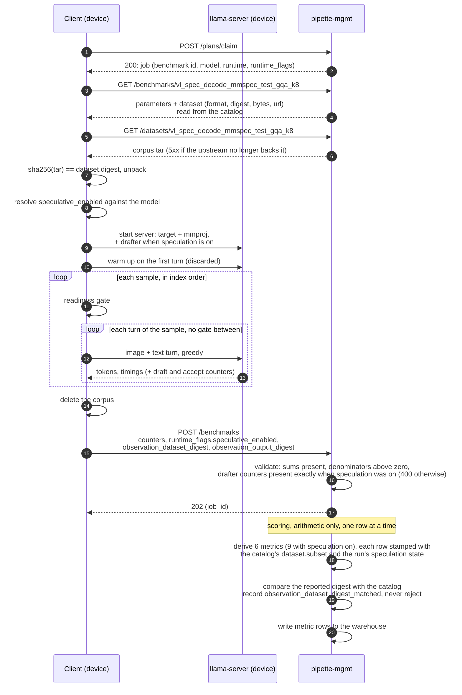

# Benchmarks

Each benchmark is a single entry in the catalog identified by a `benchmark_id`
that encodes the type and its parameters (e.g. `prefill_throughput_256`,
`decode_throughput_128_256`, `eval_ifstruct_release_v1_0`,
`vl_throughput_384x512_32_128`). Benchmarks are defined as TOML files in
`{data_dir}/benchmarks/{benchmark_id}.toml`: one file per entry, loaded at
startup. Clients discover benchmarks via the API and submit their measured
values.

The benchmark catalog is public. Anyone can browse it without authentication,
except for the entries an organization keeps to itself
([§1.1](#11-private-benchmarks)). Submitting results requires an approved
client. See [authentication.md §4](authentication.md#4-access-matrix) for the
access rules.

See [`examples/benchmarks/`](../examples/benchmarks/) for ready-to-use TOML files.
The ASR entries are not among them: they live in the deployment's catalog
([§2.10](#the-deployments-ladder)).

## 1. Overview

| Type | Model type | What it measures |
|------|-----------|------------------|
| [Prefill Throughput](#21-prefill-throughput) | Text | How fast the model processes the input context (time to first token) |
| [Decode Throughput](#22-decode-throughput) | Text | How fast the model generates output tokens after prefill |
| [End-to-End Latency](#23-end-to-end-latency) | Text | Total time from prompt submission to last generated token |
| [Peak Memory Usage](#24-peak-memory-usage) | Text | Peak host, GPU, and NPU memory consumed during inference |
| [Eval (Accuracy)](#25-eval-accuracy) | Text | Model accuracy on a question-answering benchmark |
| [VL Throughput](#26-vl-throughput) | Vision-Language | Prefill, decode, and end-to-end timing for image + text input |
| [VL Peak Memory](#27-vl-peak-memory) | Vision-Language | Peak host, GPU, and NPU memory for an image + text workload |
| [VL Speculative Decoding](#28-vl-speculative-decoding) | Vision-Language | One VL model decoding a real image + text corpus, speculation on or off; accept length and throughput per row |
| [VLM Eval (Accuracy)](#29-vlm-eval-accuracy) | Vision-Language | Model accuracy on a multimodal question-answering benchmark |
| [ASR Throughput](#210-asr-throughput) | Audio-Language | Prefill, decode, and end-to-end timing for one audio clip + optional text + the model's transcription prompt |
| [ASR Peak Memory](#211-asr-peak-memory) | Audio-Language | Peak host, GPU, and NPU memory for one audio clip + optional text |
| [ASR Eval (Error Rate)](#212-asr-eval-error-rate) | Audio | Transcription word error rate on an Open ASR Leaderboard (English) or FLEURS test set |

**Text** benchmarks (2.1–2.4) use synthetic text-only prompts.
**VL** benchmarks (2.6–2.7) use a synthetic image alongside a text prompt and
require a model with a vision encoder.
**Eval** (2.5) applies to any model type: the server provides the prompts.
**VL Speculative Decoding** (2.8) requires a vision-language model with a
vision encoder, and a drafter to run with speculation on. Its workload is a real
image + text corpus the client downloads from mgmt, served only while its
upstream still backs the pin (see [§2.8.1](#281-the-dataset-object)).
**VLM Eval** (2.9) applies to any vision-language model: like text Eval, the
server provides the prompts (including images), and scoring happens
server-side.
**ASR Eval** (2.12) applies to any audio-input model: the server provides each
clip as a request in the model family's own shape, in a corpus the client
downloads, and scoring happens server-side. Its entries are org-private.

**ASR** benchmarks (2.10–2.11) use a synthetic audio clip of a set length and
format (see [The input clip](#the-input-clip)) and require a model with an audio
encoder.

### 1.1. Private benchmarks

An organization may keep benchmarks **of its own**, in addition to the public
catalog. They live in the organization's own keyspace,
`org-benchmarks/{org_id}/{benchmark_id}.toml`
([storage.md §3](storage.md#3-metadata-contract)), and each file is exactly the
shape of a public entry: the path says whose it is, the body says nothing about
it.

```toml
# org-benchmarks/org_0195c3e2-a4f3-7b8c-9d1e-2f3a4b5c6d7e/eval_acme_internal_v3.toml
benchmark_type = "eval"
parameter_eval_id = "acme_internal"
parameter_dataset_name = "v3"
parameter_max_tokens = 4096
```

**Who is served them.** `GET /benchmarks` and `GET /benchmarks/{benchmark_id}`
(and their `/api/v2` twins) serve the public catalog to everyone, and to a request
**signed by a principal of the organization** its own entries as well: an
approved client the organization holds, directly or through a member who owns
it, or an active user who belongs to it
([httpapi.md §2.5](httpapi.md#25-get-benchmarks)). To
everyone else, an unsigned request included, the entry does not exist: it is
absent from the listing and its id is a `404`. `GET /datasets/{benchmark_id}`
applies the same rule to the corpus, so a private `vl_spec_decode` entry's
dataset is as private as its definition. On the wire a private entry carries
`org_id` beside its parameters, so a member can tell its own entries from the
public ones; a public entry carries no such field.

**Read per request.** The public catalog is loaded at startup and cached; an
organization's entries are read from its keyspace on each request that reaches
them, so a write is served on the next read with nothing to invalidate.

**Who curates them.** The organization's administrators, over HTTP or in the
app, and the host with `pipette-mgmt orgs benchmarks` ([cli.md](cli.md)). The
routes and who may call them are in
[Organizations: Private benchmarks](api/orgs.md#private-benchmarks). A definition is
held to the same checks a file is at load, so what could not be served cannot
be written.

**One id, one entry.** A private entry may not take an id the public catalog
holds, nor one another organization keeps: either write is refused with `409`.
The public entry is what would be served, and the server's own passes (below)
must resolve every id to exactly one definition. Benchmark ids are one namespace
across organizations, as handles are, so the first writer keeps an id. An entry
planted behind the routes' back under a public id is dropped with a warning,
and an id two organizations hold resolves to neither server-side.

**No misleading prefix.** A private id is named freely, but one that starts
with a type's prefix (`decode_throughput…`, `eval_…`) must be that type, or the
write is refused with `400`. Readers with only the id type it by that prefix:
a client, and the read of a plan filed before its manifest recorded
`benchmark_types`.

Nor may a private entry pin a dataset another organization's entry pins, unless
a public entry pins it too. `GET /datasets/{benchmark_id}` serves the artifact
by the digest its entry pins, so a second organization's pin would be served
the first organization's copy. A private entry that pins a public entry's
digest must pin the same dataset, and an asr_eval entry state the same
`parameter_sample_count`: the probe and build follow the public pin of a
digest, whatever a private entry says. Nor may an `eval`, `vlm_eval` or
`asr_eval` entry name the evals-server eval and dataset (`parameter_eval_id`
and `parameter_dataset_name`, or the task and `parameter_dataset_version`)
another organization's entry names, unless a public entry names them too: the
evals server serves and scores samples by name alone, so the second entry would
read the first organization's prompts and answer key. Each of these writes is
refused with `409`. Those names must each be one plain path segment (letters, digits,
`.`, `_` and `-`, starting with a letter or digit), so no other spelling of
them reaches the same samples; any other is refused with `400`.

**Its work runs like a public benchmark's.** Every surface that resolves a
`benchmark_id` reads the keyspace, scoped to who is asking:

- **Plans.** A job may name a private id when the user filing the plan belongs
  to the organization. A user holding `submit_any_plans`, and the `campaigns`
  commands on the host, reach every organization's. Anyone else is refused exactly as for an unknown id
  ([plan-ingestion.md §6.2](plan-ingestion.md#62-ingestion-time)). The id
  does not have to start with its type: a plan's `runtime_flags`,
  `model_flags` and `benchmark_flags` select the cell by its definition's
  `benchmark_type` ([plan-ingestion.md §6.1](plan-ingestion.md#61-expansion-time-pipette-planner)).
- **The server's passes.** Scoring, `queue-maintenance`, `requeue-eval` and the
  dataset cache read every organization's entries. A private result scores,
  an expired private job gets its synthetic failure, and a private corpus is
  built, so `GET /datasets/{benchmark_id}` serves it to the organization.
- **Submissions.** A result is accepted from a device the organization holds,
  the rule the definition is served by. A **failure** is also accepted from any
  device reporting its own live claim on a job that runs the id
  ([httpapi.md §2.7](httpapi.md#27-post-benchmarks)).

**Who claims the job.** Eligibility knows nothing of organizations: a device
outside the organization that matches a job's clauses can claim it, and is then
refused the definition. Its worker reports a retriable failure, which denies it
the job and returns the job to the queue for the organization's own devices, so
each outsider costs a private job one claim. A job only outsiders match is
settled by the usual backstops: the all-denied pass for a `clients` roster, its
`expires_at` otherwise. The vault gates an organization's artifacts at fetch
and at claim ([Vault](api/vault.md)): a device that may not fetch a job's
artifact is not granted the job nor renewed a lease on it, and a success it
reports is refused.

This is a deliberate choice over routing by organization. The claim path trusts
eligible markers without re-running the matcher, and they are rebuilt when a
device's profile changes or an operator reindexes, never when its owner or its
owner's organization does. Markers keyed on membership would go stale in both
directions, where the fetch reads membership on each request. The cost is
disclosure of the job body (its model, runtime and benchmark id) to an outsider
that claims it; the definition and the corpus stay private.

### Common rules

These apply to all performance benchmarks (2.1–2.4, 2.6) unless stated
otherwise:

- **Greedy decoding**: always use `temperature = 0.0` for reproducible results.
- **Synthetic inputs**: prompt content and image content do not affect timing.
  Use random tokens or gradient images: only the dimensions matter.
- **Token counting**: when a benchmark specifies "exactly N tokens", N is the
  number of tokens in the user-provided prompt text as counted by the model's
  tokenizer. Do not count BOS, EOS, or other special tokens that the runtime
  adds automatically.
- **Power profile**: on devices with configurable power modes (e.g. Jetson
  `nvpmodel`), set the device to the target power profile before benchmarking
  and document it in `device_name`.
- **EOS handling**: for benchmarks that specify a fixed number of output tokens,
  disable stop tokens (ignore EOS) so the model generates exactly the requested
  count. The server derives every decode rate from `parameter_decode_tokens` and
  has no field for the count generated, so a run that stops short must fail the
  cell rather than submit.
- **Warm-up**: run one full inference and discard the result before measuring.
- **Repetitions**: run the measurement multiple times (5 recommended). Submit
  the **mean** of each timing value. Report the standard deviation of each
  timing field alongside it using the per-field stddev name (see per-type
  submission fields below).
- **Timing**: use runtime-internal timing when available (e.g. `llama-bench`
  built-in measurement, or the `timings` object from `llama-server` responses).
  Only fall back to wall-clock timing when the measurement directly wraps the
  computation with no I/O or HTTP layer in between.
- **Environment**: run benchmarks in a stable thermal state with no competing
  workloads.

### Common submission fields

The fields every submission carries, beside its type's own, are in
[httpapi.md §2.7.1.1](httpapi.md#2711-request-body). How to fill the device
fields:

- `device_name` is the manufacturer's product name, with the memory or storage
  SKU when it tells variants apart (`iPhone 16 Pro`, `MacBook Pro 16" M3 Max`,
  `Jetson AGX Orin 64GB`). No software versions or runtime details.
- `device_chip_model` is the primary chip: the SoC on mobile and Apple Silicon,
  which includes the integrated GPU and NPU, and the CPU model on x86.
- `device_cpu_arch` is the platform's raw CPU architecture (for example,
  `amd64` or `aarch64`). The server maps known aliases to a canonical
  `arch:` flag, for example `amd64` to `arch:x86_64`. The server converts
  other values to a lowercase slug.
- `device_os_family` is the platform's raw OS family (for example, `Linux`
  or `Darwin`). The server maps known aliases to a canonical `os_family:`
  flag, for example `win32` to `os_family:windows`. The server converts other
  values, such as `Linux`, to a lowercase slug.
- These examples are not the full alias lists. `canonical_cpu_arch` and
  `canonical_os_family` in `crates/pipette-core/src/client.rs` hold them.
- `device_gpu_model` names a GPU, which the pipette client reports for an
  NVIDIA or AMD card on Linux and any display adapter on Windows, so it can be a
  GPU inside the chip. `device_npu_model` names only a discrete NPU, outside the
  chip (`Hailo-8 26T`, `AWS Inferentia2`).
- What each platform's thermal and device-condition fields read is the clients
  repo's
  [device-conditions.md](https://github.com/Liquid4All/pipette-clients/blob/main/docs/methodology/device-conditions.md).

#### Per-form-factor device field examples

Every `device_*` column shown for each device. `—` means null/absent.

| `device_form_factor` | `device_name` | `device_os_name` | `device_os_version` | `device_chip_model` | `device_gpu_model` | `device_gpu_vram_bytes` | `device_npu_model` | `device_npu_vram_bytes` | `device_ram_bytes` |
|---|---|---|---|---|---|---|---|---|---|
| `phone` | iPhone 16 Pro | iOS | 18.2 | Apple A18 Pro | — | — | — | — | 8589934592 |
| `phone` | Galaxy S25 Ultra | Android | 15 | Snapdragon 8 Elite | — | — | — | — | 12884901888 |
| `tablet` | iPad Pro M4 13" | iPadOS | 18.2 | Apple M4 | — | — | — | — | 17179869184 |
| `laptop` | MacBook Pro 16" M3 Max | macOS | 15.4 | Apple M3 Max | — | — | — | — | 38654705664 |
| `laptop` | Razer Blade 16 | Windows | 11 | Intel i9-14900HX | NVIDIA RTX 4090 Laptop | 17179869184 | — | — | 34359738368 |
| `desktop` | Mac Studio M2 Ultra | macOS | 15.4 | Apple M2 Ultra | — | — | — | — | 206158430208 |
| `desktop` | Custom PC | Linux | Ubuntu 24.04 | AMD Ryzen 9 7950X | NVIDIA RTX 4090 | 25769803776 | — | — | 68719476736 |
| `server` | Dell R750xa | Linux | Ubuntu 22.04 | Intel Xeon w5-3435X | NVIDIA A100 80GB | 85899345920 | — | — | 549755813888 |
| `server` | AWS inf2.xlarge | Linux | Amazon Linux 2023 | Intel Xeon Platinum | — | — | AWS Inferentia2 | 34359738368 | 34359738368 |
| `embedded` | Jetson AGX Orin 64GB | Linux | Ubuntu 22.04 | Jetson AGX Orin | — | — | — | — | 68719476736 |
| `embedded` | Raspberry Pi 5 8GB | Linux | Debian 12 | BCM2712 | — | — | Hailo-8 26T | — | 8589934592 |

**Key rules**: unified-memory devices (phones, tablets, Apple Silicon) leave
the GPU and NPU columns null. Hailo-8 has no reportable device memory, so
`device_npu_vram_bytes` is null even though `device_npu_model` is set.

`job_id`, `client_id`, `benchmark_type`, and `submitted_at` are injected by the
server. A client may send `benchmark_type` together with `benchmark_params`,
and the server refuses a pair that disagrees with the catalog's
([httpapi.md §2.7.1.1](httpapi.md#2711-request-body)). Do not send the others.

---

## 2. Benchmark Types

### 2.1. Prefill Throughput

Measures how fast the model processes the input context. The reported
`prefill_time_ms` is also the time to first token (TTFT).

#### Parameters

| Field | Type | Description |
|-------|------|-------------|
| `benchmark_type` | string | `prefill_throughput` |
| `parameter_prefill_tokens` | integer | Number of tokens to prefill |
| `parameter_batch_size` | integer | Optional, default `1`. Requests kept in flight at once, each on its own slot of the one server. `1` is the reference procedure; more is the same request under load, where per-request TTFT grows as the slots compete for the host. Must be `≥ 1` |

Benchmark id grammar: `prefill_throughput_<prefill_tokens>_bs<batch_size>`,
e.g. `prefill_throughput_512_bs4`; a batch size of 1 omits `_bs1`. The id's
`_bs<n>` is the author's promise: nothing checks it against the parameter.

#### Execution

1. Load the model with the target quantization.
2. Construct a prompt of exactly `parameter_prefill_tokens` tokens.
3. Warm up (one prefill + one output token, discard).
4. Prefill the prompt and generate exactly **one** output token. Time this step
   only, from the start of the prefill to the first token produced.
5. Record the elapsed time as `prefill_time_ms`. Repeat and average (see
   [Common rules](#common-rules)).

With `parameter_batch_size > 1`, keep that many identical requests in flight
for the whole measurement: size the server for it (vLLM `--max-num-seqs`,
SGLang `--max-running-requests`, llama-server `--parallel`, with the context
per slot), warm up with one request per slot, then issue the batch and time
each request from its own submission to its own first token. Under load the
scheduler queue is part of TTFT, so it is timed. `prefill_time_ms` is the mean
**per request**, not the batch's wall clock; the aggregate rate follows from
`parameter_batch_size * prefill_throughput` downstream.

The llama.cpp CLI has no server, so it runs the batch through
`llama-batched-bench` and reports the tool's one time for it. While the batch's
prompt tokens fit one `--batch-size` (2048 by default), every prompt finishes
with the batch and that time is each prompt's. Above it the tool prefills in
chunks, and the time is the slowest prompt's rather than the mean.

**Includes**: model forward pass, KV-cache allocation, and (once
`parameter_batch_size > 1`) the scheduler queue ahead of each request.
**Excludes**: model loading, tokenization, I/O.

#### Submission fields

| Field | Type | Description |
|-------|------|-------------|
| `prefill_time_ms` | f32 | Time to prefill in milliseconds |
| `prefill_time_ms_stddev` | f32 (optional) | Standard deviation of `prefill_time_ms` across repetitions. Optional |

#### Derived metrics

| Metric | Formula | Unit | `value_stddev` |
|--------|---------|------|----------------|
| `ttft` | `prefill_time_ms` | ms | `prefill_time_ms_stddev` |
| `prefill_throughput` | `parameter_prefill_tokens / prefill_time_ms * 1000` | tokens/sec | `prefill_throughput * prefill_time_ms_stddev / prefill_time_ms` |

---

### 2.2. Decode Throughput

Measures how fast the model generates output tokens in isolation. The prompt is
prefilled first to put the KV-cache into a realistic state, but only the decode
phase is timed.

#### Parameters

| Field | Type | Description |
|-------|------|-------------|
| `benchmark_type` | string | `decode_throughput` |
| `parameter_prefill_tokens` | integer | Number of tokens to prefill (sets KV-cache size) |
| `parameter_decode_tokens` | integer | Number of tokens to generate |
| `parameter_batch_size` | integer | Optional, default `1`. Requests kept in flight at once, each on its own slot of the one server. `1` is the reference procedure; more is the same request under load, where per-request decode time grows as the slots compete for the host. Must be `≥ 1` |

Benchmark id grammar:
`decode_throughput_<prefill_tokens>_<decode_tokens>_bs<batch_size>`, e.g.
`decode_throughput_512_100_bs4`; a batch size of 1 omits `_bs1`. The id's
`_bs<n>` is the author's promise: nothing checks it against the parameter.

#### Execution

1. Load the model with the target quantization.
2. Construct a prompt of exactly `parameter_prefill_tokens` tokens.
3. Warm up (full prefill + decode cycle, discard).
4. Prefill the prompt (do **not** time this step).
5. Generate exactly `parameter_decode_tokens` tokens. Time this step only,
   from the first decode token to the last.
6. Record the elapsed time as `decode_time_ms`. Repeat and average (see
   [Common rules](#common-rules)).

With `parameter_batch_size > 1`, keep that many identical requests in flight
for the whole measurement: size the server for it (vLLM `--max-num-seqs`,
SGLang `--max-running-requests`, llama-server `--parallel`, with the context
per slot), warm up with one request per slot, then issue the batch and time
each request from its own first decode token to its own last.
`decode_time_ms` is the mean **per request**, not the batch's wall clock; the
aggregate rate follows from `parameter_batch_size * decode_throughput`
downstream. The llama.cpp CLI runs the batch through `llama-batched-bench`,
which decodes every sequence in lockstep, so the tool's one time for the batch
is each request's.

**Includes**: all decode forward passes and, once `parameter_batch_size > 1`,
time spent waiting while the other slots are served.
**Excludes**: prefill, model loading, tokenization, I/O.

#### Submission fields

| Field | Type | Description |
|-------|------|-------------|
| `decode_time_ms` | f32 | Time to decode in milliseconds |
| `decode_time_ms_stddev` | f32 (optional) | Standard deviation of `decode_time_ms` across repetitions. Optional |

#### Derived metrics

| Metric | Formula | Unit | `value_stddev` |
|--------|---------|------|----------------|
| `decode_throughput` | `parameter_decode_tokens / decode_time_ms * 1000` | tokens/sec | `decode_throughput * decode_time_ms_stddev / decode_time_ms` |

---

### 2.3. End-to-End Latency

Measures the total wall-clock time from submitting a prompt to receiving the
last generated token. This captures the full user-facing latency including
prefill, all decode steps, and any runtime overhead.

#### Parameters

| Field | Type | Description |
|-------|------|-------------|
| `benchmark_type` | string | `end_to_end_latency` |
| `parameter_prefill_tokens` | integer | Number of tokens to prefill |
| `parameter_decode_tokens` | integer | Number of tokens to generate |
| `parameter_batch_size` | integer | Optional, default `1`. Requests kept in flight at once, each on its own slot of the one server. `1` is the reference procedure; more is the same request under load, where per-request latency grows as the slots compete for the host. Must be `≥ 1` |

Benchmark id grammar:
`end_to_end_latency_<prefill_tokens>_<decode_tokens>_bs<batch_size>`, e.g.
`end_to_end_latency_512_256_bs4`; a batch size of 1 omits `_bs1`. The id's
`_bs<n>` is the author's promise: nothing checks it against the parameter.

#### Execution

1. Load the model with the target quantization.
2. Construct a prompt of exactly `parameter_prefill_tokens` tokens.
3. Warm up (full prefill + decode cycle, discard).
4. Prefill the prompt and generate exactly `parameter_decode_tokens` tokens.
   Time the entire operation, from prompt submission to the last token,
   which is sampled but not decoded.
5. Record the elapsed time as `total_time_ms`. Repeat and average (see
   [Common rules](#common-rules)).

With `parameter_batch_size > 1`, keep that many identical requests in flight
for the whole measurement: size the server for it (llama-server `--parallel`,
SGLang `--max-running-requests`, with the context per slot), warm up with one
request per slot, then issue the batch and time each request from its own
submission to its own last token. `total_time_ms` is the mean **per request**,
not the batch's wall clock; the aggregate rate follows from
`parameter_batch_size / total_time_ms` downstream.

On `llama-server`, iOS llama.cpp and iOS ONNX GenAI the last token is
sampled without being decoded, so N tokens take N - 1 decode passes after the
prefill, which yields the first. iOS MLX runs N decode passes after the
prefill's token, so its rows read about one decode step higher.

**Includes**: prompt tokenization, the prefill, the decode passes after the
first token, KV-cache management and runtime scheduling overhead. The clients
send the prompt as text: a server tokenizes it, and detokenizes the reply,
inside the span. The in-process iOS llama.cpp, MLX and AFM engines tokenize
inside their window; llama.cpp and MLX detokenize nothing, while AFM streams
text, so it detokenizes inside its window.
**Excludes**: model loading. iOS ONNX GenAI tokenizes the prompt once before
the repetitions and starts its clock at `appendTokens`, so its window leaves
out tokenizing and building the generator.

iOS llama.cpp rows from earlier client builds decoded the last token too, so
they read one decode step higher; `client_version` tells them apart.

#### Submission fields

| Field | Type | Description |
|-------|------|-------------|
| `total_time_ms` | f32 | Total wall-clock time in milliseconds |
| `total_time_ms_stddev` | f32 (optional) | Standard deviation of `total_time_ms` across repetitions. Optional |

#### Derived metrics

| Metric | Formula | Unit | `value_stddev` |
|--------|---------|------|----------------|
| `end_to_end_latency` | `total_time_ms` | ms | `total_time_ms_stddev` |

---

### 2.4. Peak Memory Usage

Measures peak memory consumption while prefilling a prompt of a given length,
split by where the memory lives (host vs GPU vs NPU). Each bucket is the
**independently-sampled peak of a distinct counter**: there is no
cross-subtraction and the buckets do not partition the process footprint. Each
cell is measured once, with no repetitions. How each figure is measured, per
platform and runtime, is the clients repo's
[peak-memory-usage.md](https://github.com/Liquid4All/pipette-clients/blob/main/docs/methodology/peak-memory-usage.md);
how to read it is [below](#reading-the-memory-fields).

#### Parameters

| Field | Type | Description |
|-------|------|-------------|
| `benchmark_type` | string | `max_memory_usage` |
| `parameter_prefill_tokens` | integer | Number of tokens to prefill |

#### Execution

1. Load the model with the target quantization.
2. Construct a prompt of exactly `parameter_prefill_tokens` tokens.
3. Prefill the prompt and generate one output token.
4. Record the peak attributed to each pool, as the clients repo's
   [peak-memory-usage.md](https://github.com/Liquid4All/pipette-clients/blob/main/docs/methodology/peak-memory-usage.md)
   specifies.
5. Report observed peak values, not deltas from a baseline.

**Includes**: model weights, KV-cache, activations, runtime buffers, runtime
and driver overhead.
**Excludes**: OS overhead, unrelated processes.

#### Submission fields

| Field | Type | Description |
|-------|------|-------------|
| `max_host_bytes` | i64 | Peak host (CPU) memory in bytes |
| `max_gpu_bytes` | i64 or null | Peak GPU memory in bytes. Null when the run held none on a GPU, or the path reads no GPU pool (Apple unified memory, CPU flavors) |
| `max_npu_bytes` | i64 or null | Peak NPU memory in bytes. Null on the same terms: only Windows and Android's Snapdragon build read one |

Null means "held none, or not probed", never zero. The server accepts a zero
byte count. Only the Android app sends one: its host figure is how far its
resident set grew past a baseline, so a run that never rose above it reports
`0`.

The server also accepts `max_ram_bytes` / `max_vram_bytes`. They are the
wire names `pipette-plan-types` serializes `max_host_bytes` / `max_gpu_bytes`
under, so current `pipette-clients` builds send them. A body that carries both
names of one field is refused. `max_npu_bytes` has no other name.

#### Derived metrics

| Metric | Formula | Unit |
|--------|---------|------|
| `max_host_usage` | `max_host_bytes` | bytes |
| `max_gpu_usage` | `max_gpu_bytes` | bytes (row omitted when null) |
| `max_npu_usage` | `max_npu_bytes` | bytes (row omitted when null) |

Each bucket becomes its own metric row, so host, GPU and NPU memory are
compared apart and never folded into one figure. The scorer does not work out
which device a cell ran on, so a failed memory cell writes only a
`max_host_usage` row, with no value, even when the cell ran on a GPU or NPU.
Count failed memory cells by `job_id`, not by `max_gpu_usage` or
`max_npu_usage` rows, which only a successful run writes.

#### Reading the memory fields

- **Never derive a bucket by subtraction, and never add them blindly.** The
  peaks can fall at different moments, and whether one bucket's bytes also sit
  in another depends on the platform. On Apple Silicon `max_gpu_bytes` is null
  and the host figure already holds the Metal allocations. On Windows an Intel
  iGPU's or NPU's bytes sit inside the working set too, an AMD iGPU's mostly
  outside it. On Linux an Intel iGPU's
  bytes are outside the resident set, so the run needs host plus GPU, while an
  NVIDIA GPU's are in its own VRAM. On Android the three are pools of one RAM.
- **Compare runs on the metric**, `max_host_usage`. `observation_max_host_bytes`,
  which every type but `eval` reports, is the resident peak of any run. On a
  memory row it can read above the metric where the cell warmed up first (the
  observation covers the warm-up's process too), and below it on a llama.cpp
  Android or Linux row that swapped (the metric counts swap).
- **`observation_max_swap_bytes` is a term of its own**, never added to either:
  the two peaks need not fall at the same instant. `0` is a real reading (the
  run stayed resident); null means nothing sampled swap.
- **Split on `client_version`** before comparing across client builds: a
  changed counter changes the figure (torch-oai rows once counted the page
  cache), and the Android app's host figure is how far its resident set grew,
  not comparable to the CLI's. A null `max_gpu_bytes` on a row from a client
  that predates its path's device counter (ONNX GenAI CUDA before NVML, early
  torch-oai NVIDIA and AMD rows) does not mean the run held no GPU memory;
  compare device fields only across client versions that read them.

---

### 2.5. Eval (Accuracy)

Measures model accuracy on a question-answering benchmark. The server provides
all prompts via the API so the device has no external dependencies at runtime.
The device generates completions and submits them; scoring happens server-side.

No warm-up or repetitions are needed.

#### Parameters

| Field | Type | Description |
|-------|------|-------------|
| `benchmark_type` | string | `eval` |
| `parameter_eval_id` | string | Eval identifier on the upstream evals server |
| `parameter_dataset_name` | string | Dataset name for the eval |
| `parameter_max_tokens` | integer | Maximum tokens for generation |
| `parameter_max_context` | integer | Optional. Tokens a sample's prompt and output may reach together; the sample stops there. At most `parameter_max_tokens`, and never beside `parameter_mcq_choices` (see [The context bound](#the-context-bound) below) |
| `parameter_mcq_choices` | array of strings or absent | Allowed choices for multiple-choice prompts |
| `parameter_temperature` | number | Optional. Sampling temperature; `0.0` is greedy decoding. Must be within `[0.0, 2.0]` |
| `parameter_top_p` | number | Optional. Nucleus sampling mass. Must be within `[0.0, 1.0]` |
| `parameter_top_k` | integer | Optional. Tokens the top-k cut keeps; `0` disables the cut, which clients spell their runtime's way (vLLM disables with `-1`). Must be `≥ 0` |
| `parameter_min_p` | number | Optional. Minimum-probability cutoff relative to the most likely token; `0.0` disables it. Must be within `[0.0, 1.0]` |
| `parameter_seed` | integer | Optional. Base RNG seed, from which the client derives a per-attempt seed (see [Execution](#execution) below). Must be within `[0, 4294967295]`, the width of the narrowest runtime's seed (llama.cpp takes a `uint32_t`) |

**Sampling parameters are optional, and each is independent.** An entry that
omits one leaves the client's own default in place: the temperature policy
keyed on `parameter_eval_id` for `parameter_temperature`, and *no knob sent at
all* for the other four, so the runtime's own default applies (llama.cpp ships
`top_k = 40`, which `parameter_top_k = 0` is how a plan turns off). An entry
that omits every one of them runs exactly as it did before the fields existed.

The shipped eval entries pin the temperature the policy was already giving them
(`0.6`), so an entry states its sampling rather than leaving a reader to look
up what some client version decided. The policy stays as the fallback, for an
entry that pins nothing and for an eval id no catalog entry covers.

An absent knob is not a value, and a pinned `0` is not an absence: greedy
decoding is `parameter_temperature = 0.0`, which is a different run from an
entry that pins no temperature at all. A value out of range, or a negative
`top_k` or `seed`, is refused when the catalog loads, so a device never clamps
silently.

**Sampling that departs from the reference belongs in the id.** Sampling
changes the measurement, so two settings are two benchmark ids and two groups
in the warehouse, never two draws of one. Suffix the id with the knobs that
differ from the reference entry, in the order
`_t<temperature>_topp<p>_topk<k>_minp<p>_seed<n>`, trailing zeros trimmed
(`eval_math_500_2026.06.1_t0`, `eval_gpqa_diamond_2026.06.1_t1_topk64`). An id
is never parsed (the parameters are read from the entry), but a run whose id
hides how it differs collides with the reference run in every query.

The same rule covers the output cap and the context bound: an entry that
raises `parameter_max_tokens` above the reference's adds `_maxtok<N>`, and one
that sets `parameter_max_context` adds `_ctx<N>` in its place
(`eval_math_500_2026.10.1_ctx32768`, with `parameter_max_tokens` and
`parameter_max_context` both `32768`). A bounded entry's output never reaches
its `parameter_max_tokens`, since it stops at the bound less the prompt, so
`_ctx<N>` alone says how it differs. Either suffix follows the sampling ones.
The production catalog spells the sampling suffixes in full instead, with the
value as written: `_temp0.0`, `_temp1.0_topp0.95_topk64`. Either spelling
works, since the id is never parsed; keep to the one the catalog that holds
the entry already uses.

The reference entry itself keeps its historical id and carries no suffix, even
though it pins `0.6`: renaming it would split its own warehouse history at the
rename, and the suffix is there to tell a sibling apart from it, not to restate
what it is.

#### The context bound

`parameter_max_context` bounds a sample's prompt and output together: a sample
stops once its prompt plus its output reaches it, the way an engine stops one
at the end of its context. An entry without it is bounded by
`parameter_max_tokens` alone. It is a benchmark parameter rather than a runtime flag because it changes what is
measured: a long prompt leaves less room for the answer, so the same model
scores differently under it. A bounded entry is therefore its own id, and the
resume identity a client keeps for an eval covers the entry, so a bounded run
never resumes from an unbounded run's samples.

Two rules hold at catalog load (`EvalBenchmark::check_max_context` in
`crates/pipette-plan-types/src/benchmark/mod.rs`), and an entry that breaks one
does not load:

- **At most `parameter_max_tokens`.** The context has to be the bound that
  binds. vLLM refuses (HTTP 400) a request whose prompt plus `max_tokens`
  exceeds its `max_model_len` rather than clamp it, and the client does not
  count a prompt's tokens before it sends one, so a vLLM cell enforces the
  context by sending no `max_tokens` at all. An output cap under the context
  would then have nothing to apply it, and the entry would mean one thing on
  llama.cpp and another on vLLM.
- **Never beside `parameter_mcq_choices`.** An MCQ request asks for a few
  tokens of fixed budget, which no context bound reaches.

Only two engines can stop a sample at its context. Plan ingestion refuses a
bounded entry's cell on any other runtime, or one that leaves its context
unpinned ([plan-ingestion.md §6.2](plan-ingestion.md#62-ingestion-time)):

- **vLLM** (`docker_vllm`, `uv_vllm`): the cell runs at
  `max_model_len = parameter_max_context` and its free-text requests carry no
  `max_tokens`, so vLLM generates up to `max_model_len` less the prompt. The
  cell pins `max_model_len` at that value. A model whose `generation_config.json` sets `max_new_tokens` is capped there
  too, since vLLM reads it as the default `max_tokens`, unless the cell passes
  `--generation-config vllm` in `raw`.
- **llama-server** (`llamacpp_cli_stock_tools`): the server splits
  `--ctx-size` across its slots and stops a sample (`truncated`) when its
  prompt plus its output fills one, with context shift off as it is by
  default. The cell pins `ctx_size` at `parameter_max_context` times its
  slots, the typed `parallel` (one when unset). With more than one slot,
  `parameter_max_context` must equal `parameter_max_tokens`: the client
  refuses a multi-slot run whose slot is under `max_tokens`. A single-slot cell omits `--parallel`, and llama-server then runs four slots
  over one unified pool, each of which may use all of `ctx_size`: requests are
  serial, so one slot is busy at a time. `raw` may not carry `--kv-unified`,
  `-kvu`, `--kv-unified-per-slot`, `--context-shift` or `--parallel`/`-np`, and
  `envs` may not set their `LLAMA_ARG_*` forms: each resizes a slot or lets a
  sample run past it. llama-server also caps a slot at the model's training
  context, silently, so a bound past it runs at the training context.

The pin is required because a client sizes an unpinned context from
`parameter_max_tokens` alone, and a row it files declares the entry's
parameters, which the server fills from the catalog, so nothing would refuse
an unbounded run under the bounded id. Every client applies a pinned llama.cpp
`ctx_size` (with `parallel`). A pinned vLLM `max_model_len` holds the bound
only on a client that sends no `max_tokens` when the pin is at or under it.
An older client sends `max_tokens`, gets the HTTP 400 above on every sample,
and the job requeues, so a bounded vLLM plan waits for that client.

#### Execution

1. Load the model with the target quantization.
2. Fetch the benchmark via `GET /benchmarks/{benchmark_id}`. The response
   includes a `samples` array. Each sample has an `id` and `messages`.
3. For each sample:
   - Apply the model's chat template to the `messages` array. If using an
     OpenAI-compatible API (e.g. `/v1/chat/completions`), pass `messages`
     directly: the server applies the template. If running inference
     directly, apply the template manually before tokenizing.
   - Sample as the entry says: send `parameter_temperature`, `parameter_top_p`,
     `parameter_top_k`, `parameter_min_p` and `parameter_seed` when they are
     present, and send nothing for each one that is absent. With no
     `parameter_temperature`, fall back to the client-side policy keyed on
     `parameter_eval_id`: most evals use greedy decoding
     (`temperature = 0.0`), some sample at `0.6`. See the per-eval articles
     under [§ Supported evals](#supported-evals) for which.
   - With `parameter_seed` set, derive a per-attempt seed: for a sample id
     ending in `#k` send `parameter_seed + k` reduced modulo `2^32`, and for an
     id without a suffix (or one whose suffix is not a count) send
     `parameter_seed` unchanged. With no `parameter_seed`, send no seed. The
     repeats of one question, which the scoring service serves as `<id>#k`
     ([scoring-service.md](scoring-service.md#get-evalseval_iddatasetsdataset_namesamples)),
     are meant to be independent draws; one seed across all of them would collapse them into the same completion, and
     pass@1 over identical draws measures nothing. `EvalBenchmark::sample_seed`
     in `crates/pipette-plan-types/src/benchmark/mod.rs` implements the rule.
   - Set `max_tokens` to `parameter_max_tokens`. With
     `parameter_max_context` set, also stop the sample once its prompt plus
     its output reaches `parameter_max_context`. Where the engine stops a
     request at its context, size that context to the bound; vLLM refuses a
     prompt plus `max_tokens` past its context, so there send no `max_tokens`
     at all (see [The context bound](#the-context-bound)). A sample the bound
     stops is `truncated`, as one the output cap stops is.
   - If `parameter_mcq_choices` is present, use constrained generation to
     restrict output to a **single token** from the allowed choices (e.g.
     `["A", "B", "C", "D"]`). The runtime should mask logits so only choice
     tokens are sampled. Set `max_tokens = 1` regardless of
     `parameter_max_tokens`. If the runtime does not support logit masking,
     generate freely and submit the raw completion: the server will attempt
     to extract the answer.
   - Collect the generated text as `completion`.
4. Submit all completions in a single `POST /benchmarks` request.

Submit completions for **all** samples, even if the model produces empty or
nonsensical output. Missing samples are scored as incorrect. The order of
completions does not matter, but **each `id` must appear at most once**:
submissions with duplicate ids are rejected at the gateway with `400`.

If the local runtime crashes mid-completion for a specific sample (e.g.
[pipette-clients#103](https://github.com/Liquid4All/pipette-clients/pull/103)),
submit the sample with `completion: ""`, `stop_reason: "failure"`, and an
optional human-readable `stop_detail`. The legacy `failed` flag is not read: a
sample sent with `failed: true` and no `stop_reason` counts as not failed (see
[httpapi.md §2.7.1.1.1](httpapi.md#27111-per-sample-generation-metadata)). The
mgmt server forwards every completion to the scoring service (including failed
ones); the scorer almost always returns `is_correct: false` for empty
completions, which is what we want.

#### Supported evals

The eval benchmarks, defined under
[`examples/benchmarks/`](../examples/benchmarks/). Each has its own methodology
article:

- [`eval_ifbench_2026.06.1`](methodology/ifbench-2026.06.1.md)
- [`eval_ifstruct_release_v1_0`](methodology/ifstruct-release_v1_0.md)
- [`eval_gpqa_diamond_2026.06.1`](methodology/gpqa_diamond-2026.06.1.md)
- [`eval_math_500_2026.06.1`](methodology/math_500-2026.06.1.md)

Each pins `parameter_temperature = 0.6`, the value the client assigned from the
eval id before the catalog could carry one, and ships two siblings that pin a
different one: `_t0` (greedy) and `_t1` (`temperature = 1.0`), for comparing a
model against its recommended sampling without disturbing the reference id. The
three differ only by `parameter_temperature`, so one methodology article covers
all of them.

#### Submission fields

| Field | Type | Description |
|-------|------|-------------|
| `completions` | array | One entry per sample; ids must be unique within the array |
| `completions[].id` | string | Sample ID from the benchmark |
| `completions[].completion` | string | Model-generated text; empty when `stop_reason` is `failure` |
| `completions[].stop_reason` | string (optional) | How generation ended; `failure` if the local runtime crashed for this sample, the sole failure signal |
| `completions[].stop_detail` | string (optional) | Free-form, human-readable description behind `stop_reason`, such as the crash detail |
| `completions[].failed` | boolean (optional) | **Legacy**, never read. Send `stop_reason: "failure"` instead |
| `completions[].failed_reason` | string (optional) | **Legacy**; read as `stop_detail` only when `stop_reason` is `failure` and `stop_detail` is absent |

#### Derived metrics

| Metric | Formula | Unit |
|--------|---------|------|
| `accuracy` | `correct / total` | ratio |

`accuracy` is computed over every scored sample, including failed
ones (which are almost always counted as wrong). Consumers that want
an "accuracy over samples that could actually be evaluated" rate
compute it themselves from the `samples_failed` key in the warehouse
row's `eval_metadata` column (see
[storage.md § Per-run metadata](storage.md#per-run-metadata-eval_metadata)).

Scoring also produces per-sample results (prompt, completion,
correct/incorrect, and the `failed` / `failed_reason` columns derived from
`stop_reason`) stored as Parquet. See
[storage.md § Eval sample results](storage.md#6-eval-sample-results-contract).

---

### 2.6. VL Throughput

Measures vision-language model inference throughput. The device processes a
synthetic image at a specified resolution alongside a text prompt, then
generates output tokens. The client reports prompt processing time (covering
vision encoding + LLM prefill) and generation time separately, along with the
actual number of prompt tokens processed and, where it times one, the
request's whole span on its own clock. The prompt token count is
model-dependent due to differences in vision encoder tiling and token
compression strategies.

#### Parameters

| Field | Type | Description |
|-------|------|-------------|
| `benchmark_type` | string | `vl_throughput` |
| `parameter_image_width` | integer | Image width in pixels |
| `parameter_image_height` | integer | Image height in pixels |
| `parameter_text_tokens` | integer | Number of text tokens in the prompt (0 = image-only) |
| `parameter_decode_tokens` | integer | Number of tokens to generate |
| `parameter_num_images` | integer | Images packed into one prompt (default 1; `>1` emulates multi-frame / video) |

**Multiple images (`parameter_num_images`).** `num_images` copies of the
synthetic image are attached as separate parts of a single user message, so the
prompt is `[optional text] + N × [image]`: emulating multi-frame / video
inputs. Each image expands into its own block of image tokens, so the prompt
grows ≈ `N ×` the single-image token count and the context is sized accordingly.
`num_images = 1` is the ordinary single-image case. The per-model image-token
counts and the runtime flags that control them are documented in the client
repo's `docs/methodology/vl-image-tokens.md`.

#### Execution

1. Load the VL model with the target quantization (both LLM weights and vision
   encoder / mmproj weights).
2. Generate a synthetic PNG image of exactly `parameter_image_width` x
   `parameter_image_height` pixels, and attach `parameter_num_images` copies to
   the prompt.
3. Construct a text prompt of exactly `parameter_text_tokens` tokens.
4. Warm up (full end-to-end inference, discard).
5. Run inference with `max_tokens` = `parameter_decode_tokens`, EOS ignored.
   Record timings and repeat (see [Common rules](#common-rules)).

`prompt_ms` runs from the start of prompt processing to the first generated
token, so it covers the vision encoding and the LLM prefill. On MLX it also
covers the image's upload, decode and preprocessing, which the llama.cpp
runtimes leave out. `predicted_ms` covers all `parameter_decode_tokens` decode
steps, as
`decode_time_ms` does ([§2.2](#22-decode-throughput)). A clock that starts at
the first generated token (llama-server's `predicted_ms`, a stream's
first-to-last interval) spans one step fewer, so the desktop llama.cpp and MLX
clients scale it by `parameter_decode_tokens / (parameter_decode_tokens - 1)`
before submitting, and fail a cell with fewer than 2 decode tokens. Desktop
rows from earlier client builds are not scaled: their `decode_throughput` reads
high by that ratio (1.6% at 64 tokens, 6.7% at 16) and their `e2e_latency` low
by one decode step; `client_version` tells them apart.
The iOS and Android apps time every step.

`total_time_ms`, where a client sends it, is the request's whole span on the
client's clock, as in [§2.3](#23-end-to-end-latency). Its ends depend on the
client:

- **llama.cpp CLI**: from the send, once the request's body is encoded, to the
  arrival of the whole reply, which is not streamed.
- **MLX**: from the send to the streamed chunk that carries `finish_reason`.
- **iOS**: from building the synthetic frames, tokenizing them with the text
  and preprocessing the image, to the sample of the last token, where
  `llama-server` ends a request.
- A client that does not time the request sends no `total_time_ms`.

**`total_time_ms` includes**: text tokenization, the image's decode and
preprocessing, the vision encoding, the prefill and the decode steps up to the
last sample, and on the desktop clients the server's request handling.
**Excludes**: model loading, the warm-up, and on the desktop clients building
the synthetic image; iOS fills its frames inside the span, in place of the
server's PNG decode.

It is measured, never `prompt_ms + predicted_ms`, and the sum can exceed it:
`predicted_ms` counts a decode step the span does not hold. It covers all
`parameter_decode_tokens` steps, the desktop clients' by scaling and iOS's by
timing every one, while a request ends at its last sample, one step earlier.

#### Submission fields

| Field | Type | Description |
|-------|------|-------------|
| `prompt_tokens` | i32 | Actual tokens processed during the prompt phase (image + text, as reported by the runtime) |
| `image_tokens` | i32 (optional) | Image-only tokens: the image embeddings alone, without the boundary markers each model wraps them in (`prompt_tokens` counts those). The count is specific to the engine and its build. Optional: absent when the client cannot count it |
| `prompt_ms` | f32 | Prompt processing time in milliseconds (vision encoding + LLM prefill) |
| `prompt_ms_stddev` | f32 (optional) | Standard deviation of `prompt_ms` across repetitions. Optional |
| `predicted_ms` | f32 | Time of all `parameter_decode_tokens` decode steps in milliseconds |
| `predicted_ms_stddev` | f32 (optional) | Standard deviation of `predicted_ms` across repetitions |
| `total_time_ms` | f32 (optional) | The request's whole span on the client's clock in milliseconds, its ends as above. Must be `> 0`. Optional |
| `total_time_ms_stddev` | f32 (optional) | Standard deviation of `total_time_ms` across repetitions. Optional |

VL submissions should carry the optional common field `model_descriptor`
([httpapi.md §2.7.1.1](httpapi.md#2711-request-body)): the full model
specification, including the multimodal projector artifact and its precision.
`model_descriptor` is what uniquely identifies a VL model configuration; `model_name`
and `model_quant` remain lossy convenience fields for grouping/display.

#### Derived metrics

| Metric | Formula | Unit | `value_stddev` |
|--------|---------|------|----------------|
| `ttft` | `prompt_ms` | ms | `prompt_ms_stddev` |
| `prefill_throughput` | `prompt_tokens / prompt_ms * 1000` | tokens/sec | `prefill_throughput * prompt_ms_stddev / prompt_ms` |
| `decode_throughput` | `parameter_decode_tokens / predicted_ms * 1000` | tokens/sec | `decode_throughput * predicted_ms_stddev / predicted_ms` |
| `end_to_end_latency` | `total_time_ms`, only when submitted | ms | `total_time_ms_stddev` |

A failed row, and a row from a client that does not time the span, has no
`end_to_end_latency`. Rows scored by earlier server versions carry `e2e_latency`
instead: `prompt_ms + predicted_ms`, a sum of two phase timings rather than a
measured span. Against that sum, the span:

- on llama-server adds the request handling and image preprocessing that run
  outside the server's timers, less one decode step, so it can read above or
  below the sum;
- on MLX, whose `prompt_ms` already starts at the send, is lower by about one
  decode step;
- on iOS adds building the frames, tokenizing and preprocessing, less one
  decode step.

How large the llama-server gap is, by image size and server flags, is in the
clients repo's
[vl-throughput.md](https://github.com/Liquid4All/pipette-clients/blob/main/docs/methodology/vl-throughput.md#end-to-end-latency).

The measured token counts are **observations, not metrics**: they are
model-dependent workload facts (a 512px image is ~258 tokens on one encoder,
~1282 on another), not performance results. Each scored row carries them as
observation columns rather than as their own metric rows:

| Observation column | Source | Unit |
|--------------------|--------|------|
| `observation_vl_throughput_prefill_tokens` | `prompt_tokens` | tokens |
| `observation_vl_throughput_image_tokens` | `image_tokens` (when submitted) | tokens |

#### Comparing with the text benchmarks

Each metric has a text counterpart under the same name, but each measures a
different workload. Compare them within one `benchmark_type`:

| Metric | `vl_throughput` | Text counterpart |
|--------|-----------------|------------------|
| `ttft` | `prompt_ms`: vision encoding plus the prefill of the image, text and any chat-template tokens, on the llama.cpp CLI from `llama-server` | `prefill_time_ms` ([§2.1](#21-prefill-throughput)): the prefill of `parameter_prefill_tokens` text tokens, on the llama.cpp CLI from `llama-bench` |
| `prefill_throughput` | `prompt_tokens` over `prompt_ms`: image and template tokens counted, the encoder's time included | `parameter_prefill_tokens` over the prefill: the user's text alone |
| `decode_throughput` | decodes after the image and text prompt, whose length is model-dependent | decodes after `parameter_prefill_tokens` of text ([§2.2](#22-decode-throughput)) |
| `end_to_end_latency` | `total_time_ms`, one span on the client's clock: image preprocessing, vision encoding and a model-dependent prompt included | `end_to_end_latency` ([§2.3](#23-end-to-end-latency)): `total_time_ms`, one span from submission to the last token over exactly `parameter_prefill_tokens` of text |

Both `end_to_end_latency` spans start at the send, or on iOS at the prompt's
preparation, and end at the last token's sample, so between them the image's
cost shows: its preprocessing, encoding and prefill. Their windows differ in
three ways:

- On the llama.cpp CLI the text request is streamed and stops at its final
  chunk, while the VL reply is not streamed and stops once it has all arrived.
- The desktop VL span holds the server rendering the chat template, which the
  text requests do not run.
- The iOS VL span starts at building the synthetic frames, the text span at
  tokenizing the prompt.

Android sends no `total_time_ms`, so its VL rows have no `end_to_end_latency`.

`vl_throughput` has no `parameter_batch_size`: every row is one request in
flight, the text benchmarks' reference procedure (an id without `_bs<n>`).

---

### 2.7. VL Peak Memory

Measures peak host, GPU, and NPU memory for a single vision-language image
workload: the LLM weights plus the resident vision encoder/projector plus the
image-token KV cache. Reports the same fields, counter semantics, and derived
metrics as [Peak Memory Usage](#24-peak-memory-usage), and is read by the same
[rules](#reading-the-memory-fields). The method is the clients repo's
[vl-max-memory.md](https://github.com/Liquid4All/pipette-clients/blob/main/docs/methodology/vl-max-memory.md).

#### Parameters

| Field | Type | Description |
|-------|------|-------------|
| `benchmark_type` | string | `vl_max_memory` |
| `parameter_image_width` | integer | Image width in pixels |
| `parameter_image_height` | integer | Image height in pixels |
| `parameter_text_tokens` | integer | Text tokens in the prompt (0 = image-only) |
| `parameter_decode_tokens` | integer | Output tokens to generate (optional; absent = one token) |
| `parameter_num_images` | integer | Images packed into one prompt (default 1; `>1` = multi-frame) |

An entry without `parameter_decode_tokens` keeps the body, `ETag` and
`benchmark_params` it had before the field, and its rows hold a null
`parameter_decode_tokens`, which means one token. A submission that declares
no `decode_tokens` against an entry that sets one is refused: the client
predates the field and decoded one token.

#### Execution

1. Load the VL model with the target quantization (both LLM weights and vision
   encoder / mmproj weights).
2. Attach `parameter_num_images` synthetic images of `parameter_image_width` x
   `parameter_image_height` pixels and a text prompt of `parameter_text_tokens`
   tokens.
3. Run the prompt through the vision encoder and the prefill, and generate
   `parameter_decode_tokens` output tokens with EOS ignored, or one when the
   entry sets none.
4. Record the peak of each pool, as [Peak Memory Usage](#24-peak-memory-usage)
   does: one run, no repetitions, observed peaks rather than deltas.

Compared with a `max_memory_usage` row of the same model, a `vl_max_memory` row
from the llama.cpp CLI differs in:

- **The workload driver.** `llama-bench` has no multimodal path, so the llama.cpp
  CLI drives `llama-server`. The CLI adds no server flags of its own for this
  cell: the plan picks them through the cell's typed `no_cache` and its `raw`.
  The server's HTTP stack and threads add to the peak.
- **The resident projector.** The mmproj is loaded on top of the LLM weights,
  so its precision, recorded in `model_descriptor`, moves the peak.
- **The image encode.** The vision encoder's compute buffers, sized by the
  image, sit on top of the LLM's.
- **The context margin.** Unless the cell pins `ctx_size`, the context carries a
  small margin for the chat template and the image markers, and where the
  client cannot count an image's tokens it sizes from an over-estimate, so the
  KV cache can hold a bounded excess.
- **The host counter on Android and Linux** is swap-aware, as in the text cell.
  Older VL rows report resident memory alone (`VmHWM`), so a VL row that
  swapped reads lower than a current one; `client_version` tells them apart.

A typed `no_cache = true` renders `--no-cache-prompt`, `--ctx-checkpoints 0`
and `--parallel 1`; `--fit off` comes only from the cell's `raw`. So a row
holds what the text cell's `llama-bench` holds (one sequence, no context
checkpoints, no fit pass) only when its plan sets both:

```toml
no_cache = true
raw = ["--fit", "off"]
```

A slot or checkpoint count in `raw` replaces the one `no_cache` renders. With
fit off, a model too large for a discrete GPU fails to load. Builds before b7410
reject `--fit`, so a plan pinning one leaves it out of `raw` and its rows keep
the fit pass, and builds up to b7432 read `--parallel 1` as unset and still
open the server's default slots. Each row's `runtime_flags` records `no_cache`
and `raw`, so rows split on `runtime_flags`, not only on `client_version`. With
all three flags against none, the peak on Apple Silicon moves by -36 to +52 MiB
depending on the model; on a discrete NVIDIA GPU host the host figure reads up
to about 55 MiB lower and the GPU figure up to 60 MiB lower. The clients repo's
[server flags](https://github.com/Liquid4All/pipette-clients/blob/main/docs/methodology/vl-max-memory.md#server-flags)
gives the shift per flag and model. Rows from earlier client builds whose plan
set `no_cache` ran without `--parallel 1`, so `client_version` still tells them
apart.

The Android app does not run this benchmark.

#### Submission fields

Same as [Peak Memory Usage](#24-peak-memory-usage): `max_host_bytes`,
`max_gpu_bytes` (optional), `max_npu_bytes` (optional). Include `model_descriptor`,
since the vision encoder / projector precision it records changes resident size.

#### Derived metrics

| Metric | Formula | Unit |
|--------|---------|------|
| `max_host_usage` | `max_host_bytes` | bytes |
| `max_gpu_usage` | `max_gpu_bytes` | bytes (row omitted when null) |
| `max_npu_usage` | `max_npu_bytes` | bytes (row omitted when null) |

---

## 2.8. VL Speculative Decoding

The DSpark speculative-decoding benchmark: one vision-language model decodes a
real multimodal corpus, and the run produces **one row**. What a drafter buys is
measured by running the same benchmark twice over the same corpus, once with a
regular model (speculation off) and once with a spec-decoding model
(speculation on). The two rows are stored separately; **the server computes
nothing across them**. Pairing them, and the speedups and identity check that
come out of a pair, is analysis over the warehouse, described in
[methodology § Analysis outside the server](methodology/vl-spec-decode.md#2-analysis-outside-the-server).

The device submits counters and the server derives per-row metrics from them;
no model output leaves the device. What to count and the run hygiene are the
clients repo's
[methodology/vl-spec-decode.md](https://github.com/Liquid4All/pipette-clients/blob/main/docs/methodology/vl-spec-decode.md);
the rationale is in [design notes](design/vl-spec-decode.md).

One run end to end. The client downloads the corpus from mgmt, which serves a
cached repack only while its upstream still backs the pin:



### 2.8.1. The `dataset` object

The upstream owns the corpus. The catalog pins where it lives and what it must
hash to; mgmt repacks it into one format and serves the result from a cache, but
**only while the latest upstream probe found the upstream still publishing the
pinned content**. The mechanism is described in
[design/vl-spec-decode-dataset-delivery.md](design/vl-spec-decode-dataset-delivery.md).
This section is the `vl_spec_decode` corpus, a git upstream; a `vlm_eval` pins
the evals server's samples instead
([§2.9](#the-samples-a-device-runs-the-corpus)).

```toml
benchmark_type         = "vl_spec_decode"
parameter_draft_length = 8
parameter_max_tokens   = 2048

[dataset]
format  = "vl-spec-decode-corpus/1"
adapter = "mmspec@1"
digest  = "1862eedc832710f6c4776472d00d5ee4aa0a16d85d6a9c433398109f90239810"
bytes   = 15955456
subset  = "GQA"

[dataset.upstream]
source   = "git"
url      = "github.com/killthefullmoon/MMSpec"
revision = "290486861eabd746075ca776adb66175636c1fc0"
subpath  = "dataset/MMSpec/test"
identity = "2923603292c7dd463ad01a119f57965817778fc3"
digest   = "2bd3c7b41707c10d91726e90545b9ec5d741ac947637c90e2f9d5fe6321fa8f7"
license  = "Apache-2.0"
```

| Field | Type | Description |
|---|---|---|
| `format` | string (enum) | `vl-spec-decode-corpus/1`: user turns of text and images, no ground truth. A benchmark needing another shape gets its own format |
| `adapter` | string (enum) | The server-side reader of the upstream's layout, versioned: `mmspec@1` |
| `digest` | string | sha256 of the packed tar: what the cache holds and a client verifies |
| `bytes` | u64 | Size of the packed tar, verified by the build |
| `subset` | string | Optional. The one upstream subset this corpus keeps, as the adapter names it (`GQA`, `CharXiv`, …); absent keeps the whole upstream. Each subset is its own benchmark, so one job is one dataset and its rows carry the name in `parameter_dataset_subset` |
| `upstream.source` | string (enum) | `git` |
| `upstream.url` | string | Scheme-less `host/path` on `github.com` (no other host, port or userinfo); an `https://` prefix is accepted and normalized away. The server fetches it over HTTPS and follows no redirect |
| `upstream.revision` | string | Full 40-character commit sha. A tag or branch moves, so it is rejected |
| `upstream.subpath` | string | Optional directory the corpus lives in; absent = repository root |
| `upstream.identity` | string | Git tree id of `revision:subpath`, compared by the minute probe without fetching a blob |
| `upstream.digest` | string | Tree digest over the fetched files, recomputed by the build |
| `upstream.license` | string | Optional. Recorded, not interpreted |

All four hashes and `bytes` are produced by
`pipette-mgmt dataset-cache pins <benchmark_id>`, which runs the build path
without a store and also lists the subsets the packed corpus holds; run it on
an entry with no `subset` to learn the upstream's subsets, then author one
entry per subset. An entry that carries a retired field (`source`, `index`,
`delivery`, `approx_bytes`, `subsets`) fails to load. A `url` key directly
under `[dataset]` (not `upstream.url`) is dropped at load and on write:
`GET /benchmarks/{benchmark_id}` stamps the corpus URL itself
([httpapi.md §2.6](httpapi.md#26-get-benchmarksbenchmark_id)).

**Why one benchmark per dataset.** The reference results are per dataset, and a
job is the unit of scheduling, retry and failure: six benchmarks let six
datasets land on different devices or days, shrink `bench_timeout_seconds`
six-fold, and let one broken dataset fail alone. The whole-upstream number is
not recoverable from six per-dataset ratios, so an unfiltered entry can exist
alongside them when the pooled figure is wanted.

**The tree digest.** For every file under the checked-out subpath, take its
subpath-relative path and the `sha256` of its contents; sort by path in byte
order; hash the concatenation of `"{path}\0{hex_sha256}\n"`.

**The corpus a client receives** is an uncompressed tar with sorted entries and
fixed metadata, so one pin always yields the same bytes:

| Entry | Content |
|---|---|
| `manifest.json` | `format`, `adapter`, the `upstream` table, sample and turn counts overall and per subset |
| `samples.jsonl` | One sample per line, in traversal order: `{"id", "subset", "system", "turns": [[part, …], …]}`. Only user turns; a part is `{"type": "text", "text"}` or `{"type": "image", "path", "mime", "bytes"}` |
| `media/<sha256>.<ext>` | Images named by content hash, so a repeated image is stored once |

A client must not sort or shuffle `samples.jsonl`, and must dispatch it in
order with no more than `parameter_batch_size` samples in flight: a throughput
number over a different ordering or concurrency is a different measurement.

The client submits the tar's sha256 as `observation_dataset_digest`, and the
server **records the verdict without rejecting**: a mismatch stamps
`observation_dataset_digest_matched = false` and warns.

**Eligibility.** An 80 MB download **must be fleet-gated** by a client-reported
capability flag the plan `requires`, not derived from the device profile:
willingness to spend someone's network is not a hardware fact. A refused
download is an ordinary client-reported job failure, so an upstream outage reads
as an outage rather than as a zero.

### 2.8.2. Parameters

| Field | Type | Description |
|-------|------|-------------|
| `benchmark_type` | string | `vl_spec_decode` |
| `parameter_draft_length` | integer | Tokens the drafter proposes per verification step (`k`). Unused with speculation off, and stamped on both rows all the same: they share the benchmark id |
| `parameter_max_tokens` | integer | Generation cap per turn |
| `parameter_batch_size` | integer | Optional, default `1`. Samples kept in flight at once, each on its own slot of the one server. `1` is the reference procedure; more is the same corpus under load, where a drafter's speedup shrinks as verification competes for the host. Must be `≥ 1` |
| `parameter_temperature` | number | Optional, default `0.0`. Sampling temperature for every turn; `0.0` is greedy decoding, the reference procedure. Must be within `[0.0, 2.0]` |
| `dataset` | table | [§2.8.1](#281-the-dataset-object) |

The drafter's **identity** (how many layers, which checkpoint) is not a
parameter. That is model identity, and it belongs in `model_descriptor`, which
the server stores losslessly and never interprets. The draft *length* is a
parameter, because changing it changes the measurement on a fixed model. So is
the batch size, and for the same reason: a pair (§2.8) must share the benchmark
id, so two rows that pair ran at the same concurrency without the analyst
comparing a knob. The id's `_bs<n>` is the author's promise, like `_k<n>`:
nothing checks it against the parameter.

The temperature is a parameter for the same reason again, and unlike the other
two it changes what a drafter is measured against: under sampling the target
accepts a draft token with the probability ratio of the two distributions
rather than on an argmax match, so the acceptance rate, and with it the
speedup, is a different number at `0.8` than at `0.0`. The default is greedy
because that is the reference procedure and what every entry ran before the
field existed; an entry that omits it is served, and stamped, as `0.0`, not as
an absence a client fills in. A sampled pair also gives up the output-identity
gate of [methodology/vl-spec-decode.md §2](methodology/vl-spec-decode.md#2-analysis-outside-the-server): two
draws differ by construction.

Benchmark id grammar:
`vl_spec_decode_<upstream>_<split>_<subset>_k<draft_length>_bs<batch_size>_t<temperature>`,
e.g. `vl_spec_decode_mmspec_test_gqa_k8_bs8_t0.8`; an unfiltered entry omits
`<subset>`, a batch size of 1 omits `_bs1`, and a greedy entry omits `_t0`.

### 2.8.3. Execution

1. Download the corpus ([§2.8.1](#281-the-dataset-object)), verify its sha256
   against `dataset.digest`, and unpack it. Delete it when the job ends.
2. Resolve the run's mode from the `speculative_enabled` runtime flag (the
   table below).
3. Start a server with the target model and its projector (mmproj). With
   speculation on, add the drafter: a separate `draft` file, or none when it is
   merged into the weights, at `parameter_draft_length`. With it off, launch no
   speculation flag at all. Warm up on the corpus's first turn and discard.
4. Traverse `samples.jsonl` in order, one turn at a time, at
   `temperature = parameter_temperature` (greedy, `0.0`, unless the entry says
   otherwise), `max_tokens = parameter_max_tokens`. **Gate on
   readiness before each sample**, never between the turns of one sample: a
   multi-turn sample is one conversation whose later prompts carry the earlier
   replies. Record per-turn timings on both clocks, generated tokens, the
   speculation counters when on, and a hash of each reply.

   With `parameter_batch_size > 1`, keep that many samples in flight: a slot
   takes the next sample in file order the moment its current one ends, and
   runs that sample's turns sequentially. Size the server for it (llama-server
   `--parallel`, SGLang `--max-running-requests`, with the context per slot).
   Gate on readiness **once, before the traversal**: the host is never idle
   between samples, so a per-sample gate would only stall the other slots.
   Warm up with one turn per slot, not one turn.

**Mode.** Unset follows the model; set, it is the run's condition, and the
model only bounds it:

| Model | unset | `false` | `true` |
|---|---|---|---|
| `gguf_vision` / `mlx` (no drafter) | off | off | refused when the plan is parsed |
| `gguf_vision_speculative` | on | off: the same weights, no speculation flags; a merged drafter stays in the file, unused | on |
| `mlx_speculative` | on | off: the target alone, the drafter bundle never loaded | on |

A spec-off run on a merged drafter keeps the drafter weights resident, so its
numbers are not those of a plain `gguf_vision` row.

**Run hygiene.** The client should refuse to start on battery. The server
**records and does not reject**: a run that happened on battery is degraded
data, not invalid data, and `device_power_state`, `device_battery_level` and
`device_power_save_mode` already say so on the row.

Per-cell knobs (`benchmark_flags`): `http_timeout_seconds` bounds one turn's
request, `bench_timeout_seconds` the whole traversal (gate waits included, so it
must allow for one per sample: 100 for an MMSpec `test` subset), and
`readiness` gates before every sample.

Runtime knobs (`runtime_flags`) are llama-server's, plus `envs` for a fork's
kernel switches and `speculative_enabled`, both on this benchmark alone among
the llama.cpp cells. With speculation on, the draft length
(`--spec-draft-n-max`, `--draft-max`, …) and a separate drafter (`-md`) are
derived, so reserved in `raw`, as is the slot count (`--parallel`, `-np`) at
any batch size; with it off, `raw` may carry no speculation flag
(`--spec-*`, `--*draft*`, `-md`), since that would make the baseline row
speculative. Every client records the value it **resolved**, never leaves it
unset, and the server reads the row's mode from there.

`envs` values are redacted to bare keys on submission, as on every cell, so the
row's `runtime_flags` says `GGML_DSPARK_DELTA` was set and not to what. The
authored value survives in `requested_runtime_flags`, which the server stamps
from the job it issued; pair on that column when a kernel switch is part of the
launch settings.

The DSpark release config, for example:

```toml
runtime_type        = "llamacpp_cli_stock_tools"
model_type          = "gguf_vision_speculative"
benchmark_type      = "vl_spec_decode"
speculative_enabled = true
flash_attention     = "on"
number_gpu_layers   = 99
ctx_size            = 8192
mmap                = true
envs                = ["DSPARK_FUSED=1", "GGML_DSPARK_DELTA=16"]
raw                 = ["--spec-type", "draft-dflash", "--spec-draft-n-min", "0"]
```

### 2.8.4. Submission fields

Counters, not rates. The accept-length convention differs between runtimes and
papers, so the wire carries what was counted and the server derives its columns
from that; another convention the totals support stays recomputable from the
stored counters. Timings are sums over the whole traversal, in milliseconds.

Every row reports **two clocks**. `prompt_ms` / `predicted_ms` are the runtime's
own accounting (`timings`): the throughput is computed from `predicted_ms`,
because tok/s is a property of the host, and together they give the reference
harness's TTFT and end-to-end, comparable within one engine only. `ttft_ms` /
`decode_ms` / `e2e_ms` are the client's clock around the request, which
includes the queueing, image upload and transport a user waits through and the
runtime never sees. `e2e_ms` is **measured, not `ttft + decode`**: a submission
where it falls below the sum of its own two phases is rejected, since a wall
clock cannot run shorter than what it contains.

| Field | Type | Description |
|-------|------|-------------|
| `vl_spec_decode_turns` | i32 | Turns the traversal covered. Must be `> 0` |
| `vl_spec_decode_prompt_ms` | f32 | Σ prefill time, runtime clock. Must be finite and `≥ 0` |
| `vl_spec_decode_predicted_ms` | f32 | Σ generation time, runtime clock. Must be `> 0` |
| `vl_spec_decode_ttft_ms` | f32 | Σ client-observed time to first token. Must be finite and `≥ 0` |
| `vl_spec_decode_decode_ms` | f32 | Σ client-observed time from first token to last. Must be finite and `≥ 0` |
| `vl_spec_decode_e2e_ms` | f32 | Σ client-observed whole-request time. Must be `> 0` and not below `ttft_ms + decode_ms` |
| `vl_spec_decode_generated_tokens` | i64 | Σ tokens emitted. Must be `> 0` |
| `vl_spec_decode_drafted_tokens` | i64 | **Speculation on only.** Tokens the drafter proposed. Must be `> 0` |
| `vl_spec_decode_accepted_tokens` | i64 | **Speculation on only.** Drafted tokens the target matched, including drafts discarded when the stop token cut the reply. Must not exceed `drafted_tokens`, and must be **strictly below** `generated_tokens` over the traversal |
| `vl_spec_decode_turn_accept_length_sum` | f32 | **Speculation on only.** Σ over turns of `(generated − 1) / decode_forwards`, on the runtime's own decode forward count. Must lie in `[0, turns × (parameter_draft_length + 1)]` |
| `runtime_flags` | string | Must be a JSON object carrying `speculative_enabled` as a boolean: the mode the client resolved and ran |
| `observation_dataset_digest` | string | Optional. 64 hex chars: the sha256 of the corpus tar the client verified |
| `observation_output_digest` | string | Optional. 64 hex chars: sha256 over the traversal's replies in order, each turn as `sha256(text)`, a tab, its token count, a newline. Equal on two rows over the same corpus means greedy-identical output |

The three drafter fields are **all present or all absent, and present exactly
when `runtime_flags.speculative_enabled` is `true`**. Absent, not zero, with
speculation off: a row with no drafter has no draft to count, and zeros would
put a `0 / 0` in the acceptance rate. A spec-off row carrying them is a baseline
that speculated; a spec-on row without them has no acceptance to report. Both
are rejected.

Each turn's accept length is `(generated − 1) / decode_forwards`, the prefill's
token and forward out of both terms. It lies between 0 (a one-token reply ran
no decode forward) and `k + 1` (each forward commits at most `k` drafts plus
the target's own token): the bounds on `turn_accept_length_sum`. The upper
bound is a whole number, so it is checked exactly.

One job is one dataset, so there is no per-subset breakdown on the wire: the
client reports the counters of the corpus it was served, and the server knows
which dataset that was from the catalog.

The decode forward count is not on the wire. It is the runtime's own figure
(llama.cpp `draft_n / k`, `mlx_vlm.server` `draft_rounds`, SGLang
`spec_verify_ct`); the client keeps it per turn in its local record as
`counted_forwards`. `generated_tokens − accepted_tokens` is **not** that
count: `accepted_tokens` includes drafts discarded at the stop token, and on
one turn `accepted` can exceed `generated`. The traversal-wide
`accepted < generated` rule only keeps the legacy `accept_length` division
defined.

Every field marked `> 0` is a denominator the server divides by. Zero is not
"no result" there: it would reach the warehouse as `inf` under a metric name a
dashboard plots, so it is rejected at the gateway instead, never clamped into
range.

A `vl_spec_decode` submission should carry `model_descriptor`, which is what
names the drafter. `model_name` / `model_quant` stay lossy convenience fields.

### 2.8.5. Derived metrics

Per row, one division each. `T` is `vl_spec_decode_turns`, and every other
name below drops the `vl_spec_decode_` prefix.

| Metric | Row | Formula | Unit |
|--------|-----|---------|------|
| `decode_throughput` | every row | `generated_tokens / predicted_ms * 1000` | tokens/sec |
| `ttft_ms` | every row | `ttft_ms / T` | ms |
| `decode_ms` | every row | `decode_ms / T` | ms |
| `e2e_ms` | every row | `e2e_ms / T` | ms |
| `runtime_ttft` | every row | `prompt_ms / T` | ms |
| `runtime_e2e_ms` | every row | `(prompt_ms + predicted_ms) / T` | ms |
| `accept_length` | speculation on | `generated_tokens / (generated_tokens - accepted_tokens)`, the legacy pooled figure | tokens |
| `accept_length_per_request` | speculation on | `turn_accept_length_sum / T` | tokens |
| `draft_acceptance_rate` | speculation on | `accepted_tokens / drafted_tokens` | ratio |

A spec-off row is 6 rows in the warehouse, a spec-on row 9, and a failure the
same 6 or 9 when the client resolved its mode before failing, 6 when it never
did:
a failure may not know whether its drafter would have run.

`accept_length_per_request` is the column to read for a speculative row: the
mean over turns of `(generated − 1) / decode_forwards`. It needs its own sum on
the wire because a mean of ratios is not a ratio of sums. It does not move with
the host, so it is the cross-device sanity check. SGLang's native
`spec_accept_length` keeps the prefill's token in and reads one token per turn
higher.

`accept_length` is the **legacy pooled figure**, `generated / (generated −
accepted)`, kept under its name so the intended-metric row counts stay stable.
It keeps the prefill in both terms and reads high by the discarded drafts, so
it disagrees with `accept_length_per_request` by construction. The exact
pooled figure needs two optional wire fields, `decode_tokens` and
`decode_forwards`, as a follow-up.

`decode_throughput` is **pooled**: all generated tokens over all generation time
(`timings.predicted_ms`), never a mean of per-turn rates. Prompt processing is
excluded and reported separately as TTFT.

The **latency** metrics are mean time per request, where a request is one
turn, on the two clocks [§2.8.4](#284-submission-fields) describes.

No `value_stddev`: the traversal is the repetition. Each metric is one number
over the subset's turns, not the mean of five runs.

**Per dataset.** Every row of a submission carries the catalog's
`dataset.subset` in `parameter_dataset_subset` (NULL for an unfiltered entry),
next to the `benchmark_id` that also names it. A per-dataset chart is a
`GROUP BY parameter_dataset_subset` across the six benchmarks of one upstream.

### 2.8.6. Observations

| Column | Source |
|---|---|
| `runtime_speculative_enabled` | `runtime_flags.speculative_enabled` |
| `observation_vl_spec_decode_turns` | `vl_spec_decode_turns` |
| `observation_output_digest` | client |
| `observation_dataset_digest` | client |
| `observation_dataset_digest_matched` | server-computed |

`runtime_speculative_enabled` is the one runtime flag the server lifts out of
the opaque `runtime_flags` string into a typed column, because it is what a
pairing splits on. It is stamped on failure rows too when the client resolved it
before failing.

### 2.9. VLM Eval (Accuracy)

Measures VLM (Vision Language Model) accuracy on multimodal benchmarks such as
MME, MMStar, OCRBench, MMMU, RealWorldQA, MMBench, and PoPE. It follows the same
pipeline as text [Eval](#25-eval-accuracy), except for how the samples reach the
device: the device downloads them, images included, as a corpus
([below](#the-samples-a-device-runs-the-corpus)), generates completions, and
scoring happens server-side via the upstream evals server.

We run the **full** benchmark for each task (not a fixed subset). The exact
sample set is pinned via `parameter_dataset_version`, a dated semantic
version (e.g. `2026.10.1`) naming an immutable dataset build on the evals
server (each build pins the upstream VLMEvalKit TSV by MD5 and its own
content SHA-256), and the row count is recorded in
`parameter_sample_count`. A dataset rebuild that changes content MUST ship
under a new version so results filed under different versions are never
compared as equals.

Samples use the OpenAI multimodal message format: images are base64-encoded
data URIs in `image_url` content blocks. The device must use a multimodal chat
endpoint (`/v1/chat/completions`) that handles images natively.

A message is exactly `{role, content}`: `role` is `system`, `user` or
`assistant`; `content` is a string or an array of parts, each
`{"type": "text", "text": ...}` or `{"type": "image_url", "image_url": {"url": ...}}`.
mgmt refuses any other role or part type when it builds the corpus
(`dataset_build_failed`), so no device is handed a prompt it could not send.

#### Parameters

| Field | Type | Description |
|-------|------|-------------|
| `benchmark_type` | string | `vlm_eval` |
| `parameter_lmms_task` | string | lmms-eval / VLMEvalKit task name, used as the eval identifier on the upstream evals server. Known: `mme`, `mmstar`, `ocrbench`, `mmmu_val`, `realworldqa`, `mmbench_en_dev`, `pope`; another is kept as written |
| `parameter_dataset_version` | string | Pinned dataset version (e.g. `2026.10.1`), used as the dataset name on the upstream evals server |
| `parameter_sample_count` | integer | Number of samples in the full task set |
| `parameter_max_tokens` | integer | Maximum tokens for generation |
| `parameter_mcq_choices` | array of strings or absent | Allowed choices for multiple-choice prompts |
| `parameter_temperature` | number | Optional. Sampling temperature, within `[0.0, 2.0]` |
| `parameter_top_p` | number | Optional. Nucleus sampling mass, within `[0.0, 1.0]` |
| `parameter_top_k` | integer | Optional. Tokens the top-k cut keeps; `0` disables it. `≥ 0` |
| `parameter_min_p` | number | Optional. Minimum-probability cutoff; `0.0` disables it. Within `[0.0, 1.0]` |
| `parameter_presence_penalty` | number | Optional. Presence penalty; `0.0` disables it. Within `[-2.0, 2.0]` |
| `parameter_repeat_penalty` | number | Optional. llama.cpp's repeat penalty; `1.0` disables it. Within `(0.0, 2.0]` |
| `parameter_seed` | integer | Optional. Base RNG seed, from which `parameter_seed_rule` derives each sample's (see Execution below). Within `[0, 4294967295]` |
| `parameter_seed_rule` | string | Optional, and only beside `parameter_seed`. `per_sample_sha256`: each sample, and each repeat `<id>#k`, draws with a seed of its own (see Execution below). Absent, the base seed offset per repeat as [Eval's](#25-eval-accuracy) is, so every sample of an attempt shares one. Recorded in `benchmark_params` as `seed_rule`: a result that leaves it out of an entry naming one is refused, since the client that filed it drew by the old rule |
| `parameter_prompt_profile` | string | Optional. The model family whose prompts (VLMEvalKit's, or its model card's) the samples are worded in. Known: `internvl`, `internvl_r1` (InternVL3.5 with its R1 thinking system prompt), `granite_vision`, `minicpm_v`, `minicpm_v_cot`, `lfm_vl`, `lfm2_5_vl_3b`, `qwen3_5` (Qwen3.5's model-card answer format); another is kept as written. Absent, every model gets the dataset's own prompt |
| `parameter_image_tokens` | int | Optional. The visual tokens every image is given, for a family whose processor takes a token budget (Gemma 4's `max_soft_tokens`): the client passes it to llama.cpp as `--image-min-tokens` and `--image-max-tokens`, on the server and in the context calibration, and to vLLM as each request's `mm_processor_kwargs` `max_soft_tokens` (checked against the image tokens the server reports before the samples run), so each image is sized to it as the family's own processor sizes it. Absent, llama.cpp's default, which sizes a small Gemma 4 image far below the budget the model was evaluated with. Recorded in `benchmark_params` |

**Unset sampling is greedy.** An entry that pins none of the seven sampling
fields decodes greedily (`temperature = 0.0`) with every other sampler
neutral: `top_p = 1.0`, `top_k = 0`, `min_p = 0.0`, `presence_penalty = 0.0`,
`repeat_penalty = 1.0`, no seed. Each field it pins replaces only its own
neutral value, so an entry can follow VLMEvalKit's or a model card's
recommended decoding. Unlike [Eval](#25-eval-accuracy), an absent knob is
never left to the client or its runtime's default. An entry that pins any of
them is its own benchmark id, suffixed as an eval's is.

**A prompt profile rewords the prompts.** VLMEvalKit prompts some model
families differently from the dataset's own prompt, some model cards ask for
a particular prompt when benchmarking, and the published numbers come from
those prompts. An entry that sets `parameter_prompt_profile` is served samples
whose text the evals server rebuilds the way VLMEvalKit's wrapper or the
model card does for that family: mgmt builds the entry's corpus from the
samples fetched with `?prompt_profile=<name>`. Only the text changes; the
images, the dataset and the scoring stay the same. A name mgmt does not know is
passed through as written, and the evals server refuses one it does not build
(the corpus build fails and the probe reports the pin `gone`). An entry that
names a profile is its own benchmark id, as one that pins its sampling is.

**Whether a reasoning model thinks is a model flag**, as on a text eval: the
cell's model flags set `enable_thinking`
(`model_flags = [{ benchmark_type = "vlm_eval", model_type = "gguf_vision",
enable_thinking = true }]`, or `model_type = "torch"` on vLLM, where the client
sends it as the request's `chat_template_kwargs`). The run reports it as `model_flags`
(`enable_thinking=true`), the server stamps it as `requested_model_flags`, and
the scorer reads it from there (or, for a run the server did not queue, from
the entry's recipe), so a reasoning model's results are labelled in every row.
A model with no reasoning mode leaves it unset and its rows carry none.
InternVL3.5, whose thinking is its R1 system prompt rather than a template
switch, declares `enable_thinking = true` beside the `internvl_r1` profile.
The entry's recipe says which: a cell may not choose.

#### Whose settings an entry holds: the recipe

An entry's prompt profile, sampling and length budget are one model family's
evaluation settings, so every catalog entry also says whose they are, and
where each comes from:

```toml
[recipe]
family          = "Qwen3.5 0.8B / 2B"
models          = [{ repo = "unsloth/Qwen3.5-0.8B-GGUF" }, { repo = "unsloth/Qwen3.5-2B-GGUF" }]
enable_thinking = true
sources         = ["https://huggingface.co/Qwen/Qwen3.5-0.8B", "https://huggingface.co/Qwen/Qwen3.5-2B"]
```

| Field | Description |
|---|---|
| `family` | The model family, as a report names it |
| `models` | Each Hugging Face repo the settings are for, `org/repo_name` (matched without regard to case, at any revision): every gguf in it, so a quantization grid needs no more lines, or, for a vLLM cell, the repo's own (`torch`) weights at its root. `mmproj` optionally names the one projector file the cell must load, for a gguf repo that ships several; a line that names one covers that repo's ggufs alone |
| `enable_thinking` | The thinking mode every cell must state in its model flags: `true` for a family that thinks, absent for one with no thinking mode to set. Compared exactly: an unstated mode is not the recipe's |
| `sources` | `https` pages the settings come from: the vendor's model card, or the VLMEvalKit code the vendor contributed, at a pinned commit |
| `languages` | An asr_eval recipe's only (a vlm_eval recipe with one fails to load): the speech-recognition languages the card declares, which mark the cells outside them ([§2.12](#the-languages-a-card-declares-marked-cells)) |

The settings are each vendor's own: the decoding its model card recommends for
the published numbers, or the VLMEvalKit wrapper it contributed. A setting no
public source gives (an output budget, say) is the catalog's choice, and the
entry's comment says so.

**A cell runs only its entry's recipe.** Ingestion refuses a job whose model is
not from a repo the recipe lists (or not from Hugging Face at all), whose
projector is not the one it names, or whose `enable_thinking` is not the
recipe's (`400`, "`spec` is off `<id>`'s recipe: …", naming what the recipe
says). It reads only the spec's `model` and `model_flags` for this, so a spec
whose runtime it cannot otherwise parse is held to the recipe too; one whose
model it cannot read whole (a field this build does not know) or whose flags
are for another cell is refused rather than queued unchecked; and a model
imported into the vault is judged by its Hugging Face origin. It also
refuses a model that two entries for the same task and dataset version both
cover, until the catalog says which: a model has one score per task. The client applies the same rule before it downloads a corpus, so a run
nothing queued (`pipette benchmarks run`) is held to it too. Every catalog
entry carries a recipe (an entry without one, with a source that is not an
`https` URL, or listing a repo twice fails to load); a local definition, which
carries its samples inline, carries none. The recipe is not a parameter: it
decides who may run an entry, not what a run measures, so it is not part of
`benchmark_params` or of a run's resume identity.

**The runtime cannot override a recipe.** A vlm_eval cell's `raw` llama-server
flags may not carry any flag the entry owns: a sampler or its order
(`--temp`, `--top-k`, `--samplers`, `--repeat-last-n`, `--dynatemp-range`,
`--ignore-eos`, `--logit-bias`, `--grammar`, …), the length cap (`-n`), the chat
template or its kwargs (`--chat-template-file`, `--chat-template-kwargs`,
`--jinja`), thinking (`--reasoning`, `-rea`, `--reasoning-effort`, …),
special tokens in the reply (`-sp`), how the reply is parsed
(`--skip-chat-parsing`), a JSON schema (`-jf`), the model's metadata
(`--override-kv`, which can replace its chat template), another model,
projector or adapter (`-mm`, `-hf`, `--lora`, `--control-vector`), the
model's positions (`--rope-*`, `--yarn-*`), context shifting, a drafter (any
speculation flag), the projector's image budget (`--image-min-tokens`,
`--image-max-tokens`), or a preset that sets any of these. Each is refused as reserved when the flags are read, in either
spelling llama.cpp parses (`--top_k` is `--top-k`). Nor may the cell's `envs`
set any `LLAMA_ARG_*` variable, which llama-server reads before its argv: the
typed knobs and `raw` set everything else a cell may. Flags that move only
speed or memory (`-ub`, `--cache-type-k`, `--parallel`, …) stay the cell's.

On vLLM the rule is an allowlist, since vLLM's command line is too wide, and
changes too fast, to close a recipe by naming what may not be set: a cell's
`raw` may carry only flags that move speed, memory, device placement or
logging (`--gpu-memory-utilization`, `--max-num-seqs`, `--enforce-eager`,
`--compilation-config`, `--trust-remote-code`, …; not `--limit-mm-per-prompt`,
which also takes per-image sizes), by their
full names (an underscored spelling, `=value` and a key inside an allowed JSON
flag are read as vLLM reads them). Every other flag is refused, and the commonest
that change answers are named as reserved in the refusal: the sampling defaults
(`--generation-config`), the chat template and its kwargs, the image
processor's kwargs and `--trust-request-mm-kwargs` (the client sends the
recipe's image budget itself), quantization, the model implementation, a
quantized KV cache, a weights directory (`--download-dir`), the reasoning parsers
and `--config`. The text eval cells'
`raw` is unchanged, and so is their denylist. The cell's `envs` are an
allowlist too: device selection (`ROCR_VISIBLE_DEVICES`, …), threads, a few
collective-library settings (`NCCL_DEBUG`, `NCCL_SOCKET_IFNAME`, …, never its
plugins or files), logging and cache locations, since vLLM
reads `VLLM_*` variables that redirect the weights, load plugins or pick
kernels. A vlm_eval job's runtime and benchmark flags are refused at ingestion
unless they are tagged `vlm_eval`, so another cell's rules cannot apply to it.
`repetition_detection`, a text eval cell's stop, is not a vlm_eval cell's knob.

A recipe names repos, not revisions or files: the plan pins the revision and
the gguf, and every row records both in its model reference, so which weights
a score came from is always on the row.

The catalog's entries, one per (family, benchmark), are not in this
repository: they are organization data. A deployment puts them in its
organization's private catalog (`pipette-mgmt orgs benchmarks put <org>
<file>`), not the public one: several datasets allow
research use but not redistribution, and an entry's corpus, images included,
is served to every device that can read the entry. A private entry's corpus is
built and probed like a public one's, and served only to the organization's
devices. The two-recipes check counts only entries a filer could also name:
public ones and the same organization's.

#### The samples a device runs: the corpus

The evals server serves a task's samples with every image inline as a `data:`
URI, so an image several questions share is repeated once per question; POPE's
5,127 questions over 500 images come to 1.1 GB of JSON. A catalog entry
therefore pins its samples as a **`vlm-eval-corpus/1`** corpus, which the
device downloads from `GET /datasets/{benchmark_id}` like a `vl_spec_decode`
corpus ([§2.8.1](#281-the-dataset-object)): the same samples, each image stored
once under `media/`, cached and served by mgmt only while a fresh probe finds
the evals server still serving them.

```toml
benchmark_type            = "vlm_eval"
parameter_lmms_task       = "mmstar"
parameter_dataset_version = "2026.10.1"
parameter_sample_count    = 1500
parameter_max_tokens      = 32768
parameter_prompt_profile  = "qwen3_5"

[dataset]
format  = "vlm-eval-corpus/1"
adapter = "evals-server@1"
digest  = "…"
bytes   = …

[dataset.upstream]
source          = "evals_server"
eval_id         = "mmstar"
dataset_version = "2026.10.1"
prompt_profile  = "qwen3_5"
identity        = "115955fff4f95d524c81964dbe712b97ff3e8443ff180df38e4db9531aa3da72"
```

| Field | Description |
|---|---|
| `format` | `vlm-eval-corpus/1` |
| `adapter` | `evals-server@1`: the evals server's `/samples`, each `data:` image moved into `media/` |
| `digest`, `bytes` | sha256 and size of the packed tar, as for every corpus |
| `upstream.source` | `evals_server`: the deployment's evals server (`evals_server_url`); the pin names content, not a host |
| `upstream.eval_id`, `upstream.dataset_version`, `upstream.prompt_profile` | Must equal the entry's `parameter_lmms_task`, `parameter_dataset_version` and `parameter_prompt_profile`, or the entry fails to load: the corpus must hold the samples the scorer grades the entry on. Each is one plain name (letters, digits, `.`, `_`, `-`) |
| `upstream.identity` | The evals server's digest of those samples, the hex of `GET …/samples/digest`: SHA-256 over each sample's canonical JSON (keys sorted, compact, UTF-8) and a newline, in served order |
| `upstream.license` | Optional. Recorded, not interpreted |

Every catalog entry pins a corpus; an entry without one fails to load, and
`GET /benchmarks/{benchmark_id}` no longer carries a vlm_eval's samples.
`pipette-mgmt dataset-cache pins <benchmark_id>` prints the three hashes and
`bytes` from the entry's task, version and profile.

**Lossless, and checked twice.** The build fetches `/samples` once, hashes every
sample as served and requires the pinned identity (and the evals server's own
`X-Samples-Digest`), packs the corpus, then reads the tar back, rebuilds every
sample from it and requires the identity again. Nothing that would not give a
device the exact prompts the scorer grades is stored. The device repeats the
check before it runs: the tar must hash to `digest` and its rebuilt samples to
`upstream.identity`. **Unlike `vl_spec_decode`, a mismatch fails the run**: a
throughput number over another corpus is still a measurement, but answers to
prompts the scorer does not hold would be graded against the wrong questions.

**The corpus a client receives** is an uncompressed tar with sorted entries and
fixed metadata:

| Entry | Content |
|---|---|
| `manifest.json` | `format`, `adapter`, the `upstream` table, `samples` and `media` counts |
| `samples.jsonl` | One sample per line, in served order: `{"id", "messages": [{"role", "content"}, …]}`. `content` is a string, or parts `{"type": "text", "text"}` and `{"type": "image", "path", "mime", "bytes"}` |
| `media/<sha256>.<ext>` | Each distinct image once, named by the sha256 of its bytes |

An image part rebuilds as `{"type": "image_url", "image_url": {"url":
"data:<mime>;base64,<standard base64 of the file>"}}`, byte for byte the URI the
evals server sent. The device submits the tar's sha256 as
`observation_dataset_digest`, and the row records it with
`observation_dataset_digest_matched`.

**Scored only as the corpus it pins.** mgmt accepts a `vlm_eval` submission
for an entry that pins a corpus only when its `observation_dataset_digest` is
the entry's pinned `digest` (a `400` otherwise), checks it again at scoring,
and sends the pinned `upstream.identity` to `/score` as `samples_digest`; the
evals server refuses (`409`) if it no longer serves those samples. A refusal at
scoring leaves the job queued and logged, as any scoring error does, until it
is parked ([storage.md](storage.md#4-submission-contract)), so answers are never
graded and stored against prompts the model was not sent.

A client's own local definition (the `vlm_eval_smoke` a device seeds) carries
its samples inline in `samples` instead and pins no corpus; a definition
carrying both is refused.

#### Execution

1. Load the VLM. On llama.cpp (`model_type = "gguf_vision"`) that is the main
   model GGUF at the target quantization and a multimodal projection model
   (llama-server's `--mmproj`); on vLLM (`runtime_type = "uv_vllm"`,
   `model_type = "torch"`) it is a Hugging Face repo's own weights and
   processor, served at `--generation-config vllm` so a sampler a request
   leaves out is vLLM's neutral one, never the repo's `generation_config.json`.
2. Fetch the definition via `GET /benchmarks/{benchmark_id}`, and refuse the
   cell unless it runs the entry's recipe. Download the entry's corpus from
   `GET /datasets/{benchmark_id}`, check it against both pins, and rebuild its
   samples: each has an `id` and a `messages` array in OpenAI chat format,
   shaped as above, worded for the entry's prompt profile when it names one;
   messages may contain `image_url` content blocks with base64-encoded images.
3. For **each sample** in order:
   - Sample as the entry says: each pinned field's value, and the greedy,
     neutral value above for each one it leaves out. With `parameter_seed`
     set, derive the sample's seed by the entry's rule
     (`VlmEvalBenchmark::sample_seed`). With `parameter_seed_rule =
     "per_sample_sha256"`, send the first four bytes, read big-endian, of the
     SHA-256 of the UTF-8 bytes of `<parameter_seed>|<sample id>`, the seed
     in decimal: seed `0` and sample `élément-3#1` give `1252465368`. Without
     a rule, derive it as Eval does. One seed shared by every sample is not
     neutral: vLLM turns a request's seed into a noise vector over the
     vocabulary, so a shared seed favours the same token ids across the whole
     dataset. A new seeded entry names `per_sample_sha256`; the rule-less
     form is what entries published before it ran.
   - Set `max_tokens` to `parameter_max_tokens`.
   - If `parameter_mcq_choices` is present, use constrained generation (a
     constrained grammar / logit mask) to restrict output to a **single token**
     from the allowed choices (e.g. `["A", "B", "C", "D"]`), and set
     `max_tokens = 1` regardless of `parameter_max_tokens`.
   - Send the full `messages` array (including image content) to the
     `/v1/chat/completions` endpoint, which handles multimodal content natively.
     Do **not** use a separate `/apply-template` + `/completion` split.
   - Collect the generated text as `completion`.
4. Submit all completions in a single `POST /benchmarks` request with the
   `completions` array containing `{id, completion}` for every sample.

Submit exactly one answer for **every** sample, even if the model produces
empty or nonsensical output: an answer the model gave, however wrong, is
scored; a sample without one is not a result. The server takes a `vlm_eval`
submission only when it holds `parameter_sample_count` rows, one per distinct
`id`, none of them failed (`stop_reason = "failure"`, or the legacy `failed`
flag): any other is refused with a `400` when it arrives, so the client keeps
its checkpoint. Scoring holds the same rule on the rows as stored, before
anything collapses a repeated id, so a body queued another way is never
published either. pipette's runner
resends a failed sample (up to three attempts, kept across runs by its
checkpoint) and does not submit a run that still lacks an answer; the
incomplete-run override text evals have does not apply to `vlm_eval`.

#### Submission fields

Identical to text [Eval](#25-eval-accuracy): a `completions` array of
`{id, completion}` objects (plus the optional `failed` / `failed_reason`
fields).

#### Derived metrics

| Metric | Formula | Unit |
|--------|---------|------|
| `accuracy` | `correct / total` over every sample, as for `eval` | ratio |
| `headline_score` | the scorer's `context["accuracy"]`: the task's official headline, 0–1 | ratio |

`accuracy` is the per-sample hit rate on every task, so it compares across
`eval` and `vlm_eval`. `headline_score` is what the VLMEvalKit/lmms-eval
leaderboard reports for the task, rescaled to 0–1, and **does not mean "hit
rate" for every task**; read it per `parameter_lmms_task`:

| `parameter_lmms_task` | `headline_score` semantics (0–1) | `leaderboard_score` (scorer context) |
|---|---|---|
| `mmstar`, `mmmu_val`, `realworldqa` | micro accuracy over the full dataset | ×100 |
| `mmbench_en_dev` | CIRCULAR accuracy: a base question counts only if **all** its rotations are correct | ×100 |
| `pope` | **F1** (yes = positive class; plain accuracy is in the scorer context) | ×100 |
| `mme` | summed MME score ÷ 2800 (perception/2000 + cognition/800, acc + acc_plus per category) | MME total (0–2800) |
| `ocrbench` | Final Score ÷ 1000 (fixed denominator) | Final Score (0–1000) |

Coverage policy: every headline is over the **full pinned dataset**, and
only a submission that answers all of it is scored (above). The evals server
holds the same line: it refuses a `vlm_eval` request that does not answer
each of its samples once, and a reply that is missing the headline ratio,
or that counts samples unanswered (`context["samples_missing"]`), is not
finalized.

Methodology invariants (what makes results comparable across models): every
model run on an entry is one its recipe covers, and gets the same prompts:
VLMEvalKit's dataset-default prompts at the pinned commit, or the family's
VLMEvalKit or model-card prompts where the entry names a prompt profile (the
only system message is one a profile adds, as InternVL3.5's R1 prompt); the
same decoding, the entry's sampling with every other sampler neutral, in
the recipe's thinking mode; answer extraction is deterministic, with **no
LLM judge and no random choice**: a reasoning model's reasoning is removed,
VLMEvalKit's own matcher reads the answer first, so every answer it reads is
scored as VLMEvalKit scores it, and only an answer it cannot read (where
VLMEvalKit would ask an LLM judge) goes to pipette-scores' fixed fallback
readers (an explicit answer statement, `"answer": "C"` included, a
`\boxed{}` answer, an answer given first, the last line, a bare `"B"`
included), each counted as a fallback read; an answer none of
them reads scores as wrong (so a score can read below a published VLMEvalKit
number that a judge helped);
the chat template comes from the model's own GGUF metadata (llama.cpp
runtimes ≥ b8814 render it via Jinja by default, so pin the runtime version
in results for reproducibility).

Scoring also produces per-sample results stored as Parquet. For VLM samples the
`messages` column keeps every message and text part but drops the `image_url`
parts, whose base64 images are too large to store; a message whose content was
only an image keeps an empty parts array. The stored prompt is the one the
scorer echoes, the dataset's own, even where the entry names a prompt profile.
See
[storage.md § Eval sample results](storage.md#6-eval-sample-results-contract).

### 2.10. ASR Throughput

Measures how fast an audio-capable language model turns one clip of speech,
and any text beside it, into generated tokens: the clip passes through the audio
encoder and projector, then the language model prefills the embeddings (with the
model's transcription prompt and the text) and decodes. It is the audio
counterpart of [VL Throughput](#26-vl-throughput) and reports the same four
metrics, so the two read side by side.

The clip is synthetic, its length and format set by the definition (see
[The input clip](#the-input-clip)). How many tokens a clip becomes depends on
its length and never its content, so the workload is fixed by
`parameter_audio_duration_ms`. The client counts those tokens exactly and
reports them with the timings. The client-side method is documented in the
client repo's `docs/methodology/asr-throughput.md`.

`parameter_text_tokens` adds text of exactly that many tokens to the user turn,
beside the clip and the model's own ask, as `vl_throughput`'s does beside an
image: the clip alone is transcription, and a thousand tokens beside it stand
for the instructions or tool schemas an app sends with the audio (audio to
function calling, summarization). The client builds it from the shared seed
passage to exactly `parameter_text_tokens` under the model's own tokenizer.

#### The deployment's ladder

The ASR entries are not in [`examples/benchmarks/`](../examples/benchmarks/):
they live in the deployment's catalog, which the deployment syncs to the
server's benchmarks prefix. A local server seeded from `examples/` serves no ASR
entry until one is added to its `{data_dir}/benchmarks/`. That catalog runs
every clip length with and without text, as VL's ladder runs `text0` and
`text1024`:

| | Values |
|---|---|
| `parameter_audio_duration_ms` | 2500, 5000, 15000, 29900, 119900 |
| `parameter_text_tokens` | 0, 1024 |
| `parameter_decode_tokens` | 256 |

Twenty entries, ten per type, at 16 kHz mono, named
`asr_throughput_<ms>ms_text<n>_decode256` and
`asr_max_memory_<ms>ms_text<n>_decode256`: both types run the same ladder.
One rung of each, as files in `{data_dir}/benchmarks/`:

```toml
# asr_throughput_29900ms_text1024_decode256.toml
benchmark_type                 = "asr_throughput"
parameter_audio_duration_ms    = 29900
parameter_audio_sample_rate_hz = 16000
parameter_audio_channels       = 1
parameter_text_tokens          = 1024
parameter_decode_tokens        = 256
```

```toml
# asr_max_memory_2500ms_text0_decode256.toml
benchmark_type                 = "asr_max_memory"
parameter_audio_duration_ms    = 2500
parameter_audio_sample_rate_hz = 16000
parameter_audio_channels       = 1
parameter_text_tokens          = 0
parameter_decode_tokens        = 256
```

The four short rungs stay inside one 30 s window. Their top is 29.9 s, not
30 s, on purpose: at exactly 30 s, llama.cpp's multimodal layer opens a second,
empty 30 s window for the Whisper-family encoders that work in whole windows
(Qwen2.5-Omni and Voxtral on a stock build; llama.cpp issue 27697), so the clip
would time an empty window it does not hold. At 29.9 s every windowed encoder
stays inside one window, and Gemma 4 inside the 30 s its card documents.

The long rung, 119.9 s, fills four 30 s windows all but the last tenth of a
second. It stands for the long-form audio an app also sends (a voice note, a
meeting, a lecture) and shows how each encoder's cost and the KV cache grow
past one window, which the short rungs cannot. It sits just under a window
boundary and a whole second for the same reason the top short rung is 29.9 s:
at exactly 120 s a stock build opens a fifth, empty window for the windowed
encoders, and some families count more audio than their reference does. See
[Clips longer than 30 s](#clips-longer-than-30-s).

#### The input clip

Every `asr_throughput` and `asr_max_memory` definition states the clip's
format, and a client must send exactly that clip:

| Property | Value |
|----------|-------|
| Container | WAV (RIFF), sent as an OpenAI `input_audio` part with `format = "wav"` |
| Encoding | linear PCM, signed 16-bit little-endian |
| Sample rate | `parameter_audio_sample_rate_hz` |
| Channels | `parameter_audio_channels`, the same tone on each |
| Length | `parameter_audio_duration_ms`: `duration_ms * rate / 1000` samples per channel, rounded down where a millisecond is not a whole number of samples (44.1 kHz) |
| Content | a 440 Hz sine tone at 0.1 of full scale |

The encoding and the content are fixed here, not parameters: a clip that
differs in either (another codec, real speech) is a different benchmark with
its own `benchmark_type` or parameter, never a change under these ids.

16 kHz mono is what every speech encoder benchmarked here takes, both in
llama.cpp (`clip.cpp` fixes the rate per projector) and in the model's reference
feature extractor, so the deployment's entries use it. llama.cpp decodes the WAV
to mono float at the projector's rate before the prompt clock starts, so on
llama.cpp another rate or channel count changes the bytes sent but not the
encoder's input or the timings; a format matters for a runtime that converts
inside the timed window.

#### Parameters

| Field | Type | Description |
|-------|------|-------------|
| `benchmark_type` | string | `asr_throughput` |
| `parameter_audio_duration_ms` | integer | Length of the clip in milliseconds, at most 600000 |
| `parameter_audio_sample_rate_hz` | integer | Sample rate of the clip, 8000 to 48000 |
| `parameter_audio_channels` | integer | Channels of the clip, 1 or 2 |
| `parameter_text_tokens` | integer | Text tokens in the user turn beside the clip and the model's ask (default 0 = the clip and the ask alone) |
| `parameter_decode_tokens` | integer | Number of tokens to generate, N, 2 to 8192: the first comes out of the prefill, so the timed decode window covers the N−1 steps after it, which the client scales to N (see `asr_predicted_ms`) |

#### Clips longer than 30 s

The client's methodology (`docs/methodology/asr-throughput.md`, "Clips Longer
Than 30 s") compares each family's audio-token count past one 30 s window with
its reference's. On the client's ASR build of llama.cpp most families' counts
match their reference's there; Qwen3-ASR and Qwen3-Omni stay slightly over, by
the same rounding they show on short clips. Each row's `asr_audio_tokens` says
what was prefilled.

Gemma 4's model card documents at most 30 s of audio, and its E2B and E4B
processors cut a longer clip there, while llama.cpp encodes the whole clip.
Both ASR types run such a clip as a speed and memory scenario, and its row
carries `client_extras.asr_beyond_model_audio_limit = true`
(`observation_asr_beyond_model_audio_limit`): **beyond the model's documented
30 s audio limit; transcription quality not established there, and no
reference count past 30 s** (12B's processor does count the whole clip, and
llama.cpp matches it, but the card's limit is the same). Compare such rows as
the scenario they are, labelled, not as the model's documented use. The
quality benchmark keeps Gemma 4's 30 s cut. The client refuses a Gemma 4 clip
of a whole number of 30 s windows at a rate other than 16 kHz, which can
resample a sample past the last window, a window the encoder cannot encode.

#### Runtime flags

Both ASR cells (`asr_throughput` and [`asr_max_memory`](#211-asr-peak-memory))
run llama-server with one slot, thinking off and the model family's own chat
template and kwargs: the ask is part of the prefill this benchmark times. So
their `raw` may not carry the slot count (`--parallel`, `-np`), a reasoning
flag (`-rea`, and every `--reasoning*` and `--no-reasoning*` name) or a
template flag (`--jinja`, `--no-jinja`, `--chat-template`,
`--chat-template-file`, `--chat-template-kwargs`), and their `envs` may not
forward a name starting `LLAMA_ARG_N_PARALLEL`, `LLAMA_ARG_REASONING`,
`LLAMA_ARG_THINK`, `LLAMA_ARG_JINJA`, `LLAMA_ARG_CHAT_TEMPLATE` or
`LLAMA_CHAT_TEMPLATE_KWARGS` (the kwargs' name before llama.cpp b9360), bare or
with a value, in any case (Windows reads env names in any case). A raw
name is read as llama.cpp reads it: the name before any `=`, and `_` for `-`
in a long name (`--chat_template_file=t.jinja` is `--chat-template-file`).
The plan is refused when it is parsed
(`LlamacppCliStockTools::RESERVED_TEMPLATE_DERIVED`,
`RESERVED_ASR_ENV_PREFIXES` and `asr_refuses_raw` in `pipette_plan_types`), and
the client refuses the reasoning and template flags too. The other llama-server
cells keep these, bar the raw reasoning flags every server cell types as knobs.

#### Submission fields

The field names carry an `asr_` prefix because the client's result type is
untagged and these are the same quantities as VL Throughput's.

| Field | Type | Description |
|-------|------|-------------|
| `asr_prompt_tokens` | i32 | Tokens processed during the prompt phase (audio + text + instruction + template), as reported by the runtime |
| `asr_audio_tokens` | i32 | Audio-only portion of `asr_prompt_tokens`, counted by the runtime's multimodal layer. With `parameter_text_tokens` it must be less than `asr_prompt_tokens`, which holds the template's tokens too |
| `asr_prompt_ms` | f32 | Prompt processing time in milliseconds (audio encoding + LLM prefill) |
| `asr_prompt_ms_stddev` | f32 (optional) | Standard deviation of `asr_prompt_ms` across repetitions |
| `asr_predicted_ms` | f32 | Generation time in milliseconds for all N = `parameter_decode_tokens` steps: the N−1 timed steps after the first token, scaled by N/(N−1), as VL Throughput's `predicted_ms` is |
| `asr_predicted_ms_stddev` | f32 (optional) | Standard deviation of `asr_predicted_ms` across repetitions |
| `total_time_ms` | f32 (optional) | The request's span on the client's clock, as [VL Throughput](#26-vl-throughput) sends it; a client that does not time the request sends none |
| `total_time_ms_stddev` | f32 (optional) | Standard deviation of `total_time_ms` across repetitions |
| `client_extras.asr_context_sizing` | string | How the context was sized: `exact` (from the audio tokens the runtime counted for this clip), `upper_bound` (from an upper bound, when it could not count them) or `pinned` (the cell set `ctx_size`) |
| `client_extras.asr_audio_tokens_source` | string | Where `asr_audio_tokens` came from: `calibrated` (the runtime's own count, marker-free) or `measured` (the prompt with the clip less the same prompt without it, markers included) |
| `client_extras.asr_beyond_model_audio_limit` | bool | `true` when the clip is longer than the model's own documentation says it takes (Gemma 4: 30 s), so the row is a speed scenario whose transcription quality is not established (see [Clips longer than 30 s](#clips-longer-than-30-s)); `false` within the limit or for a model that documents none. Required, so a past-the-limit row cannot pass as a supported one |

The `client_extras` keys sit in the opaque `client_extras` object, which
is otherwise stored as sent, but mgmt reads these three
(`pipette_plan_types::AsrClientExtras`) because they decide what a row means.

A body missing any of the four required measurements or any of the three
`client_extras` keys, holding a value of any of them mgmt does not know
(the limit flag must be a JSON boolean), whose
`asr_audio_tokens` plus the entry's `parameter_text_tokens` is not less than
`asr_prompt_tokens`, or whose two keys are
a pair no client produces, is refused at intake. The pairs a client produces
are `exact` with `calibrated` (the context is sized from the count it
reports), `upper_bound` with `measured` (there was no count to size from), and
`pinned` with either (the plan sized the context).

#### Derived metrics

| Metric | Formula | Unit | `value_stddev` |
|--------|---------|------|----------------|
| `ttft` | `asr_prompt_ms` | ms | `asr_prompt_ms_stddev` |
| `prefill_throughput` | `asr_prompt_tokens / asr_prompt_ms * 1000` | tokens/sec | `prefill_throughput * asr_prompt_ms_stddev / asr_prompt_ms` |
| `decode_throughput` | `parameter_decode_tokens / asr_predicted_ms * 1000` | tokens/sec | `decode_throughput * asr_predicted_ms_stddev / asr_predicted_ms` |
| `end_to_end_latency` | `total_time_ms`, only when submitted | ms | `total_time_ms_stddev` |

The same metrics as VL Throughput: no `e2e_latency` (the two phases summed), and
`end_to_end_latency` only from a client that timed the whole request.

As with VL Throughput, the measured token counts are **observations, not
metrics**: each encoder makes its own number of tokens of the same clip.
Each scored row carries them as observation columns:

| Observation column | Source | Unit |
|--------------------|--------|------|
| `observation_asr_throughput_prefill_tokens` | `asr_prompt_tokens` | tokens |
| `observation_asr_throughput_audio_tokens` | `asr_audio_tokens` | tokens |
| `observation_asr_context_sizing` | `client_extras.asr_context_sizing` | `exact`, `upper_bound` or `pinned` |
| `observation_asr_audio_tokens_source` | `client_extras.asr_audio_tokens_source` | `calibrated` or `measured` |
| `observation_asr_beyond_model_audio_limit` | `client_extras.asr_beyond_model_audio_limit` | boolean |

The clip's length and format are recorded in `parameter_audio_duration_ms`,
`parameter_audio_sample_rate_hz` and `parameter_audio_channels`, and the text
beside it in `parameter_text_tokens`, the column VL's text fills.

The plan report compares like with like. ASR throughput's timings and token
counts draw only `calibrated` rows: a `measured` count includes the audio
markers, and unless the cell pinned the context, it was sized to an upper
bound. A pinned `ctx_size`
is a flag the cell asked for, so those rows chart in a column of their own.
ASR swap, like ASR peak memory, draws only `exact` rows. Each tab says how many
of its jobs it left out. A point from a row past the model's documented audio
limit stays in the comparison, marked on the chart and labelled in its tooltip
and in the Jobs table.

---

### 2.11. ASR Peak Memory

Measures peak host, GPU, and NPU memory for one audio clip through an
audio-capable language model: the LLM weights plus the resident audio
encoder/projector plus the audio-token KV cache. It is the audio counterpart of
[VL Peak Memory](#27-vl-peak-memory) and reports the same fields, counter
semantics, and derived metrics as [Peak Memory Usage](#24-peak-memory-usage).
Only the workload differs: one clip of `parameter_audio_duration_ms` (the same
[input clip](#the-input-clip) as ASR Throughput) and `parameter_text_tokens` of
text beside it, through the audio encoder, then `parameter_decode_tokens`
decoded. The context holds the text and the output, so the peak includes the
KV cache the decode fills: the same workload as the ASR Throughput cell with
the same parameters. The deployment's ladder is ASR Throughput's
([The deployment's ladder](#the-deployments-ladder)). The client sizes the context from the
**exact** number of audio tokens the clip becomes on that model's encoder when
the runtime can count them, so the KV cache carries no audio that is not there.
When it cannot (no counting helper in the runtime), the context is sized from an
upper bound and the peak includes KV for audio the clip does not have; a cell
can also pin `ctx_size`. The row says which in
`client_extras.asr_context_sizing` (`exact`, `upper_bound` or `pinned`), which
mgmt requires, types and stores as `observation_asr_context_sizing`, so only
`exact` rows are compared as the clip's own peak (the plan report draws only
those, and says how many of the jobs they are). A pinned context too small for
the clip is refused by llama-server and the cell fails rather than measuring a
shorter clip.
Full methodology in the client repo's `docs/methodology/asr-max-memory.md`.

#### Parameters

| Field | Type | Description |
|-------|------|-------------|
| `benchmark_type` | string | `asr_max_memory` |
| `parameter_audio_duration_ms` | integer | Length of the clip in milliseconds, at most 600000 |
| `parameter_audio_sample_rate_hz` | integer | Sample rate of the clip, 8000 to 48000 |
| `parameter_audio_channels` | integer | Channels of the clip, 1 or 2 |
| `parameter_text_tokens` | integer | Text tokens beside the clip, as in ASR Throughput (default 0) |
| `parameter_decode_tokens` | integer | Tokens decoded after the prompt, 2 to 8192, as in ASR Throughput (required) |

#### Submission fields

Same as [Peak Memory Usage](#24-peak-memory-usage): `max_host_bytes`,
`max_gpu_bytes` (optional), `max_npu_bytes` (optional). Include `model_descriptor`,
since the projector precision it records changes resident size. The resolved
context (`ctx_size`) arrives in the submission's `runtime_flags`. Plus
`client_extras.asr_context_sizing`, as in [ASR Throughput](#210-asr-throughput);
a body without a known value is refused at intake. `asr_audio_tokens_source` is
not required, as a peak reports no token count.
`client_extras.asr_beyond_model_audio_limit` is required as for ASR Throughput:
a peak for a clip past the model's documented audio limit is a hypothetical
memory scenario ([Clips longer than 30 s](#clips-longer-than-30-s)).

#### Derived metrics

| Metric | Formula | Unit |
|--------|---------|------|
| `max_host_usage` | `max_host_bytes` | bytes |
| `max_gpu_usage` | `max_gpu_bytes` | bytes (row omitted when null) |
| `max_npu_usage` | `max_npu_bytes` | bytes (row omitted when null) |

The clip's length and format are recorded in `parameter_audio_duration_ms`,
`parameter_audio_sample_rate_hz` and `parameter_audio_channels`, the text in
`parameter_text_tokens`, the decode count in `parameter_decode_tokens`, the
context sizing in
`observation_asr_context_sizing`, and the limit flag in
`observation_asr_beyond_model_audio_limit`.

---

### 2.12. ASR Eval (Error Rate)

Measures speech recognition on the nine public test sets of the Open ASR
Leaderboard's English average (huggingface/open_asr_leaderboard) and seven
FLEURS locales: English and the languages of the leaderboard's multilingual
FLEURS runs (German, French, Italian, Spanish, Portuguese, Dutch; its Armenian
is left out), a selection of `google/fleurs` locales that is pipette's own.
Both are scored by the leaderboard's own protocols (huggingface/open_asr_leaderboard
@ `62a457c5`, `normalizer/eval_utils.py`): the English sets by its English
protocol (its English normalizer on both sides, kaldialign alignment), and
FLEURS by its multilingual scoring (normalizer, number handling, alignment)
applied to FLEURS's own `transcription` references: its multilingual
normalizer (its English one for `en_us`) spells every number out in the clip's
language on both sides, so that digits and number words compare equal, then
its compound-pair alignment. The leaderboard's published FLEURS rows score
against its own cleaned copy of the references, so its numbers can differ
slightly. Every dataset is scored by word error rate. The evals server normalizes each reference and
transcript that way and reports the corpus error rate, summed edits over
summed reference units. It follows
the [Eval](#25-eval-accuracy) pipeline, except that the clips reach the device
as a corpus, as a [VLM Eval's](#29-vlm-eval-accuracy) images do, and the
result is an error rate, where lower is better.

Each sample is one clip as the model family's own runtime asks for it: the
evals server builds the request from the entry's prompt profile (its system
and user turns, and the clip as an `input_audio` part). A message's part is
`{"type": "text", "text": ...}` or
`{"type": "input_audio", "input_audio": {"data": <base64>, "format": "wav" | "flac" | "mp3" | "ogg"}}`.
A sample may also carry `chat_template_kwargs`, an object the device passes
through on its request unchanged (a Voxtral clip's `transcription` and
`language`).

**The samples are a corpus.** A clip is its audio (an English set is
gigabytes), so `GET /benchmarks/{benchmark_id}` never carries an asr_eval's
samples and reads nothing upstream for the entry. Every catalog entry pins its
samples as an **`asr-eval-corpus/1`** corpus, which the device downloads from
`GET /datasets/{benchmark_id}` as it does a vlm_eval's
([below](#the-samples-a-device-runs-the-asr-eval-corpus)), and every entry
carries a `[recipe]` with thinking off ([below](#whose-settings-an-asr_eval-entry-holds-the-recipe)).

#### Parameters

| Field | Type | Description |
|-------|------|-------------|
| `benchmark_type` | string | `asr_eval` |
| `parameter_asr_task` | string | The evals server's eval id. Known: the Open ASR Leaderboard (English) sets in its column order, `asr_esb_ami_cleaned`, `asr_esb_earnings22_cleaned_aa_chunked`, `asr_esb_gigaspeech_cleaned`, `asr_esb_librispeech_test_clean`, `asr_esb_librispeech_test_other`, `asr_esb_spgispeech`, `asr_esb_urgent2024`, `asr_esb_monsoon_en_in`, `asr_esb_voxpopuli_cleaned_aa` (word error rate; the `asr_esb_` prefix, from the leaderboard's ESB lineage, keeps the ids stable), and `asr_fleurs_<locale>` for `en_us`, `es_419`, `pt_br`, `de_de`, `fr_fr`, `it_it`, `nl_nl` (word error rate too); another is kept as written |
| `parameter_dataset_version` | string | Pinned dataset version (e.g. `2026.10.1`), the dataset name on the evals server |
| `parameter_sample_count` | integer | Rows in the evals server's dataset, the samples the Open ASR Leaderboard's row filter later excludes included: the corpus's sample count. Not the count of scored samples, which leaves those out (AMI and GigaSpeech hold such rows) |
| `parameter_prompt_profile` | string | Required. The model family whose request each clip becomes, and whose answer cleanup the scorer applies. Known: `gemma4`, `qwen25_omni`, `voxtral`, `minicpm_o`, `lfm25_audio`, `lfm3`; another is kept as written, and the evals server refuses one it does not build. Every profile runs every task: a cell in a language its card does not declare is marked, not refused ([below](#the-languages-a-card-declares-marked-cells)) |
| `parameter_max_tokens` | integer | Maximum tokens for generation |
| `parameter_temperature`, `parameter_top_p`, `parameter_top_k`, `parameter_min_p`, `parameter_repeat_penalty`, `parameter_seed`, `parameter_seed_rule` | | Optional, bounded as [VLM Eval's](#29-vlm-eval-accuracy). Unset is the profile card's value, else off (below): Gemma 4's card samples at temperature `1.0`, top_p `0.95`, top_k `64` |
| `parameter_num_beams` | integer | Optional. Beam search width, within `[2, 8]` (`1` is refused: an entry without the field decodes without beams). `minicpm_o` only. The card's recipe is `3`; another width is the entry's own deviation from it |
| `parameter_beam_repetition_penalty` | number | Optional. The beam search's repetition penalty as Transformers applies it after `log_softmax`; `1.0` disables it. Within `(0.0, 2.0]`. Unset is the card's `1.2` |
| `parameter_beam_length_penalty` | number | Optional. A finished beam's summed log-probability is divided by its length to this power; `1.0` is the mean. Within `[-2.0, 2.0]`. Unset is the card's `1.0` |

**What each profile may pin, and what an unpinned knob runs at.** One table,
in pipette-plan-types (`AsrEvalBenchmark::check_decoding` and
`AsrEvalBenchmark::effective_decoding`), so mgmt refuses at catalog load
exactly what a client refuses before it downloads the corpus, and the warehouse
records what ran. Refused when the entry loads:

- `parameter_num_beams = 1`;
- a beam penalty without `parameter_num_beams`;
- any pinned `parameter_temperature` (`0.0` included), `parameter_top_p`,
  `parameter_top_k`, `parameter_min_p`, `parameter_repeat_penalty` or
  `parameter_seed` beside `parameter_num_beams`: a beam search samples
  nothing;
- `parameter_num_beams` on any profile but `minicpm_o`, the only one whose
  end-of-beam tokens are known;
- `parameter_top_k`, `parameter_min_p` or `parameter_repeat_penalty` on
  `voxtral`, whose card's sampler chain is temperature then top_p and would
  ignore them.

A profile mgmt does not know loads (catalog skew must not stop mgmt booting)
but may not take beams, and no client resolves its decoding, so it runs
nowhere until pipette-plan-types learns its card.

An unpinned knob takes the card's value, else off:

| Profile | `temperature` | `top_p` | `top_k` | `repeat_penalty` | Sampler chain |
|---|---|---|---|---|---|
| `gemma4` | `1.0` | `0.95` | `64` | `1.0` | the runtime's |
| `qwen25_omni`, `lfm25_audio`, `lfm3` | `0.0` | `1.0` | `1`, or `0` (off) at a pinned temperature above `0` | `1.0` | the runtime's |
| `minicpm_o` | `0.0` | `1.0` | `1`, or `0` (off) at a pinned temperature above `0` | `1.02` over the whole sequence | the runtime's |
| `voxtral` | `0.0` | `1.0` | refused | refused | temperature, then top_p |

Gemma 4's card samples; the others transcribe greedily, the four greedy
through `top_k 1` keeping that cut only while the temperature is `0`: an entry
that pins a temperature above it asks them to sample, so their unpinned
`top_k` is then off, and a pinned `top_k` still wins. `min_p` is `0.0` (off)
unless pinned, and an unpinned seed is unseeded; a pinned one seeds each
sample by the entry's `parameter_seed_rule`, as VLM Eval's does
(`AsrEvalBenchmark::sample_seed`). A beam search samples
nothing, so its temperature is greedy. A beam search's unpinned penalties are
the card's: repetition `1.2` and length `1.0`, at any width. A pinned repeat
penalty on `minicpm_o` looks back over the whole sequence too. Changing a card
value changes what an existing entry runs: mint new entries instead.

`minicpm_o`'s card is OpenBMB's beam recipe: three beams at repetition penalty
`1.2` and length penalty `1.0`. An entry without beams runs the greedy branch of
the same `chat()` (repeat penalty `1.02`, the table above), and an entry with
another width keeps the card's penalties; both are deviations from the card's
recipe, which only the 3-beam entry follows.

**Reasoning is always off.** asr_eval takes no thinking knob: there is no
`reasoning` runtime flag on its cell and `--reasoning*` is reserved. Every
recipe says `enable_thinking = false`, a cell states it in its model flags
(`{ benchmark_type = "asr_eval", model_type = "gguf_vision", enable_thinking = false }`,
reported as the `model_flags` column `enable_thinking=false`), and `/score` is
sent the recipe's `false`.

Each profile's card is its family's public recipe: Google's gemma-4-E2B-it
model card (`3e22461f`, "Best Practices"); Qwen's ASR cookbook
(QwenLM/Qwen2.5-Omni `d8a31ca5`, `cookbooks/universal_audio_understanding.ipynb`);
Mistral's transcription usage (the Voxtral-Mini-3B-2507 card `3060fe34`,
mistral-common `b5416172`); OpenBMB's `modeling_minicpmo.py`
(openbmb/MiniCPM-o-4_5 `d59117d1`, `prepare_generation_config`) and
OpenBMB/OmniEvalKit `1adac057` (`o_e_Kit/configs/generation_configs.json`);
and the LiquidAI/LFM2.5-Audio-1.5B card (`c362a062`) with the
Liquid4All/liquid-audio README it points to (`19e65845`, "ASR"). LFM3 is not
a published model and has no public card: its entries are placeholders, to be
replaced with the published model's repo, recipe and sources before release,
and its recipe renders the model's native ASR chat format. Voxtral's
temperature-then-top_p chain is pipette's own, in the order vLLM (the server
Mistral's card recommends) applies them.

The catalog's entries pin each family's published recipe. Each pinned value
is one an unpinned knob runs at too, so pinning it only makes the entry read
as its recipe. Two things are the entries' own: Gemma's `seed 0`, and `minicpm_o`'s
`parameter_num_beams = 3`, which an entry must pin to search beams at all (an
entry without it decodes greedily, above):

| Profile | Decoding | `max_tokens` |
|---|---|---|
| `gemma4` | `temperature 1.0`, `top_p 0.95`, `top_k 64`, `seed 0` (the upstream recipe is unseeded) | 512 |
| `qwen25_omni` | greedy | 256 |
| `voxtral` | `temperature 0.0` | 500 |
| `minicpm_o` | 3 beams, repetition penalty `1.2`, length penalty `1.0` | 128 |
| `lfm25_audio` | greedy | 256 (pipette's own cap; the README's 512 only lengthens rare repetition loops) |
| `lfm3` | greedy | 256 (pipette's own cap) |

The catalog is the full set: every task under every profile. Every profile
runs all 16 tasks, so there are 96 entries. Each id is `asr_eval_<task without "asr_">_<profile>`, and
MiniCPM-o's ends in `_beam3`; its entries pin `parameter_num_beams = 3` and
leave the beams' penalties to the card's.

The entries are organization data and are **not in this repository**. A
deployment puts each into its organization's private catalog (`pipette-mgmt
orgs benchmarks put <org> <file>`, [§1.1](#11-private-benchmarks)), never into
the public one, because an entry's corpus, every clip included, is served to
every device that can read the entry. SPGISpeech and URGENT 2024 are licensed
for non-commercial use only, and GigaSpeech is gated: pipette uses them, as it
does every set here, only for internal, non-commercial benchmarking of its
models, org-private, with no redistribution. A private entry's corpus is built
and probed like a public one's and served only to the organization's devices.

#### Whose settings an asr_eval entry holds: the recipe

Every catalog entry carries a `[recipe]`, VLM Eval's table
([§2.9](#whose-settings-an-entry-holds-the-recipe)) with its thinking mode
always off:

```toml
[recipe]
family = "Voxtral Mini 3B"
models = [
  { repo = "ggml-org/Voxtral-Mini-3B-2507-GGUF" },
  { repo = "bartowski/mistralai_Voxtral-Mini-3B-2507-GGUF" },
]
enable_thinking = false
sources = [
  "https://huggingface.co/mistralai/Voxtral-Mini-3B-2507/blob/3060fe34b35ba5d44202ce9ff3c097642914f8f3/README.md",
  "https://github.com/mistralai/mistral-common/blob/b54161726d8cde801c976a2bad48c23777551927/src/mistral_common/protocol/transcription/request.py",
  "https://arxiv.org/abs/2507.13264",
]
```

An asr_eval recipe may also say which languages the model's card declares for
speech recognition, `languages` (below). An entry whose recipe is missing,
does not say `enable_thinking = false`, has a source that is not an `https`
URL, or lists a repo or a language twice fails to load; a vlm_eval recipe
lists no languages. The
rules a cell is held to are VLM Eval's: ingestion refuses a job whose model is
not from a repo the recipe lists (or not from Hugging Face, judged by an
imported model's origin), whose projector is not the one a line names, or
whose model flags do not state `enable_thinking = false` for the asr_eval
cell; and a model two asr_eval entries cover for one task and dataset version,
counting only entries its filer could also name (public ones and the same
organization's). The client applies the same rule before it downloads a
corpus. A cell's `raw` llama-server flags may not carry what VLM Eval's
recipe owns, nor `--beam-search`: the client starts the server with the
entry's beams, and with the profile's chat template (`--chat-template-file`),
template kwargs (`--chat-template-kwargs`), `--reasoning off` and EOT override
(`--override-kv`), all reserved. Nor may the cell's `envs` set any
`LLAMA_ARG_*` variable or `LLAMA_CHAT_TEMPLATE_KWARGS`, which builds before
b9360 read the template kwargs from.

**On vLLM** (`runtime_type = "uv_vllm"`, `model_type = "torch"`) an entry runs
a recipe repo's own weights at its root, as a vlm_eval does
([§2.9](#29-vlm-eval-accuracy)), with the vLLM vlm_eval cell's knobs and its
allowlists: `raw` takes only flags that move speed, memory, device placement
or logging, and `envs` only device selection, threads, a few collective
settings, logging and cache locations. Its model flags state
`enable_thinking = false` as on llama.cpp. vLLM runs four of the profiles'
models (`gemma4`, `qwen25_omni`, `voxtral`, `minicpm_o`): ingestion refuses an
`lfm25_audio` or `lfm3` entry on vLLM, which implements neither model, and an
entry with beams, since vLLM's beam search takes no repetition penalty to run
MiniCPM-o's beam recipe with. A torch model runs on `uv_vllm` alone, and the
job's runtime and benchmark flags must be tagged `asr_eval`.

The recipes the catalog's entries carry, one per family:

| Profile | `family` | `models` |
|---|---|---|
| `gemma4` | Gemma 4 E2B | `ggml-org/gemma-4-E2B-it-GGUF`, `bartowski/google_gemma-4-E2B-it-GGUF` |
| `qwen25_omni` | Qwen2.5-Omni 3B | `ggml-org/Qwen2.5-Omni-3B-GGUF`, `Mungert/Qwen2.5-Omni-3B-GGUF` |
| `voxtral` | Voxtral Mini 3B | `ggml-org/Voxtral-Mini-3B-2507-GGUF`, `bartowski/mistralai_Voxtral-Mini-3B-2507-GGUF` |
| `minicpm_o` | MiniCPM-o 4.5 | `openbmb/MiniCPM-o-4_5-gguf` with projector `audio/MiniCPM-o-4_5-audio-F16.gguf`, OpenBMB's own audio GGUF, which only a pipette ASR build of llama.cpp that loads it runs |
| `lfm25_audio` | LFM2.5-Audio 1.5B | `LiquidAI/LFM2.5-Audio-1.5B-GGUF`, `Mungert/LFM2.5-Audio-1.5B-GGUF` |
| `lfm3` | LFM3 (placeholder) | a placeholder, to be replaced before release: LFM3 is not a published model, and the repo is a private, unreleased checkpoint the runs use until the LFM3 GGUF is shared. With no public card, its one source is the Open ASR Leaderboard's methodology at a pinned commit |

The `sources` are the public pages each profile's card cites (above).

#### The languages a card declares: marked cells

Every profile runs every task, so a model also runs the FLEURS locales its
card does not claim. Such a cell is not refused: it runs and is scored like
any other, and is **marked** as outside the card's declared support. A
recipe's `languages` lists the languages its card declares for speech
recognition, as BCP 47 primary subtags (ISO 639-1 where one exists, else ISO
639-3): those the card states support for, or, where it states none, those it
reports speech-recognition results in. It is absent when the card enumerates
none. A task's language is English for the leaderboard's sets and the locale's
for FLEURS; plan-types' `AsrEvalBenchmark::within_declared_languages` reads
the mark from an entry (`Some(false)`: outside).

| Profile | Card | What the card declares | `languages` | Marked FLEURS cells |
|---|---|---|---|---|
| `gemma4` | [google/gemma-4-E2B-it @ `3e22461f`](https://huggingface.co/google/gemma-4-E2B-it/blob/3e22461f65e89153144f8adb70e3b8c2cc9845a7/README.md) | "Automatic speech recognition (ASR) and speech-to-translated-text translation across multiple languages", and FLEURS results, with no list of languages | absent | none |
| `qwen25_omni` | [Qwen/Qwen2.5-Omni-3B @ `f75b40e3`](https://huggingface.co/Qwen/Qwen2.5-Omni-3B/blob/f75b40e3da2003cdd6e1829b1f420ca70797c34e/README.md) | no supported-languages statement; speech-recognition results on Common Voice 15 (English, Chinese, Cantonese, French) and FLEURS (Chinese, English) | `en`, `zh`, `yue`, `fr` | `es_419`, `pt_br`, `de_de`, `it_it`, `nl_nl` |
| `voxtral` | [mistralai/Voxtral-Mini-3B-2507 @ `3060fe34`](https://huggingface.co/mistralai/Voxtral-Mini-3B-2507/blob/3060fe34b35ba5d44202ce9ff3c097642914f8f3/README.md) | "Natively multilingual: ... (English, Spanish, French, Portuguese, Hindi, German, Dutch, Italian)" | `en`, `es`, `fr`, `pt`, `hi`, `de`, `nl`, `it` | none |
| `minicpm_o` | [openbmb/MiniCPM-o-4_5 @ `d59117d1`](https://huggingface.co/openbmb/MiniCPM-o-4_5/blob/d59117d19ddb8a28a62f1b5f4e3b34ac48d510a4/README.md) | speech "in English and Chinese", and speech-recognition prompts for those two alone | `en`, `zh` | `es_419`, `pt_br`, `de_de`, `fr_fr`, `it_it`, `nl_nl` |
| `lfm25_audio` | [LiquidAI/LFM2.5-Audio-1.5B @ `c362a062`](https://huggingface.co/LiquidAI/LFM2.5-Audio-1.5B/blob/c362a0625dfe45aa588dce5f0ada28a7e5707628/README.md) | "Supported languages: English" | `en` | `es_419`, `pt_br`, `de_de`, `fr_fr`, `it_it`, `nl_nl` |
| `lfm3` | none (a placeholder for an unreleased model) | unknown | absent | unknown |

A report shows a marked cell flagged, and leaves it out of any average it
calls an average over supported cells. An average over all seven locales, if a
report gives one, takes the same seven for every model, marked cells included,
and says so. A family whose card enumerates no languages (Gemma 4) has no
marked cell; LFM3's cells are shown as unknown until it has a card.
LFM2.5-Audio is sent its card's fixed prompt, "Perform ASR.", in every
language: the card gives no other.

#### The samples a device runs: the asr-eval corpus

The evals server streams an ASR set's samples whole from
`GET /evals/<task>/datasets/<version>/samples?prompt_profile=<profile>`, every
clip a base64 WAV, with `X-Samples-Digest`. A catalog entry pins them as an
**`asr-eval-corpus/1`** corpus: VLM Eval's layout, adapter, upstream, digest
and checks ([§2.9](#the-samples-a-device-runs-the-corpus)), with each clip
stored once as a file.

```toml
[dataset]
format  = "asr-eval-corpus/1"
adapter = "evals-server@1"
digest  = "…"
bytes   = …

[dataset.upstream]
source          = "evals_server"
eval_id         = "asr_fleurs_nl_nl"
dataset_version = "2026.10.1"
prompt_profile  = "voxtral"
identity        = "…"
```

`upstream.eval_id`, `upstream.dataset_version` and `upstream.prompt_profile`
must equal the entry's `parameter_asr_task`, `parameter_dataset_version` and
`parameter_prompt_profile`, or the entry fails to load. Unlike VLM Eval's, the
profile is **required**: an ASR dataset holds no prompt, so each (task,
version, profile) is a corpus of its own (the profiles' prompts, turns and
template kwargs differ, and `gemma4` cuts clips longer than 30 s).
`upstream.identity` is the evals server's digest of that profile's samples,
VLM Eval's definition, so it covers every id, its order, the prompt text, the
template kwargs and every audio byte. `pipette-mgmt dataset-cache pins
<benchmark_id>` prints the pin.

| Entry | Content |
|---|---|
| `manifest.json` | As VLM Eval's, `format` `asr-eval-corpus/1` |
| `samples.jsonl` | One sample per line in served order: `{"id", "messages": [...], "chat_template_kwargs"?}`. `content` is a string, or parts `{"type": "text", "text"}` and `{"type": "audio", "path": "media/<sha256>.wav", "format": "wav", "bytes"}`. `chat_template_kwargs` is there only when the evals server sent it (`voxtral`) |
| `media/<sha256>.wav` | Each distinct clip's WAV once, named by the sha256 of its bytes |

An audio part rebuilds as `{"type": "input_audio", "input_audio": {"data":
"<standard base64 of the file>", "format": "wav"}}`, byte for byte what the
evals server sent. The build refuses a clip in any other format, a clip that
is not canonical base64, and an image part (a `vlm-eval-corpus/1` refuses an
audio part the same way). A clip is a 16 kHz mono WAV: 16-bit PCM when every
sample is a 16-bit value, else 32-bit float, the same samples either way.

The build parses the stream as it arrives and never stores the body; scratch
holds the media and the packed tar, about twice the corpus. An asr-eval corpus builds under its own deadline,
`dataset_asr_build_timeout_secs` (default 7200), and after the other corpora,
one at a time. The full catalog's corpora take well over a hundred gigabytes of dataset cache.

**Scored only as the corpus it pins**, as a vlm_eval is: mgmt accepts and
scores an asr_eval submission only when its `observation_dataset_digest` is the
entry's pinned `digest`, and sends `samples_digest` (the pinned `upstream.identity`)
and `enable_thinking: false` to `/score`; a `409` (the evals server no longer
serves those samples), like a digest mismatch, leaves the job queued and
logged until it is parked.

#### Execution

1. Load the audio model: on llama.cpp, its GGUF and its audio projector
   (llama-server's `--mmproj`); an entry with beams needs the llama-server of
   pipette's ASR build of llama.cpp, started with
   `--beam-search <parameter_num_beams>`. On vLLM, a recipe repo's own weights
   and processor, served at `--generation-config vllm` so a sampler a request
   leaves out is vLLM's neutral one.
2. Fetch the entry via `GET /benchmarks/{benchmark_id}`, and refuse the cell
   unless it runs the entry's recipe. Download the entry's corpus from
   `GET /datasets/{benchmark_id}`, check it against both pins, and rebuild its
   samples one at a time as they are sent.
3. For **each sample**: send its `messages` (and its `chat_template_kwargs`,
   when present) to `/v1/chat/completions` with `max_tokens` and the entry's
   effective decoding (above). With beams, send `n_beams`, `beam_repetition_penalty` and
   `beam_length_penalty`, plus the `beam_eos_token_ids` and
   `beam_bf16_logits` the client derives for the model. Collect the text as
   `completion`.
4. Submit every completion in one `POST /benchmarks`, as for
   [Eval](#25-eval-accuracy).

#### Submission fields

Identical to text [Eval](#25-eval-accuracy).

#### Derived metrics

| Metric | Formula | Unit |
|--------|---------|------|
| `wer` | the scorer's `context["error_rate"]`: summed edits ÷ summed reference words over the dataset | ratio |

Every known task is scored by word error rate, `wer`. The scorer's
`context["error_unit"]` must be `word`, the only unit it scores in, or the job
is not scored. A task mgmt does not know is scored, and its failures recorded,
as `error_rate`, with the scorer's unit in `eval_metadata`. Lower is better. The
rate as a percentage is `context["result"]`.

**A result is an answer to every sample, or no result.** As for a
[`vlm_eval`](#29-vlm-eval-accuracy), the server takes an `asr_eval`
submission only when it holds `parameter_sample_count` rows, one per distinct
`id`, none failed (`stop_reason = "failure"`, or the legacy `failed` flag, so
a row whose two fields disagree is refused too): a failed clip is not an
empty transcript. Any other is refused with a `400` when it arrives, so the
client keeps its checkpoint. Scoring holds the same rule on the rows as
stored, before anything collapses a repeated id and before `/score` is asked,
so a body queued another way stays queued, logged, and never published; the
evals server refuses such a request too (`400`). A reply without a rate, or one that counts samples
unanswered (`context["samples_missing"]`), is not finalized either. Partial
results are never published. A job that failed outright still records its
failure row, as every benchmark does. `eval_metadata` carries the scorer's
`samples_excluded`, and `error_unit` for a task mgmt does not know.

Each per-sample row keeps the scorer's `measures` and its messages' text,
each clip's part in place with its data emptied. `measures` is sum-safe: summing its counts over a job's
rows gives the dataset's totals. The owner of a scored unit (an utterance, or
an Earnings22 call's first chunk) carries `hits`, `substitutions`,
`deletions`, `insertions`, `reference_units` and the normalized `reference`
and `hypothesis`, keyed by `unit`; another chunk of the same call carries only
`{"unit": <call id>}`; and `{"excluded": true}` marks one the Open ASR
Leaderboard's row filter leaves out. `is_correct` is "its unit scored with no
error"; it is no ASR metric, and nothing is computed from it.

**Suite headlines** are not stored: a suite's is the equal-weight mean of its
datasets' rates (the nine Open ASR Leaderboard (English) sets, as the
leaderboard averages its public columns; the seven FLEURS locales), and none
at all unless every dataset
of the suite is there once, complete. `AsrSuite::headline` in
pipette-plan-types computes it, as pipette-scores' `suite.py` does: the mean
as a ratio, as a percent (`result`), and `leaderboard_result`, the figure the
leaderboard's console prints (each set's percent rounded to two decimals,
averaged, the mean shown to two decimals; its public CSV `avg` is the same
mean unrounded). `leaderboard_result` is within 0.01 of `result`: up to 0.005
from each rounding. Nothing in mgmt computes a headline yet: its consumer is
the follow-up run report, which will compute it on read from the warehouse
rows, and it lives in the shared pipette-plan-types so that a client
summarising its own run reads the same definition.

---

## 3. Appendix

### 3.1. Parquet storage schema

The warehouse columns, and how to read each one, are in
[storage.md §5](storage.md#5-warehouse-contract).

### 3.2. Glossary

| Term | Definition |
|------|------------|
| **Prefill** | The phase where the model processes the entire input prompt in one forward pass, populating the key-value cache. |
| **Decode** | The phase where the model generates output tokens one at a time, each conditioned on the KV-cache and previously generated tokens. |
| **KV-cache** | Key-value cache. Stores intermediate attention states from the prefill phase so they don't need to be recomputed during decode. |
| **TTFT** | Time to first token: the latency from prompt submission to the first output token. Equal to the prefill time. |
| **Greedy decoding** | Deterministic generation strategy (`temperature = 0.0`) that always picks the highest-probability token. Required for reproducible results. |
| **Quantization** | Reducing model weight precision (e.g. from 16-bit to 4-bit) to lower memory usage and increase speed. Common formats: `q4_0`, `q8_0`, `f16`. |
| **mmproj** | The vision encoder projection weights that map image features into the LLM's embedding space. Loaded alongside the LLM for VL models. |
| **RSS** | Resident Set Size: the amount of physical RAM a process is currently using. |
| **MCQ** | Multiple-choice question. An eval format where the model must select one of a fixed set of answer choices (e.g. A, B, C, D). |
| **Speculative decoding** | Generating with a small, fast *drafter* model that proposes several tokens at once, which the full *target* model then verifies in a single forward pass. Accepted proposals are free; rejected ones cost nothing but the discarded draft. |
| **Drafter** | The small model that proposes tokens. Part of the *model's* identity (it lives in `model_descriptor`), not a benchmark parameter. |
| **Draft length (`k`)** | How many tokens the drafter proposes per verification step. A benchmark parameter: it changes the measurement on a fixed (target, drafter) pair. |
| **Accept length** | Tokens the decode loop committed per target forward, `(generated − 1) / decode_forwards` on a turn. Roughly hardware-independent, so it is the cross-device sanity check on a drafter. |
| **Origin-pulled** | A workload its upstream source owns, addressed by a pinned spec the server hands out. mgmt repacks and caches it, and serves it only while the upstream still publishes the pinned content ([§2.8.1](#281-the-dataset-object)). |
