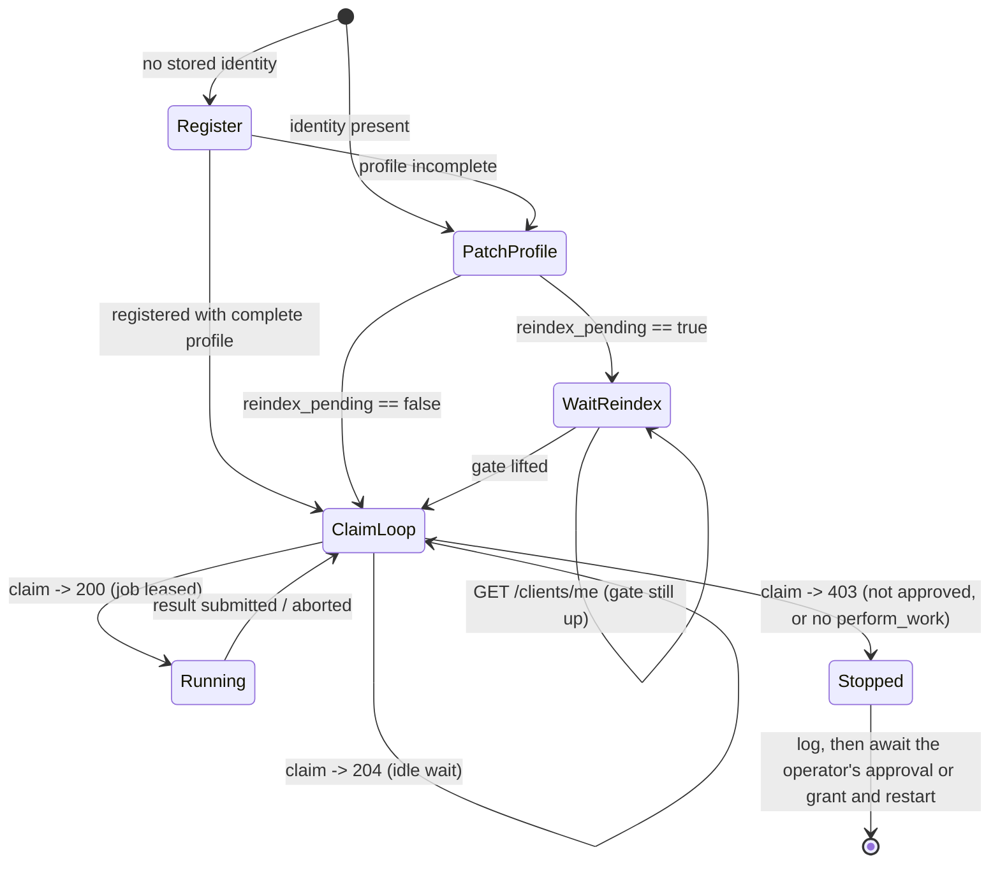
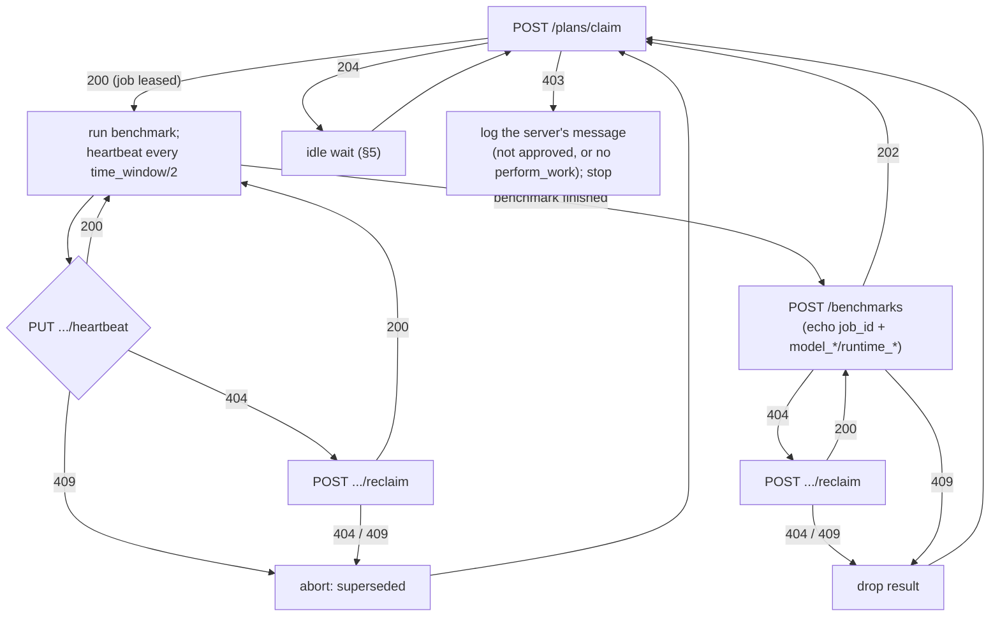

# Client Integration Guide

This guide is for authors of **client software** that runs benchmarking jobs
handed out by the job queue. It describes the client's obligations, its lifecycle,
and how it should behave at each protocol edge. The parts a correct client must
get right that the endpoint reference alone does not spell out.

It assumes a client that already knows how to run a benchmark and submit a result
(the ad-hoc path). What is new here is the **claim loop**: the client *claims*
jobs and runs them, instead of being driven manually.

The authoritative wire contract lives in [httpapi.md](httpapi.md) (endpoints and
error tables), [authentication.md](authentication.md) (identity and signing),
[queue.md](queue.md) (the job lifecycle), and
[plan-ingestion.md §5](plan-ingestion.md#5-capability-matching) (which client
matches which job). This guide does not restate those; it says how a client
should *use* them.

A Rust client parses the server's answers on this protocol as the types
`pipette_plan_types` exports, the same ones the server serializes: the
registration receipt, the device's own record, the claimed job, the submission
receipts, the job read and the error envelope.

## 1. Prerequisites

Before a client can claim work it must satisfy three things.

- **Identity.** The client holds an Ed25519 keypair and a `client_id`, obtained
  once via `POST /clients/register` (see [authentication.md §3](authentication.md#3-registration)).
  The private key is the only secret and never leaves the client. Losing it means
  a new identity. There is no recovery. Registration is idempotent on the public
  key, so a client that registered but failed to persist its `client_id` can
  re-register with the same key to recover it.
- **A synchronized clock.** Every authenticated request is signed over an
  `X-Timestamp`, and the server rejects any timestamp outside a **5-minute
  window** from its own clock ([authentication.md §2](authentication.md#2-request-authentication)).
  A client whose clock has drifted beyond that window fails *every* authenticated
  request with `401`: the symptom is total, not intermittent. Clients must keep
  their clock synchronized (e.g. via NTP).
- **A fresh nonce per request.** Every authenticated request carries an
  `X-Nonce` covered by the signature, and the server accepts each signature
  once ([authentication.md §2.2](authentication.md#22-replay-protection)).
  Generate a new one for every request, including retries. Resending stored
  headers after a timeout is rejected as a replay with `401`; a retry must be
  re-signed.
- **Approval, then permissions.** New clients start in the `pending` state and
  are approved out-of-band by an operator. A pending client cannot **claim**
  (`POST /plans/claim` returns `403` until approval), so it never enters the
  claim loop. Approval is not the whole gate: an approved client must also
  hold the permission the route requires: `perform_work` to claim, heartbeat,
  reclaim, or report a claimed job, and `submit_results` to submit an ad-hoc
  result. Registration seeds `submit_results` alone, so a lab device is granted
  `perform_work` by the same operator action that approves it
  ([authentication.md §5](authentication.md#5-permissions)). A refusal names
  what is missing (`client lacks the perform_work permission`), and the client
  reads its own set from `permissions` on `GET /clients/me`. Until that grant
  lands the device counts as no one's worker: a plan whose jobs only it matches
  reads `pending_clients`, so the gap is visible to the operator before the
  device ever polls. (Its *ad-hoc* submissions are a separate matter: rejected with `403`
  by default, or, when the server sets `[unverified_submissions] enabled =
  true`, accepted and held unscored until an operator promotes them, see
  [httpapi.md §2.7.4](httpapi.md#274-unverified-held-submissions). This never
  applies to plan-attached submissions, which require a claim the pending
  client cannot obtain.) Approval is manual and may take arbitrarily long, so
  the client is best off stopping and waiting for a restart rather than polling
  for it (see §2).

## 2. Startup

At startup a client makes sure the server holds its current device profile and
capability set and then enters the claim loop.



**Refresh the device profile and capabilities at startup, with one exception.**
Both drive job matching
([plan-ingestion.md §5](plan-ingestion.md#5-capability-matching)), so a
returning client (one with a stored identity, whose hardware or installed
runtimes may have changed since it last ran) should `PATCH /clients/me` at
startup. A client registering for the first time that supplied a complete
profile and capability set in the registration call may proceed straight to the
claim loop; the patch would be a redundant no-op. When in doubt, patch
unconditionally: the server voids the client's queue standing only when the
matching input actually *changed*
([queue.md](queue.md#the-reindex-gate)).

- `reindex_pending: false` (the common case, the same description resubmitted):
  proceed straight to the claim loop.
- `reindex_pending: true` (an OS upgrade, a GPU swapped, a runtime installed or
  removed): any lease the client held is gone. **Discard any local in-flight
  work**, and poll `GET /clients/me` until `reindex_pending` reads `false`
  before claiming. This costs at most one cron interval. See
  [httpapi.md §2.4](httpapi.md#24-patch-clientsme).

Note `capabilities` is set-granular on PATCH. Report the **full** current set;
a present value replaces the stored set wholesale (see
[httpapi.md §2.4.1](httpapi.md#241-request-body)). Section 3 covers how to
choose that set and how it carries across registration and PATCH.

**Prefer to stop rather than poll for approval.** If `claim` returns `403`, the
client is either not approved or not granted `perform_work`: the `error`
message says which. Nothing in the protocol forbids retrying (a client may keep
calling `claim`, and it will simply keep returning `403`), but both states are
manual operator actions that can take arbitrarily long, so polling spins
indefinitely against something only a human can change. The recommended
behavior is to log the server's message alongside the command that fixes it
(`pipette-mgmt clients approve <client_id>`, or
`pipette-mgmt clients permission add <client_id> perform_work`) and exit, to be
restarted afterwards. Busy-polling is legal but wasteful.

## 3. Choosing a capability set

Section 2 says *when* to report capabilities. This section says *what* to put in
them. The stakes are asymmetric: an over- or under-reported capability set is
never a protocol error. It is accepted, stored, and then quietly changes which
jobs the client is offered, so the failure mode is not a `400`, it is a client
that polls forever, or one that keeps claiming work it cannot run.

**Everything the matcher knows about a client arrives by one of two routes**: the
`device_*` profile, which the server normalizes into flags, and the
`capabilities` the client reports directly
([plan-ingestion.md §5](plan-ingestion.md#5-capability-matching)). Choosing
between them is not a judgment call:

- **If a `device_*` field exists for the fact, use that field.** Its namespace
  is reserved ([plan-ingestion.md §5](plan-ingestion.md#reserved-capability-namespaces)),
  and reporting it in `capabilities` is a `400`. That keeps exactly one way of
  expressing each device property, so a job's `os:ios` can never miss a client
  that spelled its OS somewhere else. A `tag:` flag is a `400` too: an operator
  assigns tags.
- **`capabilities` is for everything else**, in practice, what the client
  *has installed or can do*, as opposed to what it *is*. Installed inference
  runtimes are the motivating case and, today, very nearly the only case.

### What earns a flag

The useful test is not "is this true of my client?" but:

> **Would a plan author write this flag in a job's `requires`?**

Capability flags are a *matching vocabulary shared with the people who author
plans*, not telemetry and not an inventory. That framing resolves both
directions of error:

- **Under-reporting is silent.** A flag a job requires and the client does not
  report makes the client ineligible, and the only symptom is `204`, which is
  deliberately indistinguishable from "no work right now" (§5). Nothing tells
  the client it disqualified itself.
- **Over-reporting is a broken promise.** Every flag is client-attested;
  approval gates *who* is trusted, not *what* they claim, and the server
  verifies nothing. A client that reports `runtime:mlx` without MLX installed
  will be handed MLX jobs and will fail them, consuming a claim and a denial
  per attempt. Report what the client can execute *now*. Discovered at startup
  from the actual installation, not a hardcoded list of what the build was
  meant to ship with.
- **A flag no job names is usually dead weight.** Harmless, but it does
  nothing; a capability only has effect if some plan selects on it. The
  exception is a flag a client cannot add later. A build already in the field
  never reports a new flag. The builds a client can run
  (`client_version:<version>`) and schema revisions (`job_schema:<n>`)
  therefore ship before any plan requires them. For those flags, the client
  must report early.

### Established flag conventions

| Flag | Meaning | Report when |
|---|---|---|
| `runtime:<name>` | the client can run this inference runtime | the runtime is installed and usable |
| `runtime:<name>:<build>` | the client is pinned to one specific build | the client cannot run any other build of that runtime |
| `runtime:<name>:<component>=<version>` | the version of one component of a composite runtime | the runtime is assembled from several independently versioned sources (see below) |
| `job_schema:<n>` | the client understands revision *n* of the job body | for **every** revision it can parse. This is how incompatible job-format changes are rolled out ([plan-ingestion.md](plan-ingestion.md#schema-revisions-ride-on-capability-flags)) |
| `client_version:<version>` | a client build this client can run. The harness, not the inference runtime it drives. A plan's `client_versions` pins jobs to some of them | for **every** build the client can run that names a published release: the running build, and each one it can install and launch. A build that names none reports nothing in this namespace |

Anything else is a legal free-form flag, but coordinate it with the plan authors
before reporting it. A flag has no effect until some plan's `requires` names it,
and the two sides must agree on the exact string, so inventing vocabulary
unilaterally accomplishes nothing.

For `runtime:`, report **every level of granularity the client supports**: a
client that fetches runtimes on demand reports just `runtime:<name>` and is
eligible whichever build a job pins, while a client with a compiled-in build
reports both `runtime:<name>` and `runtime:<name>:<build>` (see §2).

For `client_version:`, the set changes whenever a build becomes installable or
stops being installable, and every change trips the reindex gate (§2). A client
that tracks published builds should not re-report after each publish: refresh
the set at startup or on a slow cadence, and only while it holds no lease.

### Composite runtimes get a flag per component

Some runtimes have no single version number. MLX on Apple platforms is really a
pinned set of three independently versioned sources (`mlx-swift`,
`mlx-swift-lm`, and `swift-transformers`), any of which can move without the
others. No one string identifies the build, so a single `runtime:mlx:<build>`
flag either hides the component a plan author actually cares about or forces
them to guess which one it names.

The recommended pattern is to publish a flag per component, appending
`<component>=<version>` to the runtime name, *in addition to* the general and
simplified flags:

```json
"capabilities": [
  "runtime:mlx",
  "runtime:mlx:0.31.6",
  "runtime:mlx:mlx-swift=0.31.6",
  "runtime:mlx:mlx-swift-lm=f5f18ed9d",
  "runtime:mlx:swift-transformers=1.3.3"
]
```

Each level buys something different:

- `runtime:mlx` matches a job that just needs MLX and does not care how it is
  built. Most jobs.
- `runtime:mlx:0.31.6` is the simplified form, whichever component version the
  team treats as *the* MLX version, conventionally the core one. It lets a plan
  author pin a version without knowing the runtime is a composite at all.
- The `<component>=<version>` flags let a job pin the one component that
  matters and stay silent about the rest. A job that needs a tokenizer fix
  landed in `swift-transformers` 1.3.3 requires
  `runtime:mlx:swift-transformers=1.3.3`, and keeps matching as the other two
  components move.

Three constraints carry over unchanged, and each one bites here:

- **The `=` is a convention for the humans reading flags, not syntax.** The
  server never parses inside a flag; matching stays whole-string set
  containment. `=` is chosen over a fourth colon because
  `runtime:mlx:swift-transformers:1.3.3` is indistinguishable from the
  simplified form with a build named `swift-transformers`.
- **No flag implies any other**, so all five must be reported: omitting
  `runtime:mlx` makes the client ineligible for every job that asks for MLX
  generally, however many component flags it publishes.
- **Version values are part of the agreed spelling.** They must be canonical
  (lowercase, no whitespace, a git SHA is fine), and `v1.3.3`, `1.3.3`, and an
  abbreviated SHA of a different length are simply unrelated flags. Fix the
  component names and the version format with the plan authors up front.

Derive these from the *resolved* dependency graph at startup (`Package.resolved`
rather than the version ranges the manifest requests) for the same reason §3
gives above: an over-reported flag is a promise the client cannot keep, and a
requested range is not what got built.

### Spelling is part of the contract

Flags are compared as whole, opaque strings, and **no flag implies any other**
([plan-ingestion.md §5](plan-ingestion.md#5-capability-matching)). The server
validates flags and rejects bad ones, but never rewrites them.

Two rules follow.

- **Canonical form is mandatory**: lowercase, with all whitespace removed. A
  non-canonical or empty flag is a `400` at both `POST /clients/register` and
  `PATCH /clients/me`.
- **Agreed spelling is mandatory in practice.** Nothing rejects
  `runtime:llama.cpp`, `runtime:llamacpp`, or `runtime:llama_cpp`. They are
  simply three unrelated flags, and a client that picks the wrong one matches
  nothing while looking perfectly healthy. Emit flags from a shared constant
  agreed with the plan authors rather than assembling them per client from
  whatever the runtime happens to call itself.

### How registration and `PATCH /clients/me` relate

They carry the **same field, the same vocabulary, and the same validation**
([httpapi.md §2.2.1](httpapi.md#221-request-body),
[§2.4.1](httpapi.md#241-request-body)). Registration establishes the initial
set; the PATCH replaces it wholesale (§2), while the `device_*` fields merge per
field.

**The one trap is `"capabilities": []`.** An empty array is a *present* value,
so it replaces the stored set with the empty set. A client that matches no
`requires` job at all and can only be reached by an explicit `clients` list.
"No change" is `null` or an absent key; it is never `[]`. Emitting `[]` for an
empty local inventory is the accident to watch for.

Because the PATCH is a wholesale replace, **whatever it sends becomes the
truth.** The practical consequence is that registration and the startup patch
must not be built by two different pieces of code: have one routine produce the
complete current profile and capability set, and feed its output to both the
registration body and the PATCH body. The classic bug is a registration that
enumerates installed runtimes paired with a startup patch that sends a narrower
set, which silently deletes the difference on the client's very next boot.

Two properties make that single routine safe to call unconditionally:

- The server compares capabilities **as a set**, so ordering and duplicates are
  irrelevant. Resubmitting the same flags in a different order is a genuine
  no-op. It does not count as a change and does not trip the reindex gate.
- Only an actual change to the matching input voids queue standing. When the set
  really did change, the cost is the reindex gate described in §2: discard local
  in-flight work and wait at most one cron interval.

### When matching does not go as expected

Since a wrong capability set produces no error, diagnose it by reconstructing
what the server sees. `GET /clients/me` returns the reported `capabilities`
verbatim alongside the stored `device_*` fields; the effective set is that array
unioned with the server's normalization of those fields and the client's tags.
Compare the result against the job's clauses under the rules of
[plan-ingestion.md §5](plan-ingestion.md#5-capability-matching). A job can also
exclude a client by id (`exclude_clients`); no capability change escapes that.

This reconstruction is the client-side view. An operator with access to the
management server answers the same question directly, with
`pipette-mgmt plans status <plan_id> --explain`. That command reads the plan's
jobs against the whole fleet and names the clause that blocks the match. Ask the
operator to run it when the reconstruction above disagrees with what the server
does. See [cli.md](cli.md) for the report.

## 4. The work loop

Once past startup, an idle client repeats: claim a job, run it while
heartbeating, submit the result, repeat.



Key obligations while running:

- **One job at a time.** The protocol grants a client at most one lease. A client
  must not claim again while it holds a live lease. (A client that does claim
  while already holding exactly one lease gets that *same* job handed back
  idempotently, so a lost claim response recovers transparently, though each
  hand-back counts against the job's lost-lease limit; accumulating more than
  one lease gets the client suspended. See
  [queue.md](queue.md#claiming-a-job).) Never have two `claim` or `reclaim`
  requests in flight: overlapping requests that each win a job suspend the
  client. Retry a claim only after the earlier request has returned or its
  connection is closed.
- **Heartbeat at half the `time_window`.** The claim response reports
  `time_window` as an ISO 8601 duration (e.g. `PT10M`). The client heartbeats at
  half that interval. Each successful heartbeat extends the lease by the full
  lease length from now, and the lease lapses that long after the last success.
  A claim handed back while you already held the job reports only the remaining
  life as `time_window`.
- **Run one of the builds the claim names.** `client_versions` lists the builds,
  from your own `client_version:` flags, that the job admits. Run the job on one
  of them, and send that build as the submission's `client_version` (§10). A job
  with no version clause lists every build you report. `[]` means no single
  build you report satisfies the job: report a retriable failure (§6) rather
  than run another build, since a client with other builds may run it. A client
  that reports no `client_version:` flag always gets `[]` and runs as it is. A
  response without the field comes from an older server, which pins no build.
- **Echo the claim's identity.** The submission must carry the claim's `job_id`.
  Its `model_descriptor` / `runtime_descriptor` are serialized from the same
  `spec.model` / `spec.runtime` the claim delivered, so they match without extra
  work. A plan-attached submission is accepted only from the client that currently
  holds the lease.

## 5. Error handling and retries

The single most important distinction for a robust client is between a
**definitive** protocol answer and a **transient** failure.

- **Definitive** answers (`403`, `404`, `409`, `204`) are the server telling the
  client the true state of the world. They drive the state machine above. The
  one exception is `409` on `PATCH /clients/me`: the record changed while the
  request was in flight, so resend it.
  A `413` ([httpapi.md §1.2](httpapi.md#12-request-size-limits)) is definitive
  too: the body exceeded the route's size limit, and resending it unchanged
  fails identically.
- **Transient** failures (`5xx`, connection refused/reset, DNS/TLS errors,
  timeouts) mean the request did not reach a verdict. The client must **retry**,
  not transition. Treating a transient failure as a definitive answer is the
  classic way to lose a job that was fine.

Retry transient failures with exponential backoff: start at ~1–2 s, double to a
~30–60 s cap, with jitter.

| Endpoint | Transient failure (5xx / network) | Definitive answers |
|---|---|---|
| `POST /plans/claim` | back off and retry at the idle cadence | `204` → idle wait; `403` → **stop** (not approved, or `perform_work` not granted, the message says which) |
| `PUT /plans/{job_id}/heartbeat` | **retry with short backoff. Do not abort.** You have up to `time_window/2` of slack before the lease lapses; if you cannot succeed within it, proactively `reclaim` | `404` → try `reclaim`; `409` → abort (superseded, zombie); `403` → abort and re-poll `claim` (suspended, not approved, `perform_work` not granted, or the job names a vault resource this client may not fetch; the message says which) |
| `POST /plans/{job_id}/reclaim` | brief retry | `200` → resume + heartbeat; `403`/`404`/`409` → abort and re-poll `claim` |
| `PATCH /clients/me` | retry with backoff | `409` → resend the same PATCH (it re-reads the record); `401` after a resend → the client was deleted |
| `POST /benchmarks` | retry with backoff. **Safe when plan-attached, not when ad-hoc** (see below) | `202` → done; `403` → **stop** (the permission this body needs is not granted); a success refused with `the job names a vault resource this client may not fetch…` is instead answered by reporting the job's failure (`retriable: true`, so the job goes back to the queue for a device that may fetch the model); `404` → `reclaim` then resubmit; `409` → drop the result (superseded) |

The heartbeat row is the one that matters most: a `503` or a dropped connection
is **not** lease loss. A definitive `404` (lease reaped) is not the end of the
run either. It is a prompt to `reclaim`, and the run dies only if that reclaim
in turn fails with `404`/`409`. A `409` (the lease was taken by another client)
or a `403` (the client is suspended, lost its standing, or may not fetch the
job's vault model) ends the run outright.

### Retrying a submission

The submit row's two run modes behave differently, and only one of them is safe
to retry blindly.

- **Plan-attached** (the body echoes a claimed `job_id`) is safe. The `job_id` is
  bound to your lease, so a retry either lands under that still-live lease,
  superseding your own earlier body, or comes back `404`. That `404` is not a
  lost result: it means the first attempt already landed and completed the job.
  Follow the row's advice once (`reclaim`), and when the reclaim `404`s too,
  drop the result and re-poll `claim`.
- **Ad-hoc** (no `job_id`) is **not idempotent.** The server mints a fresh id for
  every request that arrives without one, so a retry after a `202` you never saw
  records a *second, independent* result for the same run. Both are scored, and
  both land in the warehouse as separate rows for the same cell.

So bound ad-hoc retries to a small fixed number of attempts, not the open-ended
backoff the transient column otherwise prescribes, and accept the occasional
lost result rather than a double-counted one. A run that matters is better sent
plan-attached, where the lease makes the retry safe.

### Idle polling cadence

When `claim` returns `204` (no work), wait approximately **5 minutes plus 0–60 s
of jitter** before retrying; the jitter avoids synchronized polling bursts across
the fleet. The interval may be configurable, but neither hammer the server nor
sleep so long that throughput suffers. Note that `204` is deliberately
indistinguishable between "no eligible job right now" and "this client is
suspended". The client treats both identically and simply keeps polling; an
operator clearing a suspension resumes work with no client action required.

## 6. Retriable vs. non-retriable failures

Every failure submission carries a required `retriable` flag
([httpapi.md §2.7.2](httpapi.md#272-failure-variant)). Set it by asking one
question:

> **Could another device that is eligible for this job plausibly succeed?**

- **Yes, or unsure → `retriable: true`.** This is the safe default. The failure
  looks specific to *this* client: out of disk, thermal throttling, a transient
  local fault, a transient failure fetching the model or benchmark definition.
  The server records a denial for this client and keeps the job available to
  others.
- **Definitely not → `retriable: false`.** The job is broken independent of the
  device and would fail the same way anywhere, so re-running elsewhere is
  pointless. This is the narrow shortcut for clearly unworkable jobs: the claim
  response is invalid JSON or internally contradictory, the referenced benchmark
  does not exist (a permanent `404` from `GET /benchmarks/{benchmark_id}`), the
  model artifact is malformed. A non-retriable failure is the job's terminal
  result and tears the job down.

Mapping a specific runtime's exit codes and error output onto this question is
left to the client author: runtimes differ too much for a general rule. When in
doubt, choose `retriable: true`: a wrongly-retriable job is bounded by its
`expires_at`, whereas a wrongly-non-retriable job is discarded for the whole
fleet on one device's say-so.

A failure is reported through the same `POST /benchmarks` endpoint as a result,
with `message_type: "failure"`. The body echoes the claim's `job_id`,
`benchmark_id`, and `model_*` / `runtime_*` fields verbatim, and carries the
`retriable` flag plus a human-readable `failure_reason`: conventionally a
timestamp followed by the runtime's own error output. No device or metric fields
are sent. A client that ran out of memory loading the model reports a *retriable*
failure:

```json
{
  "message_type": "failure",
  "job_id": "job-550e8400-e29b-41d4-a716-446655440000",
  "benchmark_id": "prefill_throughput_256",
  "failure_reason": "[2026-03-10T12:04:51Z] llama-server failed to load model: out of memory",
  "retriable": true,
  "model_name": "llama-3.2-1b",
  "model_quant": "q4_0",
  "model_descriptor": "{\"org\":\"meta-llama\",\"path\":\"Llama-3.2-1B-Q4_0.gguf\",\"repo_name\":\"Llama-3.2-1B-GGUF\",\"source\":\"huggingface\",\"type\":\"gguf_text\"}",
  "runtime_name": "github.com/ggml-org/llama.cpp",
  "runtime_version": "b5000",
  "runtime_descriptor": "{\"flavor\":\"macos-arm64\",\"repository_url\":\"github.com/ggml-org/llama.cpp\",\"repository_version\":\"b5000\",\"type\":\"llamacpp_cli_stock_tools\"}"
}
```

A terminal failure differs only in the flag and the reason, for a benchmark that
does not exist anywhere, `"retriable": false` with a `failure_reason` such as
`"[2026-03-10T12:04:51Z] benchmark prefill_throughput_256 not found (404 from GET /benchmarks/{id})"`.
See [httpapi.md §2.7.2](httpapi.md#272-failure-variant) for the complete field
table.

## 7. Crash recovery and persistence

**A v1 client persists no benchmark state to disk.** This is a correctness-neutral
simplification, for two reasons rooted in the protocol:

- The server already makes a zero-persistence client correct. **Claim is
  idempotent** (a client still holding a live lease gets the same job back), and
  a plan-attached submission is bound to that lease: a repeat under the live
  lease supersedes the earlier body, and a repeat after the job completed
  answers `404` (§5). So a client that crashes and simply re-runs is never
  double-scored and never stranded.
- Persisting partial *computation* rarely pays off. Speed benchmarks
  (prefill, decode, latency, memory) are only meaningful run as a whole (the
  reported statistics need every repetition), so a partial run is worthless and
  must be re-run regardless. Only long eval runs could in principle benefit from
  checkpointing partial completions.

The two recovery situations, and what handles each:

- **Network blip, process still alive.** The `job_id` and echoed fields are in
  memory. When the lease has been reaped mid-outage, `POST /plans/{job_id}/reclaim`
  re-acquires the same job and the client submits normally. No disk needed.
- **Process died mid-run.** The in-progress computation is gone. The client
  re-runs the work from scratch (on restart it re-enters the claim loop; if its
  lease is still live it receives the same job back). Nothing on disk would have
  saved the computation.

Per-sample checkpointing of long eval runs is a possible **future** optimization,
deliberately out of scope here: it carries corruption risk across an unclean
crash, and the server may void the client's standing (via the reindex gate)
before the resumed work can be submitted, forcing it to be discarded anyway.

## 8. Concurrency

A lease is scoped to one `client_id`, and a `client_id` holds at most one lease.
A host that can genuinely run *N* benchmarks in parallel therefore registers *N*
separate identities (N keypairs, N `client_id`s), one per concurrent slot.

This is a rare case and is not optimized for: most target devices (phones,
single-board computers, and the like) either cannot run more than one benchmark
at once or have memory bandwidth that a single benchmark already saturates. A
client that runs one benchmark at a time needs one identity and can ignore this
section.

## 9. Job configuration fields

Everything a client needs to execute arrives in the claim's `spec`
([httpapi.md](httpapi.md#292-response-200-ok)): `benchmark`, `model`, `runtime`,
and the optional `model_flags` / `runtime_flags` / `benchmark_flags` groups.
`spec.benchmark_flags` is where the HTTP timeout, doom-loop detection settings,
and the readiness wait live.

`spec` is one type (`pipette-plan-types`' `ClientRunSpec`), so a client
deserializes it whole rather than field by field, and the flag groups' embedded
`benchmark_type` / `runtime_type` / `model_type` discriminants validate the cell
on arrival. Consequences worth designing for:

- **A spec you cannot read is terminal, not transient.** Absent, unparseable,
  naming a benchmark that disagrees with the envelope's `benchmark_id`, or pairing
  a model and runtime that are incompatible. All mean the job is mis-authored.
  Report `retriable: false` rather than letting the lease lapse: retrying it here
  or on another device fails identically, and a lapsed lease just re-serves the
  same unrunnable job until it has lost `plan_lost_lease_limit` leases, or
  until it expires when that limit is `0`.
- **A gated model's access token may travel inside `spec.model`.** Ingestion
  imports a gated model from a plan document into the vault and drops its token.
  A job that ingestion queued after the import step holds a `vault_*` arm
  instead. A job that ingestion queued before the import step can still carry a
  token. Treat the token as a secret: never log a raw spec, and strip
  `auth_token` before printing one. If a client injects its own host token, do so
  only when the field is absent, so an explicitly supplied token wins.
- **A `vault_*` source is fetched from mgmt, signed as yourself.** `vault_url`,
  `vault_archive`, `vault_remote_archive` and `vault_wheelhouse` name a private
  artifact mgmt serves to the principal that owns it
  ([Vault](api/vault.md)); the `url` beside them is
  `/vault/resources/{resource_id}/content`, **relative to the mgmt server** the
  way a dataset descriptor's `url` is, and the fetch carries your client
  signature exactly as a claim does. There is no token in the spec
  and nothing to add: what entitles you is that your device's owner owns the
  artifact. A source's `custom_label` is the artifact's name for a reader:
  it changes no fetch, and the descriptor you report keeps it. See *Fetching a vault artifact* below.

### Fetching a vault artifact

The pair of routes is the same shape as a corpus (`GET /benchmarks/{id}` for the
descriptor, then `GET /datasets/{id}` for the bytes): read the record first,
pull the bytes only if you need them, verify what arrived.

1. **Read the record.** The spec's `url` is a `VaultPath`; `resource_id()` is
   the id, and joining the path to your mgmt base URL is the fetch.
   `GET /vault/resources/{resource_id}` answers `{sha256, bytes, …}`
   under the same owner match as the bytes. A `403` here is the same `403` the
   content route would give, so there is no point trying the download.
2. **Consult your cache.** The `sha256` is the artifact's identity. If a
   content-addressed cache already holds those bytes, use them and skip the
   download; a spec may also carry its own `sha256`, which must agree.
3. **Fetch.** `GET /vault/resources/{resource_id}/content` streams the file
   with `Content-Length` (the file's, as stored) and `ETag` (the record's
   `sha256`, quoted). Stream to disk; a checkpoint is gigabytes.
4. **Verify.** Hash what you wrote and compare it to the record's `sha256`. A
   download that arrived complete and hashes to something else means the file
   was replaced behind the record. Refuse to run on it.

How each refusal maps to a disposition:

| Status | Meaning | Report |
|---|---|---|
| `403` | Your device's owner does not own this artifact, or your device belongs to nobody | `retriable: true`, so the job goes back to the queue: a device whose owner owns the artifact may fetch it |
| `404` | No such resource, or the record names a file that is no longer stored | `retriable: false` |
| `5xx` | mgmt or its store | retriable, with the usual backoff |
| digest mismatch | the file changed behind the record | `retriable: false`, and say so in `failure_reason`: this is an operator's repair |

Ingestion already refuses a plan whose vault reference names no resource or the
wrong principal ([plan-ingestion.md §6.2](plan-ingestion.md)), so the `403` and
`404` you can still meet are the ones that arise *after* filing: an artifact
deleted, or a device handed to another owner.

### Settings the submission reports

A submission reports what the run **resolved to**, not what the claim handed it.
The server records the authored side itself, from the lease it issued, so never
echo the claim's flags as the run's. A client that does destroys the comparison
([storage.md §5](storage.md#requested_model_flags--requested_runtime_flags--requested_benchmark_flags)).

- **`benchmark_flags`**: the harness settings the run applied, including the ones
  it decided itself. A claim's `spec.benchmark_flags.readiness` may carry
  `max_wait_secs` and `skip_thermal`, and a host may waive or default either.
  The submission is the only record of what the run applied, so a run that
  skipped the thermal criterion sends `"skip_thermal": true` whatever the claim
  said, and a deadline the client defaulted sends the seconds it used. Omit a setting the harness has no notion of
  ([storage.md § benchmark_flags](storage.md#benchmark_flags)).
- **`model_flags` / `runtime_flags`**: send JSON, which the server canonicalizes
  so equal settings group together; a plain string groups only with a
  byte-identical one ([storage.md § model_flags / runtime_flags](storage.md#model_flags--runtime_flags)).
- **`client_configuration`**: the environment forwarded into the runtime, as
  `{"envs": [...]}`, names only except `GGML_*`, beside `runtime_flags` and
  never inside it, and absent when the client had no entry for the runtime
  ([storage.md § client_configuration](storage.md#client_configuration)).

## 10. Reporting your own version

Send `client_version`, the version of **your** build (not of the runtime you
drove), on every submission, success and failure alike. Use the spelling your
`client_version:<version>` flags carry (§3), so the build a claim named is the
build the row records. Omit the field rather than send a blank one. See
[storage.md § client_version](storage.md#client_version).

## 11. Runtime output and extras

Send what the runtime printed as `runtime_stdout` and `runtime_stderr` on every
submission, keeping the tail of each within 1 MiB
(`pipette_plan_types::submission::RuntimeOutput::capped`) and with credentials
removed: the server stores the text as sent. Send `""` for a captured stream
that stayed empty, omit one you did not capture, and convert invalid UTF-8
lossily. Send anything else worth recording
as `client_extras`, a JSON object in a string of at most 16 KiB. See
[storage.md §4.2](storage.md#42-runtime-output) and
[storage.md § client_extras](storage.md#client_extras).

## 12. Device telemetry

Send `device_hardware_readings`, `device_os_throttling_readings` and
`readiness_gate_waits` on a success submission, each a JSON array of what the OS
returned around each measured rep, posted as returned rather than converted
([design/device-telemetry.md](design/device-telemetry.md)). None of them ever
refuses a submission; an oversized array keeps its last elements
(`keep_last_elements` in `pipette-plan-types` cuts the same way). See
[storage.md § device_hardware_readings](storage.md#device_hardware_readings--device_os_throttling_readings--readiness_gate_waits).

## 13. Time on the device

Send `device_time_ms` on every submission of a claimed job: whole milliseconds
on a monotonic clock, from the claim (app launch for a phone run that
pipette-ios-proxy drives) to the moment the result is ready, before the submit.
Omit it if you did not measure it. See
[storage.md § device_time_ms](storage.md#device_time_ms).
