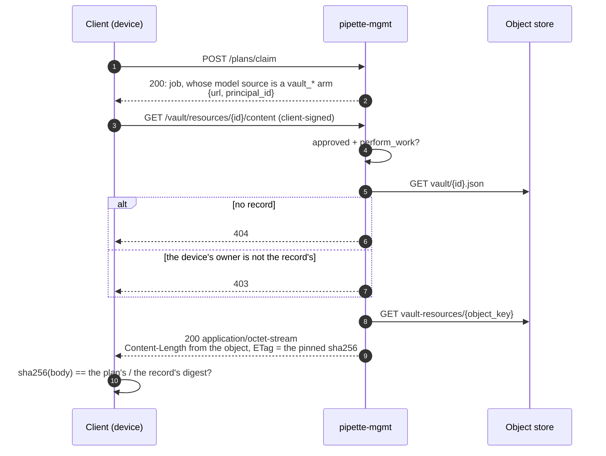

# Design: the vault, private artifacts served to one principal

Why a customer's own checkpoint reaches a device the way it does. The routes are
[Vault](../api/vault.md); the keyspaces and the record are
[storage.md §3.4](../storage.md#34-the-vault); the grants are
[authentication.md §5.2](../authentication.md#52-the-vocabulary); what ingestion
checks is [plan-ingestion.md §6.2](../plan-ingestion.md#62-ingestion-time).

## The problem

A plan can only name artifacts a third party publishes: a Hugging Face repo, a
GitHub release, a URL, a PyPI index. A customer's private checkpoint or an
internal build has nowhere to live, and nothing in a plan can say who is
entitled to fetch it. The plan types carry that claim (every downloadable model
and runtime has a `vault_*` arm with a `principal_id`); the vault serves it.

## Principle

**mgmt owns the bytes' integrity, the index and the gate.**

A client uploads each file through mgmt, by its digest, and then names the plan
variant the files make up
([`PUT /api/v1/vault/blobs/{principal_id}/{sha256}`](../api/vault/put_blob.md)).
mgmt keeps a file only as its digest says, under the segment of whoever it is
for, and writes one **vault resource** per file. A device fetches the bytes
through mgmt, and gets them only if the device's own owner is the record's
owner.

Four properties follow, and each is the reason for a decision below:

| Property | Because |
|---|---|
| A stored file is always what its digest says | a blob is written only whole, and only if its bytes hash to its key's digest |
| The gate cannot be forged by an uploader | the record lives outside the blob prefix, and only a description or an import writes one |
| The gate cannot be forged by a consumer either | a record may only name its own owner's blob, and never changes |
| A replaced blob is detected, not silently served | the record carries a `sha256` the client verifies |

## The two keyspaces, and why the split is the boundary

The bytes live under `vault-resources/{principal_id}/blobs/{sha256}` and the
records under `vault/{resource_id}.json`
([storage.md §3.4](../storage.md#34-the-vault)).

**The record is deliberately not under `vault-resources/`.** A record decides
who may fetch a blob, so keeping records out of the blob prefix keeps uploading
a file and deciding whose it is two different acts: a file is only ever
reachable through a description its owner's administrator wrote.

**And the key names its owner, which stops the same forgery from the other
side.** That prefix holds every principal's files, so a record naming any file
that merely *exists* would let any account with a login describe another
organization's upload as its own and read it through its own devices. Existence
is not entitlement. So a file is uploaded for one principal, and a description
finds its files under its own owner's segment and nowhere else. Knowing a
digest is not holding the file.

**Checked once is checked for life, because a record is immutable.** A plan
carries the id in a URL, and a record that could be changed underneath would
make that URL mean something else later. It would also reopen the forgery
above, since a hand-off would leave a key under the previous owner's segment.
Different bytes or a different owner are a new upload under a new id.

**No refusal is an existence oracle.** Every file route checks the caller's
scope over the principal before the store is touched, so a file under somebody
else's principal answers the same `403` whether or not it is there.

**A delete takes only the files no remaining record names.** Deleting a record
revokes every device's access, and a bookkeeping change must not destroy a file
another record still names.

## Who may fetch

| Record owner | Devices that may fetch | Accounts that may fetch |
|---|---|---|
| `{"type": "user", "user_id": …}` | devices that account owns | that account; `manage_any_orgs` |
| `{"type": "org", "org_id": …}` | devices the organization owns, and devices owned by an account on it | its members; `manage_any_orgs` |

A device holds no user permission, so its entitlement is not a grant but a
**relation**: `pipette_pipeline::org::owning_org` resolves an org-owned device
directly and a user-owned device through its owner's current membership. Two
consequences are deliberate:

- **A device moves with the account that owns it.** Moving an account between
  organizations moves what its devices can fetch, because ownership is derived
  at fetch time rather than copied onto the device.
- **A personal artifact does not follow its owner's organization.** A record
  owned by an account is reachable by that account's devices alone, whatever
  team the account joins, as `campaigns/` reads the same field.

An **unowned device reaches nothing**. Registration is open, so a machine that
registered itself and was never claimed is exactly the identity the vault must
not serve.

On the operator side there are **no new permission names**
([Vault: Who may do what](../api/vault.md#who-may-do-what)). New names would have
left every existing operator granted nothing here until somebody re-granted
them, for a line the roster vocabulary already draws: a team's resources are
its members' to read and upload, and its administrators' to delete, the line a
campaign draws. Uploading for the team gives a member no reach it lacked, since
it already reads the team's records, and runs nothing until a plan names the
record. Server-wide it is `manage_any_orgs` and not `read_any_orgs`, because
private weights are not roster data.

## Uploading and importing

- **The size and the digest are observations, not claims.** A file is kept only
  if its bytes hash to the digest it was sent under, and the record's size is
  the stored file's.
- **The description is typed.** Only a downloadable model or a prebuilt runtime
  can be described, each with exactly its own files, and each file must start
  as its field needs. That is what a record's `artifact` records.
- **The origin is an observation too.** mgmt writes a record's `origin` only
  when mgmt itself fetched the bytes from that public source; it cannot check
  where uploaded bytes came from, so an upload has none.
- **Results name the public model.** A run from a vault file with a HuggingFace
  origin groups with the runs from HuggingFace; the row keeps the device's
  descriptor in `model_vault_descriptor`
  ([storage.md § `model_descriptor`](../storage.md#model_descriptor--runtime_descriptor)).

Ingestion writes records itself when a model carries an `auth_token`, so no
token reaches storage
([plan-ingestion.md §6.2](../plan-ingestion.md#the-import-of-a-gated-model)).
The campaign's owner owns them, so only the owner's devices can run the job: a
foreign device claims it and gets `403` (see **Open**). The iOS and Android
clients have no vault fetch, so a gated job runs on no mobile device.

## Fetching



Every refusal happens before the first byte. A user may fetch the same URL with
an account signature, which makes the surface usable from the CLI and from a
laptop verifying what it uploaded.

## How a plan lines up with a record

```toml
type         = "gguf_text"
source       = "vault_url"
url          = "/vault/resources/vault_0195…/content"
principal_id = "org_0195…"
```

**The path is relative to the mgmt server, never an absolute URL.** The client
already holds the one mgmt base URL it talks to and joins the path to it, the
way it joins the `/datasets/{id}` a dataset descriptor hands it. A plan that
spelled a host could point a "vault" fetch anywhere.
`pipette_plan_types::location::VaultPath` is exactly that route and nothing
else, so the id is the only thing an author supplies.

The `principal_id` is a **claim about who the work is for**, and mgmt does not
consult it when serving: the record is authoritative about whose the bytes are,
and the device's own owner about who is asking. The field earns its place at
ingestion, which refuses a job whose claim, pinned digest or `custom_label`
disagrees with the record, or that names a resource outside the filer's reach
([plan-ingestion.md §6.2](../plan-ingestion.md#62-ingestion-time)). Each would
otherwise fail on every device that claimed it, and at ingestion the reason can
still be named. It is a walk of the JSON rather than a parse of the descriptor,
so the server reads only the arm it serves. A checked `principal_id` is what a
claim-time rule could later rest on.

## What is deliberately not here

- **No listing of the prefix.** mgmt lists records, which is what a client
  acts on. A file uploaded and never described reaches nobody.
- **No per-resource ACL.** One owner, and the roster decides the rest. A record
  shared between two organizations is a request nobody has made, and adding it
  later is additive.
- **No second keyspace recording who uploaded what.** The principal segment in
  the key answers that.
- **No scheduled blob sweep.** A file outlives its last record only when a
  delete failed midway; an operator reclaims it with `pipette-mgmt vault prune`
  ([cli.md](../cli.md#pipette-mgmt-vault-listshowdeleteprune)).

## Open

- **Ingestion variant check.** Ingestion does not yet refuse a plan that uses a
  resource other than as uploaded: a runtime must keep its `type` and `flavor`,
  and a model file its field and format. `pipette_pipeline::vault_check` checks
  the owner, the object, the digest and the label only. Records written before
  uploads went through mgmt carry no variant and are not backfilled; once the
  check lands, a plan naming one is refused.
- **Claim-time eligibility.** A job whose sources are all one principal's could
  be made claimable only by that principal's devices, which would turn a
  fetch-time `403` into a scheduling decision. Its precondition is met:
  `principal_id` is checked at ingestion. What remains is the matcher, and it is
  not small: `pipette_core::matching::job_matches_client` judges a body against
  a `Client` alone, a user-owned device's organization is a roster read the
  matcher does not make, and the eligible index is cached per capability set,
  so it would need a reindex marker on every ownership change. Until then a
  foreign device claims, fetches, and reports a terminal `403`.
- **Presigned redirects.** mgmt streams the object today, so a fleet pulling a
  large checkpoint puts that bandwidth through the service. A presigned URL
  issued only after the gate passes would take mgmt out of the byte path without
  weakening it, at the cost of a URL that outlives the check for its lifetime.
- **Rotation.** A new build is a new record, and the plans that named the old
  one keep naming it until they are revised: nothing here rewrites a plan, and
  nothing expires a cached artifact on a device. The client's content-addressed
  cache decides the second; the first is what campaigns are for.
