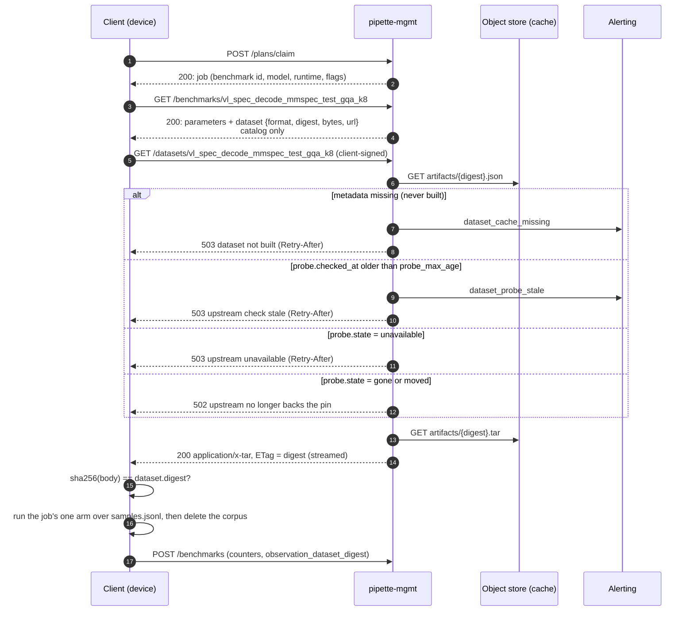

# Design: dataset delivery through an upstream-gated cache

Why corpora reach clients the way they do. The contract and the catalog entry
are [benchmarks.md §2.8.1](../benchmarks.md#281-the-dataset-object) and
[httpapi.md §2.15](../httpapi.md#215-get-datasetsbenchmark_id); the cache
layout is [storage.md](../storage.md#dataset-cache-dataset-cacheartifacts); the
commands, settings and alarm events are
[cli.md](../cli.md#pipette-mgmt-dataset-cache-probebuildpins).

## Principle

The upstream owns the data. mgmt keeps one repacked copy per pin, but **serves
it only while the most recent upstream check, minutes old at most, found the
upstream still publishing the pinned content**; otherwise it refuses with a 5xx
and alerts. The cache is never deleted; a failing check only stops it serving.

Everything upstream-specific lives in a server-side **adapter**, so a client
reads one format and never talks to an upstream. The format is named for the
benchmark it serves: it carries what `vl_spec_decode` reads (user turns of text
and images, no ground truth), and another benchmark gets another format.

Three moving parts, and **no request ever contacts the upstream**:

| Part | Runs | Does |
|---|---|---|
| **Probe** | `pipette-mgmt dataset-cache probe`, every minute | cheap upstream check per pinned upstream; records the verdict on the metadata of every artifact built from it |
| **Build** | `pipette-mgmt dataset-cache build`, recurring, own lock | builds an artifact only when it is missing: full fetch, verify, repack, re-verify |
| **Serve** | every download request | reads the artifact's metadata; streams the tar only if the recorded verdict is `ok` and fresh |

The probe cadence is the throttle: N requests in a minute cost zero upstream
calls, and the upstream sees one check per minute however many artifacts are
built from it and however large the fleet is. Two benchmarks pinning the same
corpus (`_k4`, `_k8`) share one artifact. Probe and build are separate commands
with separate locks
(the `process-submissions` / `score-eval` split): an 80 MB build must not hold
up the minute probe, or every artifact's verdict would go stale behind it.

## Upstream identity: the cheap check

A pinned revision is a commit sha, so its content cannot change in place. What
can change is whether the upstream still serves it: deleted, made private,
history rewritten. The probe asks that without downloading the corpus: a
`git fetch --depth 1 --filter=blob:none <url> <revision>` into a scratch repo,
then `git rev-parse <revision>:<subpath>`. The identity is the **git tree id**
of the subpath, a Merkle hash over every file below it (MMSpec `test` at
`2904868`: `2923603292c7dd463ad01a119f57965817778fc3`). A Hugging Face dataset
repository is reached through `git` as a git repository. The one other upstream
kind is the evals server
([below](#the-evals-server-as-an-upstream-vlm_eval-asr_eval)).

The identity is pinned in the catalog next to the full tree digest. The probe
compares identities; the build additionally recomputes the full digest over the
downloaded bytes. All three hashes and `bytes` are produced when the entry is
authored, by running the build path without a store (`dataset-cache pins`).

## Request path



The request path makes one metadata read and, if it passes, one artifact read.
Every refusal happens **before the first byte**.

`probe_max_age` (default 3 minutes, three probe ticks) is what keeps "served only
while the upstream backs it" true when the probe itself stops running: a verdict
nobody has refreshed is not a verdict, so stale `ok` refuses like a failing one.

## Probe path (every minute)

```mermaid
sequenceDiagram
    autonumber
    participant P as dataset-cache probe (1 min, locked)
    participant S as Object store (cache)
    participant U as Upstream
    participant A as Alerting

    loop each distinct upstream the catalog pins
        P->>S: GET artifacts/{digest}.json, for every artifact built from it
        alt no artifact built yet
            Note over P: nothing to probe yet; build's job
        else at least one built
            P->>U: one blobless fetch of revision, read subpath tree id
            P->>P: state = ok / unavailable / gone / moved
            loop each built artifact of that upstream
                P->>S: PUT artifacts/{digest}.json (probe.checked_at, state, since)
                opt state changed
                    P->>A: dataset_upstream_{state} (or dataset_upstream_recovered)
                end
            end
        end
    end
    Note over P: exit non-zero while any artifact is not ok
```

## Build path (own lock)

```mermaid
sequenceDiagram
    autonumber
    participant B as dataset-cache build (locked)
    participant S as Object store (cache)
    participant U as Upstream
    participant A as Alerting

    loop each distinct artifact digest the catalog pins
        B->>S: HEAD artifacts/{digest}.tar
        alt present
            Note over B: nothing to do; never rebuilt, never deleted
        else missing
            B->>U: full fetch of revision/subpath
            B->>B: full tree digest == upstream.digest?
            B->>B: adapter → deterministic tar
            B->>B: sha256 == dataset.digest?
            alt either digest differs
                B->>A: dataset_build_failed (expected vs observed)
                Note over B: write nothing; retry next tick
            else both match
                B->>S: PUT artifacts/{digest}.tar
                B->>S: PUT artifacts/{digest}.json (probe.state = ok, checked_at = now)
            end
        end
    end
    Note over B: exit non-zero if any build failed
```

A build that just verified the full upstream bytes counts as a passing probe, so
a fresh artifact is servable at once. A new adapter version or pin produces a new
digest, which is simply a missing artifact: the old one stays in place, unserved
once no catalog entry points at it.

## Alerting

mgmt has no notification channel; a recurring task surfaces problems through a
non-zero exit and a log event with a stable `event` field that a log-based
alarm keys on. Probe events fire on state transitions only, so a moved
upstream alerts once, not once a minute. A push channel (Slack, SNS) can
subscribe to the same event names later.

## Measured on MMSpec `test`

- **Probe:** blobless fetch of the pinned commit, ~1 s and 136 KB, no image bytes.
- **Build:** sparse checkout of `dataset/MMSpec/test` (601 files, 77 MB) plus
  repack, ~17 s; a second build from a fresh fetch reproduced the pinned digest
  byte for byte.
- **Artifact:** 79,619,072 bytes, 601 tar entries (the manifest, `samples.jsonl`,
  599 images: two upstream images are identical and stored once), 600 samples,
  723 turns.

## The evals server as an upstream (`vlm_eval`, `asr_eval`)

A `vlm_eval`'s prompts are the evals server's: `GET /evals/{eval}/datasets/{version}/samples?prompt_profile=`
builds them from the pinned dataset, each image inline as a base64 `data:` URI.
Serving them inline from `GET /benchmarks/{id}` meant mgmt read, parsed and
re-serialized the whole body on every request, `304` included, and a device
downloaded every image once per question that shows it. The same machinery
serves them as a corpus instead, with the evals server as the upstream:

| | Git upstream (`vl_spec_decode`) | Evals server (`vlm_eval`) | Evals server (`asr_eval`) |
|---|---|---|---|
| Pin | `url`, `revision`, `subpath` | `eval_id`, `dataset_version`, `prompt_profile` (the entry's own) | the same, `prompt_profile` required: an ASR dataset holds no prompt |
| Identity | git tree id | the evals server's samples digest: SHA-256 over each sample's canonical JSON (keys sorted, compact, UTF-8) and a newline, in served order | the same, every clip's base64 and the template kwargs included |
| Probe | blobless fetch, read the tree id | `GET …/samples/digest`: a few bytes, memoized by the evals server, which keeps the digest resident and not the samples | the same; a cold set's first probe may time out while the evals server learns its six profiles' digests in one pass, and reads `unavailable` until it does |
| Build | full fetch, tree digest, adapter, pack | `GET …/samples` once, parsed one sample at a time as it streams in (the body is never stored); each `data:` image moved to `media/<sha256>.<ext>` | the same, each `input_audio` clip moved to `media/<sha256>.wav`; one at a time, after the others, under `dataset_asr_build_timeout_secs` |
| Format | `vl-spec-decode-corpus/1` | `vlm-eval-corpus/1` | `asr-eval-corpus/1`: VL's layout, an `audio` part and a line's `chat_template_kwargs` |
| Size | MB | tens of MB | GB per corpus; over a hundred GB for the catalog |

**Lossless by construction, and proven per build.** The build hashes every
sample as served and requires the pinned identity and the evals server's own
`X-Samples-Digest`; it packs, reads the tar back, rebuilds every sample from it
with the very function a client uses (`pipette-plan-types`'
`VlmEvalCorpusSample::to_eval_sample_in`, for the entry's format) and requires
the identity again. Each format holds its own media part alone: a vlm-eval
corpus refuses a clip, an asr-eval one an image. An
image whose base64 would not re-encode to the same string is refused there,
not on a device. The evals server computes the digest in Python and mgmt and
clients in Rust; shared test vectors (control characters, DEL, U+2028, astral
characters) pin the two to the same bytes. The client checks the tar's digest
and the rebuilt samples' identity before it runs, and refuses either mismatch:
answers to prompts the scorer does not hold would be graded against the wrong
questions.

**One verdict per artifact.** The probe still reaches each upstream once, but
judges every artifact against its own pin: two entries may pin the same eval,
version and profile at different identities (one stale), and only the one the
evals server still serves is `ok`. Serving and the build's "already built" both
require the cached artifact to have been built from the entry's own pin
(upstream, format, adapter, and the subset it keeps), so an entry that copied
another's digest is refused rather than served that corpus. An artifact
recorded before subsets were is not checked on its subset.

**The header is required.** The build refuses a `/samples` without
`X-Samples-Digest`: the evals server's digest covers every field it sent, while
mgmt's typed samples drop a field they do not read, so only the comparison of
the two catches such a field.

**Scoring is bound to the corpus.** A submission is scored only if it ran the
pinned corpus (`observation_dataset_digest`), checked again when the staged
score is finalized, and `/score` receives the pinned samples digest and refuses
(`409`) if the evals server's samples moved since.
The probe keeps new downloads off a moved upstream; this keeps answers already
given from being graded against prompts the model was not sent.

### Measured (AMD cluster, datasets `2026.10.1`, dataset prompts)

| Eval | Samples | Images | `/samples` body | Corpus |
|---|---:|---:|---:|---:|
| pope | 5,127 | 500 | 1,118 MB | 83.5 MB |
| mmbench_en_dev | 4,876 | 1,250 | 199.1 MB | 39.9 MB |
| realworldqa | 765 | 762 | 183.8 MB | 138.0 MB |
| ocrbench | 1,000 | 930 | 114.1 MB | 76.2 MB |
| mme | 2,374 | 1,177 | 96.2 MB | 37.1 MB |
| mmmu_val | 900 | 954 | 69.3 MB | 51.7 MB |
| mmstar | 1,500 | 1,430 | 59.8 MB | 44.1 MB |
| **all seven** | | | **1,840 MB** | **470 MB** |

The corpus saves twice: an image shared by several questions is stored once
(POPE's 500 images serve 5,127 questions), and every image is raw bytes rather
than base64.

- **`GET /benchmarks/vlm_eval_pope`:** inline, 1.118 GB in 3.5 s, a matching
  `If-None-Match` still 3.3 s to its `304`, and mgmt peaking at 3.6 GB RSS. Now
  542 bytes in 0.5 ms: the entry and its pin.
- **`dataset-cache pins` on POPE:** 10.5 s, peak 132 MB RSS for a 1.1 GB body,
  since the body is parsed one sample at a time. The build of all nine
  artifacts of the check (the seven above and two prompt profiles) took 11.4 s.
- **Probe:** 0.1 s for those nine artifacts once the evals server's digests are
  memoized; its first digest of POPE after a restart takes about 3 s.
- **Client:** download, digest check and rebuild of POPE's corpus in 1.9 s,
  MMStar's in 0.2 s (mgmt on the same host).

## Open

- **`dataset_probe_max_age_secs`.** Three minutes tolerates one or two missed
  runs before refusing; lower is stricter, higher rides out a slow scheduler.
- **Probe fan-out.** One blobless fetch per distinct upstream per minute
  (~1 s each), four upstreams at a time, each bounded by
  `dataset_probe_timeout_secs`. The lock lease is sized from the pin count, so a
  catalog of many slow upstreams lengthens the run rather than letting the next
  tick overlap it; past a few dozen upstreams the minute cadence itself would
  need revisiting.
- **Serving bandwidth.** mgmt streams the tar from the object store; a presigned
  redirect issued only after a passing metadata check would take mgmt out of the
  byte path without weakening the gate.
- **A native Hugging Face upstream.** A `huggingface` kind (a tree API probe,
  per-file downloads) can follow when an upstream needs it. Its identity would
  be the sha256 over the sorted `{path}\0{lfs.oid or oid}\n` lines of the
  `GET /api/datasets/{org}/{repo}/tree/{revision}/{prefix}?recursive=1` listing.
