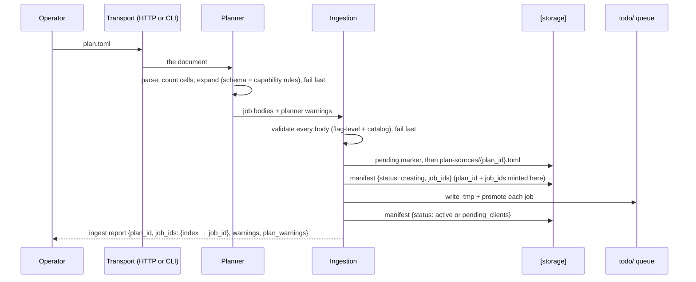
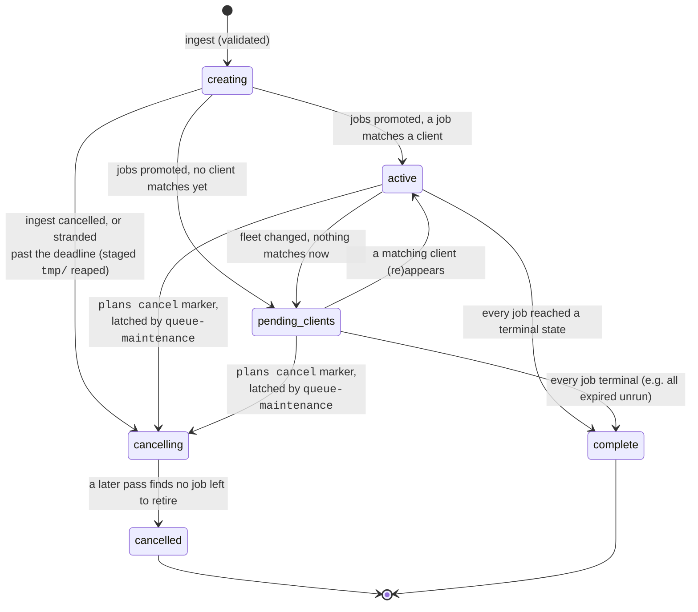

# Plan expansion and ingestion

This document specifies how a **plan** becomes scheduled work. An operator
files a plan as a TOML **plan document**. The server completes these tasks:

- The server stores the document.
- The server expands the document into individual **job bodies**.
- The server validates the bodies.
- The server stages the bodies in the job queue (`todo/`).
- The server tracks the plan lifecycle.

This document also defines the capability-based matching model that the queue
uses to decide which client may run which job.

## 1. Division of responsibility

**The planner owns plan knowledge.** The planner is the `pipette-planner` crate
in this repository. It holds the scheduler plan schema (`SchedulerPlan`), the
benchmarks × models × runtimes matrix expansion, model/runtime compatibility,
and the capability-requirement rules (which hardware a model or runtime
demands). The model, runtime and benchmark descriptors come from the
`pipette-plan-types` crate. The planner is the only component that understands
what a job *means*.

**Ingestion and the queue own scheduling.** They match jobs to clients by
capability flags, lease jobs out, recycle and expire them, and track each plan's
manifest and lifecycle. They do not interpret job content. Each job body
contains a scheduling **envelope** that the server owns. The envelope wraps a
**`spec`** that the server stores and forwards verbatim.

| Field | Where | Why the server reads (or writes) it |
|---|---|---|
| `job_id` | envelope | server-minted at ingestion; the sole task identity |
| `requires`, `any_of`, `clients` | envelope | eligibility: the inputs to capability matching |
| `excludes`, `not_all_of`, `exclude_clients` | envelope | the negative eligibility clauses. Who the job must **not** run on |
| `expires_at` | envelope | resolved at ingestion and encoded into the `avail/` filename, which every scheduling path reads; the body keeps a stamped copy |
| `merge_duplicates` | envelope | whether this job may join a job that already runs the same cell (§7); default `true`. `false` still lets a later plan join the job this one mints |
| `required_flags` | envelope | written at ingestion from the `tag:` and `client_version:` flags a plan marks `:required` (§4): the routing flags a carried run must be shown to have held (§7). A submitted body may not set it |
| `spec` | — | the run specification, **stored and forwarded untouched** |
| `spec.benchmark` | spec | resolved against the benchmark catalog: fills the claim response's `benchmark_id`, and attributes synthetic failure records |
| `spec.model`, `spec.runtime` | spec | **presence checked** at ingestion; their contents are read only to derive an opaque `model_descriptor` / `runtime_descriptor` for a synthetic failure record, `spec.model` is parsed in full to check coverage in the model parameter table, and a spec this build parses must pair a runtime with a model it loads (§6.2) |
| `spec.model_flags`, `spec.runtime_flags`, `spec.benchmark_flags` | spec | copied, canonicalized, into the `requested_*_flags` columns of the run's warehouse rows ([storage.md §5](storage.md#requested_model_flags--requested_runtime_flags--requested_benchmark_flags)). `spec.runtime_flags` is also checked against the runtime and model, and on an eval benchmark against the catalog entry's context bound and output cap (§6.2), and scoring reads `spec.model_flags`' `enable_thinking` back from that column and forwards it to the scoring service ([scoring-service.md](scoring-service.md#post-score)); nothing else in them is interpreted |
| `time_window` | response only | the lease increment, written by the claim handler; never stored, and ignored if a job body carries it |

Ingestion reads each of these keys as an opaque value. It resolves
`spec.benchmark` against its catalog, and checks that a spec it can parse
pairs a runtime with a model it loads. Every other row above is a presence check or a verbatim copy. A spec it
cannot parse, and anything else inside `spec` (whatever future fields appear),
passes through ingestion and the queue untouched. So a new spec field needs a
change to the planner, which writes it, and to the device clients, which read it.
Ingestion and the queue need no change (see §7 on schema revisions). This is
also the reason `spec` is nested rather than flattened: a new spec field cannot
collide with an envelope field that the queue depends on.

The envelope never reaches the device. The claim response carries `job_id`,
`benchmark_id`, `time_window`, an optional `expires_at`, `client_versions`, and
`spec`. The eligibility fields are inputs to selection, already spent once a job
is handed out. `client_versions` is what the client needs from them: which of
the builds it reports the job admits (see [httpapi.md](httpapi.md) §2.9.2).

A plan is filed into a campaign, through the HTTP routes
([Campaigns: Filing a plan document](api/campaigns.md#filing-a-plan-document)) or the `campaigns`
commands ([cli.md](cli.md)). The server-mode plan format (§4) is distinct from
the local-dispatch format a client runs against devices it reaches directly.

## 2. Concepts

- **Plan**: a set of jobs that the server stages, tracks and cancels as a unit.
  An operator usually files a plan as a plan document.
- **Plan document**: a declarative TOML document that describes a matrix of
  benchmarks × models × runtimes and the device eligibility for each
  combination (§4). An operator writes it. The server expands it into job
  bodies.
- **Plan source**: the plan document that a plan was filed from, stored at
  `plan-sources/{plan_id}.toml`. The manifest records its digest in
  `source_sha256`. A plan filed as job bodies has no source.
- A **planner warning** identifies a plan-document fault that does not stop the
  plan. For example, the explicit `clients` roster can run a job when no client
  satisfies its capability path (§6.1). It describes the document, not the
  fleet. The manifest stores the planner warnings in `plan_warnings`.
- **Job**: one benchmark run of one model on one runtime, eligible to a set
  of clients. The unit the queue leases to a device
  ([queue.md](queue.md#jobs)).
- **Plan id** (`plan-{UUIDv7}`): minted by the server at ingestion, when the
  plan manifest is created, and recorded only there: job bodies never carry
  it. It is the handle for progress and cancellation, and the key of the plan
  manifest. A *per-plan grouping* identity, distinct from a job's own
  `job_id`.
- **Job id** (`job-{UUIDv7}`): the server mints the ID during ingestion,
  immediately before it stages the job, so an ingest cannot collide with
  another. An operator can file the same document twice, and each ingest
  receives new IDs.
- **Note**: optional free text on why a plan was filed, given at filing and
  editable afterwards. The store keeps the note next to the plan manifest. The
  note is not part of the manifest or of a job body.
- **Capability flag**: a short string describing something a client can do or
  is (`os:ios`, `os_version:26.1`, `device:iphone17`, `job_retry`, or any
  free-form string). Matching is defined entirely in terms of these.

## 3. Pipeline



Every transport runs the same expansion and the same ingestion, and each offers
a dry run that expands and validates a document and writes nothing.

## 4. The server-mode plan format (summary)

The authoritative definition is `SchedulerPlan` in the `pipette-planner` crate
(`crates/pipette-planner/src/scheduler_plan.rs`). Its JSON Schema, with every
model, runtime and flag shape, is the `SchedulerPlan` component of
`GET /api/v1/openapi.json` ([httpapi.md §1.5](httpapi.md#15-the-openapi-document)), and
[`examples/plans/scheduler/`](../examples/plans/scheduler/) holds example
documents. [Campaigns: The plan document](api/campaigns.md#the-plan-document)
states what each field means to a filer: expansion, eligibility,
`client_versions`, `:required`, `expires_at`, `merge_duplicates` and
`custom_label`. This section records how the planner turns the fields into job
bodies. A server-mode plan is a **distinct format** from the local-dispatch
format: it has no transports. Each `[[variants]]` block pairs a sub-matrix of
benchmarks × models × runtimes with the **eligibility** for those runs:

```toml
benchmarks = ["decode_throughput_512_100", "end_to_end_latency_512_256"]
# expires_at = "2026-08-01T00:00:00Z"      # optional; `never` is also allowed
# merge_duplicates = false                 # optional; default is true

# iOS Apple Foundation Model: one benchmark, and also pinned to one client.
[[variants]]
requires   = ["os:ios"]                     # supported-iPhone any_of injected by rules (§6.1)
clients    = ["ev1_9f2c…"]                   # eligibility is (this client) ∪ (requires match)
models     = [{ type = "apple_foundation_text" }]
runtimes   = [{ type = "apple_foundation", private_thermal = true }]
benchmarks = ["decode_throughput_512_100"]  # per-variant override of the top-level list

# macOS MLX: both top-level benchmarks.
[[variants]]
requires = ["os:macos"]                      # requires-only; any matching client is eligible
models   = [{ type = "mlx", source = "huggingface", org = "LiquidAI", repo_name = "LFM2.5-350M-MLX-4bit" }]
runtimes = [{ type = "mlx_macos_pipette", version = "0.20.0", requirements = { type = "catalog" }, flavor = "macos-arm64" }]
```

This plan expands into **3 jobs**: variant 1 → 1 benchmark × 1 model × 1
runtime = 1, variant 2 → 2 benchmarks × 1 model × 1 runtime = 2.

The planner copies three plan-level or variant-level fields into the envelope
of each cell's body: the plan's `expires_at` when set, its `merge_duplicates`,
and the variant's negative clauses (`exclude_clients`, `excludes`,
`not_all_of`, matched as §5 describes).

**`client_versions`.** The planner writes the list as one more `any_of` group
of `client_version:` flags, sorted, after the groups the rules inject, so it
composes with `requires`, `tag:` flags and the negative clauses as any
`any_of` group does (§5). A runtime has to be copied from the build's release
manifest (`pipette-ios-<v>.json`) as written because pipette-ios-proxy matches
the whole descriptor. `private_thermal` covers both private-API switches, and
`private_memory` is written only by a build that has one switch and not the
other. The claim response tells the client which of its builds the job admits
(`client_versions`, [httpapi.md §2.9.2](httpapi.md#292-response-200-ok)).

**`:required`.** Ingestion takes the suffix off, so the job matches the plain
flag, and lists the plain flag in the body's `required_flags`. Only `tag:` and
`client_version:` flags take it, because they are the routing flags: they say
where the job runs next, not what a finished run measured. A required one
counts as part of the measurement when a revision carries runs over (§7).
Every other flag is measured already, so one that ends in `:required` stays
the flag it is.

**One body per distinct rendering.** The planner writes each distinct job body
once. Two cells can render one body, for example two variants that differ only
in a flag that the capability rules inject (§6.1), and it merges them whatever
`merge_duplicates` says: the flag governs joins across plans and inputs (§7),
not two cells that are already one body.

A `clients` entry is a **management-server client id** (`ev1_…`). Transport
definitions (adb serials, binary paths, ssh hosts) have no analog here: the
plan declares *eligibility*, not execution targets. A vault source's
`custom_label` names the record because a resource id says nothing to a
reader; it is checked against the record at ingestion (§6.2) and stays out of
the content key (§7).

A model's `auth_token` is consumed at ingestion: the server imports that model
into the vault and stores no token (§6.2, "The import of a gated model").

## 5. Capability matching

Client selection is a single rule: **set-superset containment.**
[Devices: Capability matching](api/devices.md#capability-matching) states the
model a plan author writes against: the effective capability set, the six
clauses, the eligibility rule, and that an exclusion beats the `clients`
roster. This section records how the server builds the set, why the rule is
shaped as it is, and the invariants the queue rests on.

A client's **effective capability set** is computed internally as:

```
effective_capabilities(client) = normalize(device_* profile) ∪ reported capabilities ∪ tag flags
```

Clients report their `device_*` profile over the ordinary wire protocol; the
server *normalizes* each populated field into a reserved-namespace flag in
**canonical form** (lowercased, whitespace stripped; see
[Reserved capability namespaces](#reserved-capability-namespaces)) and unions
the result with the flags the client reports directly. The client's tags join
as `tag:<tag>` flags, assigned by an operator
([authentication.md §7](authentication.md#7-client-tags)). One set-containment
check then drives all matching.

The server owns the reserved namespaces and `tag:`, so a client that reports
one directly (`os:ios`, a device property it could otherwise fake) is rejected
at register / `PATCH /clients/me`. Every other flag is client-attested.
Approval decides *who* is trusted, not what they claim.

**Exclusion is a factor over the whole disjunction, so it beats the `clients`
roster.** The roster is an OR that short-circuits the capability check, so
naming the device in `clients` would defeat an exclusion applied only to the
capability branch. A denial always overrides a match.

Exclusions only ever narrow, so an authored clause and one the server injects
**compose by union** and need no precedence rule between them. They are also
indistinguishable once stored: the body records the clause, not its author.

**The server injects a clause at ingestion or at spawn, never after
promotion.** A promoted body is immutable ([queue.md](queue.md#jobs)), and the
eligible index rests on that: `queue-maintenance` skips the `avail/` keys it
has indexed, and `claim` trusts a marker without re-running the matcher, so a
clause added after indexing would narrow the body while the markers still name
the clients it excludes. To narrow a job that is already promoted, retire it
and mint a replacement.

**A rollback across a matcher change widens eligibility.** The envelope schema
is open, so a build that predates a clause reads a body that carries it and
ignores it: the excluded devices become eligible again. The widening outlasts
the rollback, because the old build's markers stay indexed. Run
`pipette-mgmt flag-reindex --all` after you roll forward
([operations.md §3.3](operations.md)).

The planner's capability rules inject `any_of` groups (§6.1). A device
family is the motivating case: an iOS Apple-Foundation job requires the device
be one of a curated list of supported models, so a new model that can't run it
is handled by omitting it from the list. Each member is still compared by
exact string equality, so `any_of` adds a disjunction without adding any
pattern matching.

Malformed or unmet requirements fail closed (the client is simply not
eligible), so a bad requirement can never widen eligibility: a `requires` that
is empty matches nobody through flags, as does an empty `any_of` group. A
malformed clause (not a JSON array, or holding a non-string element) of any
kind but `clients`, positive or negative, makes the job match nobody, the
`clients` roster included; a malformed `clients` lists nobody, which only
narrows. A malformed exclusion that is skipped would widen eligibility. One
rule over all the clauses prevents that. Ingestion rejects such a body
(§6.2), so a queued one comes from a writer that bypassed ingestion.

The empty-list forms (`excludes: []`, `not_all_of: [[]]` and the rest), and
what a device with an empty set matches, follow from the rule;
[Devices: Capability matching](api/devices.md#capability-matching) states them.

The eligible set is materialized as `eligible/` markers by `queue-maintenance`
([queue.md](queue.md#the-eligible-index)) rather than recomputed on each claim.

**Exact match is deliberate**, RAM included (`ram_bytes:17179869184`). Lab
devices are effectively identical, so exact match is sufficient and is in fact
*preferable* for benchmark replication: it pins a run to one specific,
reproducible hardware configuration. Each flag is a whole, opaque string, so
granularity is explicit on both sides: a client advertises every level it
supports, and a plan's `requires` flags are written in the same canonical form
the server normalizes device attributes into, so they line up exactly.

To apply these rules to a real plan against the real fleet, run
`pipette-mgmt plans status <plan_id> --explain`. It narrows the fleet one clause
at a time and names the clause that leaves no client eligible ([cli.md](cli.md)).

### Bodies that can never match

Ingestion refuses a body that no *possible* client can match, and a body that
matches nobody in today's fleet is only a warning (§6.2).
[Devices: Capability matching](api/devices.md#capability-matching) lists the
rules the refusal applies, and `pipette_core::matching::unmatchable_reason`
holds them. `queue-maintenance` retires an unmatchable body that reaches the
queue by another route. This section records why the rules are shaped as they
are.

One rule kills both eligibility branches at once, so it proves the body
unmatchable on its own: an empty `not_all_of` group. Every capability set
contains the empty group, so the group excludes every client, whatever its id or
flags.

Every other rule proves one branch dead, and a body needs both. A flag exclusion
cannot kill the roster branch, because a client id does not determine the
client's flags. Each capability-branch rule is a contradiction inside the body:
a `not_all_of` group that holds only flags `requires` demands, for one, is
carried whole by every client that satisfies `requires`.

The rules are **sound but deliberately incomplete**. The general question is
satisfiability of a monotone CNF formula (`any_of` contributes all-positive
clauses and `not_all_of` all-negative ones), which is NP-complete. So the check
is a fixed set of syntactic rules that reject a *provable* contradiction. A
combination they do not cover is accepted and matches nobody at match time, as
an unsatisfiable body always has. Read them as a set of rules, not as a
decision procedure.

One related check stands beside it: a `not_all_of` group is a conjunction, and a
client derives at most one flag per reserved namespace, so a group that names
two of them can never be carried whole and excludes nobody. Ingestion rejects it, since
a typo there reads as a narrowing while it silently widens eligibility.
`excludes` is a disjunction, so it is exempt. `[chip:a15, chip:a16]` is its
motivating case.

### Reserved capability namespaces

The server owns these namespaces: it derives them from the `device_*`
profile, and rejects a client that tries to report one directly. String values
are slugified (lowercase, whitespace removed); byte counts are matched exactly
as their decimal value.

| Namespace | Meaning | Source |
|---|---|---|
| `os:<name>` | operating system | `device_os_name` |
| `os_version:<v>` | OS version | `device_os_version` |
| `arch:<name>` | CPU architecture. The server maps known aliases to a canonical value (for example, `amd64` to `x86_64`) and keeps other values as a lowercase slug | `device_cpu_arch` |
| `os_family:<name>` | OS family. The server maps known aliases to a canonical value (for example, `win32` to `windows`) and keeps other values, such as `linux`, as a lowercase slug | `device_os_family` |
| `device:<model>` | device model/generation | `device_name` |
| `chip:<model>` | SoC | `device_chip_model` |
| `form_factor:<ff>` | phone/tablet/laptop/… | `device_form_factor` |
| `ram_bytes:<n>` | total RAM (exact) | `device_ram_bytes` |
| `gpu:<model>` | GPU | `device_gpu_model` |
| `gpu_vram_bytes:<n>` | GPU VRAM (exact) | `device_gpu_vram_bytes` |
| `npu:<model>` | neural accelerator | `device_npu_model` |
| `npu_vram_bytes:<n>` | NPU VRAM (exact) | `device_npu_vram_bytes` |
| `tag:<tag>` | a tag an operator assigned, any number per client | the pre-auth key at registration, or `clients tag add` |
| `runtime:<name>` | an installed/available runtime | reported by the client |
| `client_version:<v>` | a client build the client can run, any number per client | reported by the client; a variant's `client_versions` matches it (§4) |
| *(free form)* | anything else | reported by the client |

The `arch:` and `os_family:` examples are not the full alias lists.
`canonical_cpu_arch` and `canonical_os_family` in
`crates/pipette-core/src/client.rs` hold them.

### Runtime versions

A runtime's **version to run** belongs to a variant's runtime descriptor (the
*what to execute*), not to eligibility (`requires`). Keeping it out of
`requires` lets platforms with different version semantics coexist without any
special matching:

- A client that fetches runtimes on demand (e.g. Android) is told which build
  to run by the descriptor, so it advertises just `runtime:<name>` and is
  eligible whatever build a job pins.
- A client with a fixed, compiled-in build (e.g. iOS) runs only that build, so
  it advertises both `runtime:<name>` and the concrete
  `runtime:<name>:<build>`. A run that must pin to those devices puts
  `runtime:<name>:<build>` in `requires`: an ordinary exactly-compared flag.

Because each **variant** pairs its eligibility with its own runtime
descriptor, a run spanning platforms with different version rules is authored
as separate variants in one plan (an Android variant whose descriptor fetches
the build, and an iOS variant that runs the device's compiled build), each
with concrete `requires` flags. A single variant is the wrong tool for
spanning them, precisely because their version semantics differ.

## 6. Validation

Validation happens in two layers. The planner checks the plan document, and
ingestion checks the job bodies. Both layers stop at the first error. An invalid
document produces no job bodies. An invalid set of job bodies stages no jobs.

### 6.1 Expansion time (`pipette-planner`)

Everything that requires understanding the plan's contents.
[Campaigns: What the server checks](api/campaigns.md#what-the-server-checks)
lists what a filer is refused and warned about; this section records where the
planner does it and why. The planner runs these checks in order, and it stops
at the first failure:

1. **Parse.** The document must be valid TOML and a valid `SchedulerPlan`:
   model↔runtime structural compatibility and orphan detection (a model or
   runtime that matches nothing in its variant), the `requires` / `clients`
   rule, the `client_versions` values (the refusal names the value), and the
   shapes of `expires_at` and `merge_duplicates`. Each `runtime_flags`,
   `model_flags` and `benchmark_flags` entry must select a cell of its variant,
   and no two may select the same one. An entry selects by `benchmark_type`.
   The planner reads that type from each benchmark's definition in the
   catalog the filer reaches (§6.2), not from its id, because a private id is
   named freely. An id outside that catalog is untyped: its variant's flags
   are not checked against it, and ingestion then refuses it by name. The
   manifest records each benchmark's type as `benchmark_types`, and every
   later parse of the stored document (ordering a plan's jobs for reading,
   rekeying a revision's jobs) types its cells by that record, not by the
   catalog of the day, so a plan reads as it was filed. A plan filed before
   the manifest recorded them was typed by each id's prefix, and still reads
   that way. A stored document parsed again only to rewrite its tokens checks
   its models alone, so it is parsed with no types.
2. **HuggingFace tokens.** Each device that runs a job gets its
   `runtime_flags` environment, so a token value there would reach every one
   of them. The refusal names the variant, never the token, and tells the
   author to set `PIPETTE_HF_TOKEN` on the devices. A model's `auth_token`
   (or a speculative draft's) stays on the model in the job body: ingestion
   imports the model into the vault and drops the token (§6.2, "The import of
   a gated model").
3. **The job ceiling.** The planner refuses the plan before expansion if its
   cell count exceeds `plan_max_jobs`. The message is the one that a set of job
   bodies over the ceiling gets (§6.2).
4. **The capability-requirement rules**: a table keyed on runtime kind that
   injects the hardware policy a plan author shouldn't have to know.
   Required flags (`requires`), device-family disjunctions (`any_of`, e.g. the
   supported-iPhone list for Apple Foundation on iOS), commit-to-exactly-one
   guardrails (`one_of`, e.g. one `os:`), and conditional injection (`when` a
   committed flag is present). The planner rejects contradictions. It rejects
   two effective requirement flags from one mutually exclusive namespace. It
   also rejects an Apple Foundation Model variant that requires `os:android`.

The rules then apply the checks of §5 "Bodies that can never match" to each
variant's effective requirement: the author's flags plus the injected ones, and
the `client_versions` group, which `excludes` must not cover whole. A dead
capability path is refused only when the `clients` roster is dead too; with a
live roster it is a **planner warning** that names the variant, as are the two
contradictions the API lists (an `exclude_clients` that denies every listed
client, and a live roster beside `client_versions`). The filing report returns
the planner warnings in `plan_warnings`, and the manifest stores them.

Over HTTP, each refusal answers `400` with its whole chain of messages, and the
CLI prints the same chain. The refusal writes nothing: no source, no manifest
and no job.

The rules live in `crates/pipette-planner/src/capability_rules.rs`, so a rules
change, such as a new supported device or a raised minimum, is a reviewable
code change and a release of `pipette-mgmt`. A rule that changes a body changes
its content key (§7), so the new body does not merge with the older job for
that cell.

### 6.2 Ingestion time

Everything the server can check **without understanding job contents**, plus
the checks only the server *can* perform because they consult server-side
state. Ingestion runs these checks on every set of job bodies: the expansion of
a document. It validates the whole set before it writes anything, and any
rejection rejects the ingest as a unit.
[Campaigns: What the server checks](api/campaigns.md#what-the-server-checks)
and [Campaigns: Errors](api/campaigns.md#errors) state what a filer is refused
and with which status; the list below records why each check sits here, and
the checks a document filed over HTTP cannot reach.

Rejections:

- The set holds more jobs than `plan_max_jobs` (default 5000). Ingestion counts
  the set before it checks any job, so the refusal costs one comparison. The
  ceiling applies to every transport that files a plan.
- A job body is not a JSON object, or already carries a `job_id` or `plan_id`
  (identity is server-assigned at ingestion; pre-set identity fields are a
  malformed job body).
- A job declares neither a non-empty `requires` nor a non-empty `clients`,
  or any of its six eligibility fields is malformed (wrong JSON shape,
  non-string elements, flags not in canonical form). The negative clauses are
  checked exactly like the positive ones, so a typo in an exclusion is an
  ingest error rather than a job that silently matches nothing.
- More than one flag from the same **reserved namespace** in a job's flat
  `requires` set (e.g. both `os:ios` and `os:android`). The server already
  owns the reserved-namespace table (it is the same table that normalizes
  `device_*` profiles into flags), so this check adds no new list to keep in
  sync. It applies only to reserved namespaces and only to the flat
  `requires` set: `any_of` groups are *deliberately* many flags from one
  namespace, and free-form flags may legitimately share a prefix. `excludes`
  is a disjunction like `any_of`, so it is exempt too.
- More than one flag from the same reserved namespace in one `not_all_of`
  group. The group is a conjunction, so no client can carry it whole and the
  clause excludes nobody (§5).
- **No possible client can match the body**: the rules are in §5.
- A malformed `expires_at`, or one at or before the time of ingestion. A
  client can never claim such a job, so the plan cannot run as written. Every
  transport and the dry run apply the check, and staging applies it again
  after the import step, because an import can take hours.
- A `merge_duplicates` that is present and is not a boolean. The string
  `"false"` reads as mergeable, which is the opposite of what its author asked
  for, so the server refuses it rather than honor it the wrong way. An absent or
  `null` field means the job merges.
- No `spec`, or a `spec` that is not a JSON object. A body without one has no
  runnable content: it would ingest cleanly and then be leased out as a claim
  every client rejects terminally.
- `spec.benchmark` absent, or not in the benchmark catalog the plan's principal
  reaches. This is the one spec field the server resolves, and it is
  server-domain knowledge. The catalog lives on the server, and the server must
  resolve this same id later to build synthetic failure records (§9), so an
  unknown id accepted now would become an unresolvable error in
  `queue-maintenance` later. The refusal names the closest catalog id
  when the unknown one is within a typo of it (an edit distance of at most a
  quarter of its length).

  The API states the reach (the public catalog plus the filing user's
  organization's private benchmarks,
  [benchmarks.md §1.1](benchmarks.md#11-private-benchmarks)); the `campaigns`
  commands reach every organization's, as `submit_any_plans` does. Work on an
  organization's benchmark is its own to file, as its catalog is its own to
  curate. A private id outside the reach is refused as an unknown one is so
  that the refusal discloses nothing about another organization's catalog. An
  id two organizations hold is refused for everyone because the passes that
  settle the job could not tell which definition it ran.
- `spec.model` or `spec.runtime` absent. A **presence check only**: the server
  does not validate their contents and could not (partners define their own model
  formats and runtimes). Together with `benchmark` they are the three fields a run
  specification cannot omit, so checking they exist costs nothing and converts a
  terminal device-side rejection into an ingestion error the operator sees.
- A `spec` that parses as this build's `ClientRunSpec` and cannot run
  (`ClientRunSpec::validate`): the runtime cannot load the model, or
  `runtime_flags` are for another runtime or model. A client refuses such a spec
  for good at claim. The benchmark is checked only by the eval rule below, and
  `model_flags` and `benchmark_flags` are left to the client, but for a
  vlm_eval's or asr_eval's recipe below. A spec that does not parse (a partner's format, or
  one newer than this build) is not checked here.
- A `spec` that parses, on an eval benchmark, whose cell cannot run the entry
  as the catalog defines it (`EvalBenchmark::check_cell_context`, in
  `crates/pipette-plan-types/src/cell/context_bound.rs`). A client would run
  the cell anyway, so it is refused here, where the message names the knob:
  - The entry sets `parameter_max_context`, and the cell is not on an engine
    that stops a sample there with its context pinned to the bound
    ([benchmarks.md §2.5](benchmarks.md#the-context-bound) lists the engines
    and pins).
  - The entry sets no `parameter_max_context`, is free text, and a vLLM cell
    pins `max_model_len` at or under `parameter_max_tokens`. That bounds a
    context the entry leaves unbounded, and on a client that sends
    `max_tokens` every request gets vLLM's HTTP 400.
- A **vlm_eval job off its entry's recipe** ([benchmarks.md
  §2.9](benchmarks.md#29-vlm-eval-accuracy)): the spec's `model` is not from a
  Hugging Face repo the entry's `[recipe]` covers, or loads another projector
  than the one it names, or its `model_flags` state another `enable_thinking`
  than the recipe's (`OffRecipe`); or two entries for the job's task and
  dataset version both cover its model (`AmbiguousRecipe`). Only `model` and
  `model_flags` are read, so this holds whether or not the rest of the spec
  parses, and a spec whose `model` or `model_flags` this build cannot read
  whole, or whose flags are for another cell, is refused (`RecipeUnchecked`)
  rather than queued unchecked. A model imported into the vault is judged by
  its Hugging Face origin, as the model-parameter check reads it.
- An **asr_eval job off its entry's recipe** ([benchmarks.md
  §2.12](benchmarks.md#212-asr-eval-error-rate)), by the same rules: its
  `model_flags` must be the asr_eval cell's and state `enable_thinking =
  false`, as every asr_eval recipe says. Two asr_eval entries count as covering
  one model only for one task and dataset version, and only when the job's
  filer can name both (public entries and its own organization's).
- A **vault reference that cannot be satisfied**: the one part of a descriptor
  the server reads, because it serves the bytes
  ([Vault](api/vault.md)). Any object tagged with a `vault_*`
  source is found by a walk of the body rather than a parse of the descriptor,
  so every other arm's shape stays a client concern. The `400` row of
  [Campaigns: Errors](api/campaigns.md#errors) lists the refusals. Each one
  but the label has exactly one outcome on every device that claims the job,
  a `403`, a `404`, or a failed digest check after a multi-gigabyte download,
  so it is refused here where the message can still name the resource. A
  wrong label would run, and every reader would take the artifact for
  something else. The check runs before anything is written, and again on the
  bodies that the import step rewrites (below).

  A plan names only the vault resources in its filer's reach
  ([Vault: Who may do what](api/vault.md#who-may-do-what)); the `campaigns`
  commands reach every resource, and the campaign's owner does not widen the
  reach. A resource outside it is refused before its owner, object or digest
  is judged, so the refusal names no owner. Otherwise a filer could name
  another owner's resource, and that owner's devices would fetch it and run
  the work for the filer's plan.
- An `auth_token` that the import step does not remove (below). The message
  names the job and the field as a JSON pointer, such as
  `/spec/runtime/auth_token`. It never holds the value.
- A model that carries a token, in an ingest that cannot import from
  HuggingFace.
- A model whose import HuggingFace, or the import's own file checks, refuse
  ([Campaigns: Errors](api/campaigns.md#errors) lists the causes). The message
  names the model by its HuggingFace reference, never the token.
- **Only under `--strict-models`** on the `campaigns` commands that file a plan
  (`create`, `ingest`, `variants`, `revise`, `rerun`): `spec.model` matches no
  entry in the model parameter table (the model-params rows). Off by default,
  where the same condition is a warning instead. See the warning below for why.

#### The import of a gated model

A job body can carry a model `auth_token`, the access token for a gated
HuggingFace repository. Ingestion does not store the token. It imports the
model into the vault ([Vault](api/vault.md)) and rewrites the body to name the
vault copy. [Campaigns: Filing a plan document](api/campaigns.md#filing-a-plan-document)
states what a filer sees: whose records the import writes, the per-owner
reuse, the stored document, the progress stream and the statuses. The steps:

- Ingestion takes each `spec.model` that holds a token and parses as a typed
  model. A model with a field the type does not know is left alone, since the
  rewrite would drop that field, and its token is then refused.
- It resolves the model on the Hub with the token: the commit the `revision`
  names, or the default branch's, and the file list.
- It reuses the owner's existing import of that commit and those files, or
  downloads them: a gguf file as one blob under its LFS digest, a model
  directory (or its `prefix`) as one deterministic tar. Each record carries a
  `huggingface` origin, so the scorer records a run under the HuggingFace model.
- It replaces the model with the vault arm of the same type, naming the
  campaign's owner in `principal_id` and holding no token. Only the owner's
  devices can fetch the result
  ([design/vault-resources.md](design/vault-resources.md)), and the vault
  check of the rewritten bodies (above) runs under the filer's reach.

The token exists only in request memory while the import runs. No token reaches
`job-sources/`, `todo/`, a manifest, the content key or a log. Two bodies that
name one commit with different tokens rewrite to the same records, so they merge
onto one job (§7).

**The stored plan document.** A document with a model token is rewritten from
its TOML values, each imported model replaced by its vault arm, under a header
comment that counts the replaced models. A document with no model token is
stored byte for byte. A campaign revision expands the stored document again,
so it imports nothing and calls the Hub zero times, and the content keys of the
vault-arm bodies equal those of the jobs that the head filed, so the jobs carry
over (§7). The table check reads a vault model with a HuggingFace origin as
that HuggingFace model.

Warnings (the plan is accepted).
[Campaigns: Response `201 Created`](api/campaigns.md#response-201-created)
gives each warning's `kind`, its grouping, and how an HTTP caller's fleet tier
projects it. The stored warnings and the CLI report keep full detail. Why each
is a warning:

- A group of jobs matches **no working client**. Registered, approved and
  holding `perform_work` are the three things `POST /plans/claim` checks
  ([authentication.md §5.4](authentication.md#54-status-and-permissions)).
  An approved machine nobody granted `perform_work` matches a clause and is
  refused the moment it asks for the job, so counting it here would report the
  plan matched. A user may legitimately queue work ahead of the clients that
  will run it. Grouping by requirement set rather than per job keeps a large
  plan readable. The groups are derived from the jobs; the server has no
  notion of the plan's variants.
- A group of jobs names a model with **no entry in the model parameter
  table** ([storage.md §5](storage.md#model-parameter-table)). Such a job runs
  normally; its rows lose the `model_params_*` columns until an operator adds
  the entry and runs `fix-model-param`. So this is a gap to close rather than a
  reason to refuse work. `--strict-models` turns it into a rejection for a
  caller who would rather find out before the jobs are queued; the HTTP filing
  routes never reject on it, because a table the operator has not caught up
  with must not cost a tenant their plan. For the same reason a table that
  cannot be read or parsed counts as empty, with a logged warning.

  The match is the rule the scorer resolves a row by: `spec.model` is parsed
  as the typed model the client serialized, and the names it gives its weights
  are looked up exactly. An imported model is matched in the HuggingFace form
  the import replaced. A descriptor this build cannot parse warns like an
  uncatalogued one. An **empty or absent table matches everything**, so a
  deployment that ships none sees no warnings.

## 7. The job-body handoff

Ingestion takes a list of job bodies. Each body is a complete job (the fields
of §1), **minus `job_id`**, which the server mints and
stamps at ingestion. The bodies carry no identity of any kind. Only the plan
manifest contains `plan_id`.

The planner supplies the list. It hands its expansion of a plan document to
ingestion in the same process, in the planner's order. The ingest report names
each job by its index in that order. A §6.2 rejection also names the offending
body by its index. A §6.1 planner rejection instead names a document field or
variant.

A plan filed as JSON job bodies has no stored document: its jobs run as any
other plan's do, but a revision of it gets `409`.

Filing the same document twice is cheap rather than wasteful: the second plan
shares the first plan's jobs, by the merge below.

### The duplicate-job merge

Two plans may describe overlapping work. Ingestion detects that and merges it:
one job runs once, and every plan that wants that cell counts it as its own.
[Campaigns: Shared jobs](api/campaigns.md#shared-jobs) states what a filer
sees: which bodies share a job, what takes no part, and how each plan's
deadline reads. This section records the mechanism and why it is safe.

**The content key.** The server digests each job body after the import step
(§6.2) and keys the merge on that digest. The digest covers every data field,
with the six eligibility clauses normalized to sorted sets. A body holds no
model token here, so two bodies that name one HuggingFace commit with different
tokens digest alike.

Eligibility is part of the key because a merge must never change who may run a
job: two jobs whose eligibility differs get their own jobs even when their spec
is identical. The negatives are in the key for the same reason as the positives:
a merge across one `excludes` flag widens the eligible set of one of them.
Identity, the deadline, and `merge_duplicates` sit outside the key: identity is
what a merge collapses, the deadline is settled by the join rule below, and the
merge flag controls only whether this input looks for an existing job. A vault
source's `custom_label` sits outside it too: it repeats the name of the record
the path beside it names, so it tells no two cells apart. The job keeps the body
it was minted with. The digest's preimage carries a version token, so a change
of derivation never matches an old record ([storage.md §2](storage.md#2-logical-layout-and-invariants)).

Two spellings of one number (`1` and `1.0`) inside a body digest differently.
The consequence is a missed merge (both jobs run), never a wrong merge.

**Claiming a cell.** A job that mints its own `job_id` claims its digest with a
create-if-absent write *before* the job can be claimed by a client. Two ingests
of one cell therefore produce one job: the loser of the create reads the winner's
record and joins its job.

**The deadline model.** A job runs under **one horizon per member plan**. Each
plan records its own horizon in a `job-plans/{job_id}/{plan_id}.{expires_at}`
membership marker, and a plan's effective horizon is the latest of its markers.
The job's `avail/` key carries one official deadline: the latest horizon any
member held when that key was last written. The expiry pass moves it only once
it has lapsed.

A joiner therefore **accepts the deadline the key carries**, whatever horizon it
asked for. A plan that wants the cell for less time joins and stops waiting at
its own horizon; one that wants it for longer joins, and the job moves onto its
horizon once the shorter one lapses. The one bar to a join is a job that is
already dead: an `avail/` entry past its own deadline. The deadlines need not
match, which is what makes merging reachable: two plans filed minutes apart
resolve default deadlines minutes apart.

A plan that mints or joins a job writes one marker, at the latest horizon among
its inputs that share the cell. A plan that joins the same cell again in a later
ingest adds its own, which is why readers take the latest marker.

**Lapse and re-date.** Each `queue-maintenance` run settles two things, in order.
First, **a member's lapse**: a plan whose horizon for a job has passed, with no
submission record, gains an `expired_jobs` entry, loses its markers on the job,
counts it `failed` and stops waiting. The job itself is untouched. Second, **the
job's own deadline**: a lapsed `avail/` key is renamed onto the latest remaining
member horizon, or, with none left, the job becomes a synthetic `"system"`
failure ([queue.md](queue.md#expiration)).

The key carries the **latest** member horizon rather than the most proximate
one, for three reasons. A lapse is final, so serving the job past a lapsed
member's horizon costs that member nothing and still answers the survivors. One
rename per lapse of the encoded date is fewer renames than one per member
boundary. And a job stays claimable throughout, with no gap at each
intermediate boundary. The cost is claim ranking, which orders a shared job by
its least-urgent member.

The rename moves a deadline only while it is already lapsed, and the claim gate
refuses a lapsed key with the same predicate. So a claim and a re-date compete
for one key only when the deadline passes inside one request, and the claim path
retries under the job's current key.

**The merge window.** There is no multi-object atomic write, so between finding
a live job and recording membership the job can be claimed, completed, expired
or retired by another plan's cancel. The invariant: **a joiner writes its
membership marker before it re-checks the job**, with fresh reads of `avail/`,
`leased/`, `avail/` again, and the submission record. Every forward transition
writes its destination before it deletes its source, and the second `avail/`
read covers the two backward ones (lease recycle, teardown's restore). A job
that completed inside the window is the wanted outcome: the joiner reads the
same record. A job every read misses was retired, so the joiner drops its marker
and mints a fresh job. Writing the marker first is what lets teardown trust its
own listing of members (§9).

**A stranded key.** A content-key record whose job is in neither queue may
belong to an ingest that is still staging. Inside `plan_creating_max_age_secs`
(§8) the record stands and the new job mints unmerged; past it the record is
provably an orphan and the new job takes the digest over. Every takeover is a
compare-and-swap on the version read, because an unconditional overwrite would
orphan a rival's live job from the index.

**Opting out.** `merge_duplicates: false` (§4) is a rule about minting, not about
ownership. An opted-out input joins nothing: it reads neither the index nor the
other inputs of its own plan, so the plan gets its own run of the cell. The job
it mints still publishes its content key when the digest is free, so a later
plan joins it like any other. The flag buys this plan a run of its own, not a
private one.

**Accepted gaps.** The merge never wrongly shares state. Its races cost
duplicate work (two ingests that both lose the create, a straddled recycle that
reads a live job as gone, a lapsed-in-place job refused by the dead-check) or
residue that the age-gated GC collects (§10). An ingest that fails partway
through step 2 (§8) leaves membership markers on the jobs it joined; until the
GC's manifest-gone arm collects them, a teardown of the owning plan releases
such a job instead of retiring it, so it runs once more. Two gaps are worse.
Teardown can lose a job a plan joined inside a retire window when the body it
would restore is gone; that plan counts the cell `cancelled`. A restore that
fails on an I/O error loses the job the same way; it is logged and the run
exits non-zero, while a process that dies mid-teardown loses it silently. And
a job whose key says `never` can outlive its last member, because a `never` key
never lapses; an operator can delete its `avail/` entry, and PIP-569 closes the
gap by bounding `never` at ingestion. Closing the others needs an atomic
multi-key read the queue does not have.

### Carrying a campaign's jobs over

[Campaigns: Carrying jobs into a revision](api/campaigns.md#carrying-jobs-into-a-revision)
states which revisions carry, and which runs a revision keeps or runs again.
This section records how. The merge above joins a live job only, so a revision
placed by it alone would run every finished cell again. The revision therefore
**carries over** the superseded plan's own jobs first, before it reads the
index.

The superseded plan's manifest records the digest of each job (`content_keys`).
Each placement of the revision whose digest matches one takes that job, in
whatever state it is in:

- **Finished**, with a submission record: the revision lists the job and writes
  no marker. It counts the job `finished` or `failed` from the record, as the
  superseded plan did. The fleet match at ingestion skips it, because no client
  has anything left to run. The record is read first, and a job that has one is
  finished whatever the queue still holds of it.
- **Queued**, in `avail/` or `leased/`: the revision joins it as the merge does.
  It writes its membership marker, then re-checks the job, so a teardown of the
  superseded plan that runs later finds a member and releases the job instead of
  retiring it.
- **Past its deadline in place, or gone with no record**: nothing to carry. The
  cell is placed as any other.

A job the superseded plan lost to a lapse (`expired_jobs`) is not carried: that
plan never got an answer for it, so the revision places the cell afresh.

**A change of requirements moves where a cell runs next, not a run it already
has.** The digest covers eligibility, so a placement whose clauses changed finds
no match above. It then takes a finished job of the superseded plan for the same
cell (the same body, eligibility aside) whose run still answers it:

- The record is a success. A failed run runs again.
- With the routing flags left out of both bodies (`tag:` and `client_version:`
  flags the body's `required_flags` does not list, and the `clients` and
  `exclude_clients` rosters), the clauses are unchanged, and the old body's
  roster was empty, so its run met them. Or the new clauses add no exclusion,
  and the run meets their `requires` and `any_of`, each flag one whose presence
  on that run is known. A reserved device namespace (§5) is read off the
  `device_*` fields of the record, and a `client_version:` flag off its
  `client_version`. A flag the old body required is held by any client it
  matched by capability; a run through the roster held none. Any other flag
  fails closed, and the cell runs again. Exclusions may only shrink: a record
  names the device as its client reported it (an iPhone by its own name), so a
  flag it lacks proves nothing. A group that mixes routing flags with others is
  kept whole, since without them it would claim something else, so any change to
  it, or a tag it names, fails closed.

So a build pin only routes, and moving it keeps the runs on other builds. A
pin marked `:required` (§4) keeps only runs whose recorded build it names, and
dropping or unmarking it keeps them all. A required tag is held only by a run
the old body already required it of. Marking or unmarking a flag changes the
body, so the next revision checks the head's runs against it.

A job with no record is not taken: its queued body keeps the clauses it was
filed under, so the cell is placed afresh and the old job is stopped with the
superseded plan. The revision keys a job it takes under the new digest, so the
next revision carries it by digest. The job keeps the source it was first
stored with.

**A revision may also take finished runs from other plans.** With
`carry_earlier`, the campaign's earlier plans offer their finished jobs, newest
first back along `previous_plan_id`, after the superseded plan's own; a
recalculation's job comes before the one it rescored. With `inherit_from`, named
plans of any campaign offer theirs next, in the order named. Only the named plan
is offered, not the chain behind it. `add_from`
([`POST /api/v1/campaigns/{campaign_id}/variants`](api/campaigns/edit_variants.md)) offers
each plan whose variants it copies as `inherit_from` does, and `restore` offers
the plan of each variant that it copies. The same rules
apply: a success whose run still answers the cell. Left out are a job that
lapsed, and a job that a later plan of its campaign re-ran, since that re-run was
asked for. A cell whose carried job is still queued takes such a run in its
place, and the queued job stops with the superseded plan. A named plan's job
that is still queued or running is not on offer: the duplicate merge joins it.
Either switch files the head's own document too, which otherwise files nothing.

Carrying ignores `merge_duplicates`. The flag keeps a plan off *other* plans'
runs of a cell, and the superseded plan's run is the campaign's own. A plan
named in `inherit_from` was asked for by name, so its runs are taken too. Where
the superseded plan opted out and ran a cell more than once, each placement of
the cell takes one of its jobs.

**A re-run withholds the jobs it names.** They are left out of the carry, and
each placement of their digest that no other carried job takes is minted as a
fresh job. It reads no index and joins nothing, as an opted-out input does, but
still publishes its key when the digest has none. Joining is not an option: the
index may still name the answered job, and a job whose result is recorded can
sit in `leased/` until its lease is torn down, so a join would take the old
run and run nothing. The re-run names jobs with a recorded result only, so the
minted job never duplicates a run in flight. A lapse is not a result: the job
may still run for another plan. The manifest's `rerun_of` maps each minted job
to the job it runs again.

**A recalculation answers the jobs it names.** It withholds them from the carry
as a re-run does, and each placement of their digest that no carried job takes
is minted as a fresh job. That job is never staged into `todo/` and holds no
membership marker. In their place, staging writes a copy of the named job's
submission record to `submissions/incoming/`, under the fresh `job_id`,
submitted now and naming that job in `rescored_from`. The copy keeps the
time of the device run in `run_submitted_at`
([storage.md](storage.md#run_submitted_at)). The
scorer takes the copy as it takes any submission. The job counts
`finished` from that write, and the fleet match skips it as it skips a carried
finished job. It reads no index and publishes no key: no plan can join a job
that is never queued. Only an eval's success is named, because a failure holds
no completions and every other benchmark's score is the device's measurement.
A copy is written before the plan is finalized, so a filing that fails later
leaves its copies to be scored under jobs of a plan that maintenance tears
down as stranded (§8).

**A re-run or a recalculation places every cell again.** It files the superseded plan's own
document, so each job it carries must find its cell, and each named cell must
be placed. A shortfall means the document expands differently now, under a
changed planner, and filing it would run cells nobody named. Ingestion refuses
it before the first placement, so nothing is written.

### Satisfying a cell from an earlier run

A cell that the fleet already measured does not run again. Ingestion lists the
earlier finished job in the plan, and that job counts `finished`. The report
names the input `satisfied`.

**The index.** Staging records the cell of each job that it mints in the
`job_cells` table. The key of a row is the cell digest. The cell digest is the
content key without the eligibility clauses and `required_flags`. A submission records the flags of a
finished run in `submission_outcomes.run_flags`
([storage.md §4.4](storage.md#44-the-job-cell-index)). Only the SQL store keeps
the index. A deployment without `[database]` satisfies no cell: each cell takes
a job by the other rules below.

**The rule.** The rule covers a unit that would mint a job. It also covers a
unit that would carry a queued job of the superseded plan. Such a unit takes an
earlier job of its cell if all of these hold:

- The run finished. A failed run does not answer.
- The run answers the clauses of the unit, by the rule that a change of
  requirements uses (above). The recorded device must meet the new clauses. The
  new clauses must not add an exclusion. A run through a `clients` roster can
  answer a unit that targets an OS, if its recorded device has that OS.
- No later plan re-ran the job. A re-run asks for a new answer, so the job that
  it replaced answers nothing. If that re-run fails, the cell runs again.
- No other unit of the plan holds the job. One run answers one unit.
- The job has the scope of the campaign
  ([storage.md §4.4](storage.md#44-the-job-cell-index)). A campaign of an
  organization, or of a user in an organization, takes a run from any campaign
  of that organization or its users. A campaign of a user in no organization
  takes only the runs of that user's own campaigns.

The unit takes the newest such job, by its UUIDv7 `job_id`. Ingestion sets no
age limit on the run. It does not check that the client still exists. The cell
digest fixes the spec, the model, and the runtime, and the rule above checks the
device. The spec names its benchmark by id, so the digest does not cover the
catalog entry behind that id. A change to a catalog entry under the same id
starts no new cell, and an earlier run still answers it. Give a changed
benchmark a new id.

**Precedence.** Each unit takes the first of these that applies:

1. A recorded job of the superseded plan, failed ones included, a job that
   answers a changed cell, a re-run, or a recalculation (above).
2. An earlier finished run that answers the cell, unless the input opted out.
3. A queued job of the superseded plan. Carrying ignores `merge_duplicates`.
4. The opt-out. An input with `merge_duplicates: false` mints.
5. The duplicate merge onto a queued job of any plan.
6. A fresh mint.

A queued job of the superseded plan is not carried if an earlier run answers
the cell. It stops with the superseded plan, as a queued job does when another
plan's run takes its place.

**What the plan holds.** The plan lists the earlier job in `job_ids` and keys it
under its own digest in `content_keys`, so a later revision carries it. It
writes no membership marker, and it does not queue the job again. The fleet
match at ingestion skips it, and a plan whose cells all have answers latches
**complete** at the next `queue-maintenance` run. The HTTP report counts each
satisfied input in `merged_job_count`. The `campaigns ingest` command names
each satisfied input.

### Schema revisions ride on capability flags

The job body is a contract between the planner (writer) and the device
clients (executors); ingestion and the queue carry it opaquely. When that contract
changes incompatibly, no new mechanism is needed. The existing matching
machinery expresses it: jobs written to revision *n* carry `job_schema:<n>` in
`requires`, and each client reports a `job_schema:<n>` flag for **every
revision it understands**. A client that can't parse a revision simply never
matches its jobs. The server needs no knowledge of what any revision means.

> **Not yet wired up.** No plan emits a `job_schema:<n>` requirement and no
> client reports the flag, so the mechanism is inert. The next incompatible
> revision should implement the flag on both sides in the change that
> introduces it.

## 8. Ingestion flow (atomic-ish)

Every transport runs this one flow. Ingestion is an uncoordinated `todo/`
writer: it stages complete job bodies and promotes its own `tmp/` writes into
`avail/`, and the atomic rename hides any partial write
([queue.md](queue.md#jobs)). There is no multi-object atomic write, so
ingestion stages first and promotes second, gated by the manifest status:

1. **Collect and check.** Expand the plan document (§6.1) and validate the
   whole set (§6.2). Then run the import step (§6.2), and check the vault
   references of the rewritten bodies. Nothing but completed imports' vault
   records has been written. A dry run stops here
   ([Campaigns: Response `201 Created`](api/campaigns.md#response-201-created)
   gives its answer). The models the owner already holds are rewritten to
   their vault arms only for the vault check and a revision's carried-job
   counts; the answered bodies keep the HuggingFace form.

   On a campaign route, a disconnect during the import, and the re-read of the
   campaign after it, are as
   [Campaigns: What a failed filing leaves](api/campaigns.md#errors) states.
   From step 2 on, the filing runs to completion. A revision advances the
   campaign only if the owner and the head are still the ones it read;
   otherwise it cancels its own plan.
2. **Mint and record.** Mint the `plan_id`, and place each input on a job: mint
   a `job_id` for it, or merge it onto a job that already runs the same cell
   (§7). Resolve each job's **expiry** and stamp it into the body: the body's
   `expires_at`, or **30 days** past ingestion, so an operator who omits one
   still gets a bounded queue lifetime. Ingestion is the one place that
   converts the extended ISO 8601 form to the basic form that bodies and queue
   keys use. Then write, in order:

   1. an empty marker at `plan-sources-pending/{plan_id}`;
   2. the document at `plan-sources/{plan_id}.toml`, create-if-absent (an
      existing one is a bug, which fails the ingest);
   3. the manifest `{status: creating, job_ids}`, listing the **distinct**
      jobs, with `source_sha256` (and `submitted_sha256` when the stored
      document is not the sent text);
   4. a delete of the marker; a failed delete is logged and the ingest
      continues.

   So an ingest that finishes inside `plan_creating_max_age_secs` never writes
   a manifest that names a missing source, and one that stops before the
   manifest leaves a marker `queue-maintenance` collects (§9 "Retention").
3. **Stage.** For each **distinct** job, concurrently: write the job source
   `job-sources/{job_id}.json` if absent, then the link
   `job-plan-links/{job_id}/{plan_id}`, and, for a **minted** job only, the
   membership marker `job-plans/{job_id}/{plan_id}.{expires_at}`, then
   `write_tmp` and the promote. A merged job is already queued, and its marker
   was written before the merge was confirmed (§7). Three orders hold within a
   job:

   - the job source before the link, so every link names a stored job source;
   - the job source before the promote, so each queued job has one before a
     client can claim it;
   - the marker before the promote, so no reader of a queued job finds its
     minting plan's membership absent.

   A job source is **the body that the job ran**: write-once, and it outlives
   the job's time in `todo/`. A job source can hold a token from before the
   import step existed, so a reader drops every token before it serves one
   ([`GET /api/v1/jobs/{job_id}/plans`](api/plans/list_job_plans.md)).
4. **Settle.** Write the manifest status: `active` if at least one job matches a
   working client, else `pending_clients`, by the same check that produced the
   §6.2 warnings.
5. **Report.** The CLI prints the ingest report as JSON on stdout, with the
   per-input `merges` (§11, [cli.md](cli.md)); the HTTP routes answer a
   narrower form ([Campaigns: Response `201 Created`](api/campaigns.md#response-201-created)).

If ingestion fails partway, nothing is claimable that shouldn't be: staged
`tmp/` files are reaped by the stale-`tmp/` cleanup, and a manifest stuck in
`creating` is resolved through the same teardown path as cancel (§9). The job
sources and links a failed ingest wrote stay with its manifest.
`queue-maintenance` treats a `creating` manifest as stranded once it is
older than `plan_creating_max_age_secs` (default 6 hours).

**Set that threshold above the longest expected ingest.** A manifest torn down
while its ingest still runs loses the teardown: `put_plan` is last-writer-wins,
so the ingest's own step-4 status write overwrites it, and the jobs it promotes
stay live under a plan that nothing retires. A longer wait only delays a
teardown, so the default is generous. An operator who wants a plan stopped
sooner cancels it, which teardown acts on at once.

`queue-maintenance` indexes the new `avail/` jobs into `eligible/` markers on its
next run, so claimability lags ingestion by up to one cron interval.

## 9. Plan lifecycle

A plan manifest (`plans/{plan_id}.json` in the `[storage]` backend) tracks
the plan through its life. Manifests live in durable storage, not the
ephemeral `todo/` queue, so a finished or cancelled plan stays queryable long
after its jobs have left the queue. Nothing deletes a manifest (see
[Retention](#retention) below).



[Plans: Plan statuses](api/plans.md#plan-statuses) states what each status
means to a reader and where it moves. What the server does in each:

- **creating**: the manifest is written with the full job-id list (§8 step 2)
  before any body is staged, and nothing is claimable until the bodies are
  promoted.
- **active** / **pending_clients**: ingestion writes one of the two by the
  same fleet check (§8 step 4), and `queue-maintenance` reconciles them on every run against
  the working fleet. A plan
  queued ahead of the fleet, one whose only capable clients have
  deregistered, and one whose only capable clients hold no `perform_work` yet
  all read **pending_clients**, which is the honest state, not an error.
- **cancelling**: `queue-maintenance` retires the plan's live jobs from
  `avail/` and `leased/`, across as many runs as it takes. A job the lease
  recycler returns to `avail/` delays the settle, but never returns the plan to
  **active**. A plan that stays here across many runs means teardown keeps
  failing, which the run's non-zero exit reports.
- **complete** / **cancelled**: latches. No pass revisits them. A plan reaches
  **cancelled** from an operator's cancel or from an ingestion that aborted
  before completing (§8).

**A run that retires any of a plan's jobs writes cancelling; only a run that
retired none settles the plan.** `queue-maintenance` deletes a lease by the
expiry it listed, and a heartbeat that renamed the lease first turns that delete
into a no-op that still reports success. So a run cannot trust "nothing
outstanding" read from its own teardown, and **cancelled** is a latch no later
run revisits. A cancel on a plan with live jobs therefore shows **cancelling**
for one cron interval; a plan whose jobs all finished settles at once.

### Manifest contents

The manifest's fields are documented on `PlanManifest`
(`crates/pipette-core/src/plan.rs`), and [`GET /api/v1/plans/{plan_id}`](api/plans/get_plan.md)
gives the projection a reader sees. The rules that span fields:

- **`job_ids` is the authoritative plan→jobs list**: job bodies carry no
  `plan_id`. Progress counts, the **complete** check, starvation reporting and
  teardown read it; result submission never touches a manifest. A job may
  belong to several plans (§7), and the `job-plans/` membership markers give the
  reverse direction. A marker is written for **every** job, so an absent marker
  means the plan released the job or its horizon lapsed (`expired_jobs` tells
  which). The exceptions are a carried job that already has a result and a
  satisfied job (§7). Both hold no marker.
- **The six counts partition the plan's jobs.** A job in `expired_jobs` counts
  `failed` ahead of every other rule. Otherwise `available` and `running` come
  from the run's `avail/` and `leased/` listings, and the rest by submission
  record: `finished` for success (a job in `incoming/` or the score queue
  included), `failed` for failure. `cancelled` counts jobs teardown retired,
  absent from both queues with no record.
- **Beyond `expired_jobs`, the counts read the queue, not the membership tree**,
  which is the honest reading for a shared job. Cancelling one plan of several
  *releases* the job, so that plan keeps counting it `available` or `running`
  until it settles. Once a plan latches, its final snapshot stands, and the pass
  never revisits it.
- **`queue-maintenance` is the sole writer after ingestion.** Ingestion writes
  `creating` and the first **active** / **pending_clients**; the pass then
  reconciles `status` among **active** / **pending_clients** / **complete** and
  writes `progress_snapshot` in the same run. It leaves a live **creating**
  manifest alone, because every listed job reads as absent before promotion and
  a completion check would latch **complete** at once. For the same reason a run
  lists the manifests before `avail/` and `leased/`: a manifest it reads past
  **creating** had every job promoted before the queue listings. It acts on
  **creating** only for a cancel marker or a stranded manifest (§8), both ending
  **cancelled**.

There is no completion-time estimate. Progress is the counts; an operator who
wants wall-clock forecasting can derive it from the warehouse offline.

### Cancellation and teardown

[Plans: Plan statuses](api/plans.md#plan-statuses) states what a cancel
answers and when it lands, and which jobs are released rather than retired.
This section records how teardown does it.

`plans cancel` writes a **cancel marker** at `cancelled_plans/{plan_id}` and
stops. It mutates neither `todo/` nor the manifest. `queue-maintenance` owns the
**cancelling** / **cancelled** latch as well as the teardown, because a status
write from the command would race the pass's own status refresh, and a delete
from the command could be undone by the pass's lease recycler. The marker is an
idempotent write, so cancelling twice is a no-op.

For each still-present job the pass drops this plan's membership marker and
re-reads the job's members, fresh:

- **Markers remain: the job is *released*.** Another plan still wants it, so it
  stays claimable and runs to a result those plans read.
- **No marker remains: the job is *retired*.** The pass deletes its `avail/`
  entry and every lease on it, and the same run's orphan sweep takes its
  markers. A running client gets `404` on its next heartbeat and stops.

The invariants that keep this safe:

- **The marker before the re-check.** A joiner writes its marker before it
  re-checks the job (§7), so a marker this listing misses belongs to a joiner
  that will find the job retired and mint its own.
- **Restore on a late joiner.** Teardown reads the body before the deletes and
  the members again after them. A member that appeared in between gets the job
  back: the pass restores it to `avail/` under its original key, flags it for
  re-indexing, and counts it released. A body it cannot read means the job left
  the queue on its own, so the pass releases it and declares nothing terminal.
- **A job with no marker at all is retired**: marker absence counts as a
  release only when another plan's marker proves it.
- **Teardown follows the status, not the marker.** It runs every pass while the
  status reads **cancelling** or **cancelled**, so a lease the recycler returns
  in the same window is deleted again on the next pass. A resurrection is
  self-healing. The cost is up to one cron interval before a running client
  stops; a result it submits in that window either lands as a normal terminal
  result or gets `404`.
- **A release does not hold the settle.** It deletes nothing, so a plan whose
  every job is shared settles in one pass.

**When the marker goes.** The pass keeps the marker while an ingest could still
overwrite the latch: the status is one an ingest can run under (**creating**,
**cancelling**, **cancelled**) *and* the plan is younger than
`plan_creating_max_age_secs`. `put_plan` preserves no latch, so a marker dropped
earlier could leave the plan **active** with nothing to retire its jobs. A
cancel on an ordinary handed-over plan collects its marker in the same run as
the latch. The pass also deletes a marker that can no longer lead to work: its
plan already terminal, or its manifest gone on a fresh read. Until the latch,
`cancel_requested` reports the pending cancel beside the status.

### Synthetic failure records

`queue-maintenance` retires a job without a client result in four cases
([queue.md](queue.md#consequences-of-failure)), and writes a terminal synthetic
failure for each, so the outcome is recorded.
[Plans: Failures no client sent](api/plans.md#failures-no-client-sent) lists
the cases, the `failure_source` and `failed_reason` a reader gets, and why a
synthetic row's descriptors must not be joined on. The record takes `job_id`
from the envelope and `benchmark_id` from `spec.benchmark`, and it resolves
`benchmark_type` from the benchmark catalog. §6.2's catalog check guarantees
that resolution succeeds. The scorer copies `failure_source` to the warehouse
column of the same name, the discriminant a query groups on
([storage.md §5](storage.md#failure-rows)).

**Cancellation teardown writes no record.** An operator cancels a plan to stop
work that should not run (a badly targeted plan can expand into very many jobs,
and stopping it quickly is the right fix), so its jobs need no durable outcome.
They are deleted, and the plan's snapshot counts them `cancelled`.

**The descriptors.** `model_descriptor` and `runtime_descriptor` are canonicalized
as for any client-submitted descriptor
([storage.md §5](storage.md#model_descriptor--runtime_descriptor)). The
`auth_token` is **dropped** rather than replaced with a redaction marker so that
it matches how a client spells the same model, which omits the key. They still
differ from a client's: the server canonicalizes the *raw JSON* of
`spec.model`, while a client re-serializes it through its typed `Model`, which
drops any field the type does not describe. So the two match byte for byte only
when the spec carries no fields beyond the client revision's schema, and number
spelling (`1` against `1.0`) can differ too. Model parameters are unaffected:
the scorer resolves them from the names a descriptor gives its weights.

When a body cannot produce a record at all, the disposition depends on whether an
operator could ever fix it:

- **`spec.benchmark` names a benchmark the catalog does not know.** Restoring the
  definition makes the same body recordable, so the job is **kept** (left in
  `avail/` with its markers intact), and the maintenance run exits non-zero every
  time, so the misconfiguration surfaces through cron monitoring until someone
  acts.
- **The body structurally cannot yield a record**: no `job_id`, no `spec`, no
  usable `spec.benchmark`. No catalog change can help, so retrying would re-warn
  forever while the entry stayed claimable. The entry is **deleted**, with the
  defect named in the log, and the run succeeds. Ingestion refuses such a body
  (§6.2), so no plan's completion waits on it.

The scalar `model_name` / `model_quant` / `runtime_name` / `runtime_version`
grouping labels are left **null** on a synthetic record. Recovering them would
mean parsing the partner-defined schemas inside `spec`, which the server
deliberately cannot do; the descriptors carry the same information losslessly.
Warehouse queries that group system-attributed failures by `model_name` will
therefore see nulls.

### Retention

A plan is kept for good. Nothing deletes a manifest, the document a plan was
filed from, a job-plan link or a job source, however long ago the plan ended. A
campaign delete removes the campaign record and leaves every plan it filed. The
cost is that every reader of `plans/` as a whole (`plans list`,
`GET /api/v1/plans`, each `queue-maintenance` run) slows
in step with the number of plans ever filed.

The one exception is an ingest that runs past `plan_creating_max_age_secs`
before it writes its manifest: the pending-source sweep can delete its document,
and the manifest then names a document that is gone.

**Pending source markers.** An ingest that stops before its `creating`
manifest leaves its `plan-sources-pending/{plan_id}` marker (§8). The pass
collects a marker older than `plan_creating_max_age_secs` that it also saw on the
previous run. It reads the manifest again, directly: with no manifest it deletes
the document, then the marker; with one, only the marker; on a failed read,
nothing, since reading a failure as "no manifest" would delete a live plan's
document. The keyspace holds only in-flight ingests and crash residue, so its
cost does not grow with the number of plans.

## 10. Job lifecycle within a plan

Once promoted, each job follows the queue's lifecycle ([queue.md](queue.md)). A
plan reaches **complete** when all its jobs are terminal.

**One terminal event serves every plan that holds the job.** A shared job (§7)
runs once and writes one submission record, and each member plan's counts read
that record through its own `job_ids`. So a single result advances every plan
that wanted the cell, and no plan waits for a run of its own.

Two events are plan-specific. Teardown ends the job for the plan that cancelled
and leaves it running for the others (§9). A **member lapse** does the same on a
deadline rather than an operator's request. The plan whose horizon passed counts
the job `failed` and stops waiting, while the job runs on for the members whose
horizons have not (§7). A synthetic expiry failure therefore reaches only the
plans that still held the job when its last horizon passed.

`queue-maintenance` collects the plan-index keys a terminal job leaves behind:
its content-key record, once no live job answers to it, and its membership
markers. A membership marker also goes when its job is live but the named plan
does not hold it: the manifest is gone, or its `job_ids` omit the job (a join
abandoned inside the merge window). Every arm waits for
`plan_creating_max_age_secs`, because a mid-flight ingest's keys are young and
name a job, or a manifest, that is not there yet. Without the live-job arm, an
abandoned marker would pin a `never`-expiry shared job in the queue for good.

## 11. Interfaces

The plan commands are in [cli.md](cli.md), and the HTTP routes with their
permissions and projections in [Campaigns: Filing a plan document](api/campaigns.md#filing-a-plan-document)
and [Plans](api/plans.md).

**Per-input merge detail is CLI-only.** `campaigns ingest` prints the ingest
report with `merges`, which names each input that merged and the source of its
job:

- `within_plan`: a job of this plan.
- `across_plans`: a job of an earlier plan.
- `carried`: a job of the plan that the campaign revision replaced.
- `satisfied`: an earlier finished run that answers the cell.

The command runs on the server host with access to the whole queue. Naming a merged input over HTTP would tell a
submitter which of their cells another tenant already queued, so the HTTP report
gives `merged_job_count` only. That is a narrower shape, not a redaction: the
`job_ids` map still carries each shared `job_id`, whose UUIDv7 prefix dates it.
