# Topology: who exists, who owns what, who may do what

The administrative object model in pictures: every object an administrator
creates, grants, hands over or removes, how those objects point at one another,
and what happens on the wire when they are used. Every diagram here is drawn
from a rule another document specifies; follow the link under it for the
wording, the routes and the reasons. Where a picture and its source disagree,
the source wins.

| Section | What it answers |
|---|---|
| [1. The map](#1-the-map) | who owns what, in one picture |
| [2. Every admin object](#2-every-admin-object) | what each object is, who makes it, who may change it |
| [3. Relation diagrams](#3-relation-diagrams) | how the objects point at one another |
| [4. Ownership](#4-ownership-stored-against-derived) | what is recorded, what is derived, what a delete leaves behind |
| [5. Permissions](#5-permissions) | the grants, the groups, the order a request is judged in |
| [6. A worked example](#6-a-worked-example) | one organization, four accounts, four devices |
| [7. Decisions per object](#7-decisions-per-object) | a flowchart for each scope rule |
| [8. How it works: sequences](#8-how-it-works-sequences) | onboarding, signing in, running work, offboarding, step by step |

## 1. The map

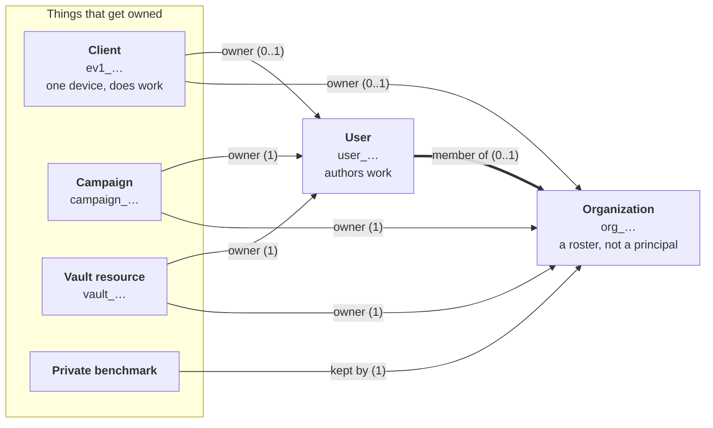

Each owned object names **one** owner: an organization or a user, never both.
How the work flows over those objects at run time:

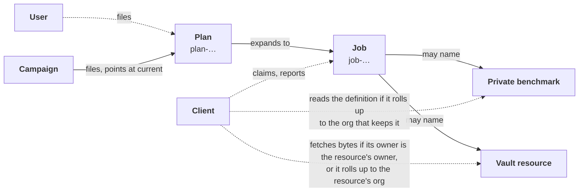

Three things to read off it:

- **An organization grants no permission.** It is a roster plus an owner of
  things. What a caller may do is its permission set ([§5](#5-permissions)),
  scoped by its membership, plus what needs no grant: every account administers
  its own vault resources, and reads its organization's vault resources and
  private benchmarks.
- **A device has at most one owner, a user has at most one organization.** A
  device owned by a user rolls up to that user's organization.
- **A plan has no owner; its campaign does.** A plan filed outside every
  campaign is its filer's.

## 2. Every admin object

Everything an administrator can create, grant, hand over or remove, grouped by
what it is for.

### 2.1. Who administers

Five actors. Only the last four are accounts or devices.

| Actor | What it is | Acts through | Bounded by |
|---|---|---|---|
| **Host operator** | A person with a shell on the server host. Not an account, holds no key | `pipette-mgmt` subcommands, which act on the server's data directly | nothing: no permission is checked and no scope applies |
| **Server admin** | A user holding the `server_admin` group | signed API routes, the console | nothing inside this server: every `_any_` verb. A membership, which Clerk gives every provisioned account, does not put the account in its org admin's hands: the org admin reads it and cannot change its status, set, membership or pre-auth keys. Devices it owns stay in the organization's `manage_clients` reach |
| **Org admin** | A user holding `org_admin` **and** a membership | signed API routes, the console | its own organization, plus every device that rolls up to no organization (unowned, or owned by an account in none), which it may approve, delete or adopt, and grant once adopted; the whole fleet to read (`read_clients`). To an account it grants only names it holds (the ceiling), and it changes no account holding an `_any_` name it lacks (rank) |
| **Operator** | A user holding `org_member`, or any other set | signed API routes, the console | its own objects; its organization's campaigns, vault resources and private benchmarks to read; its organization's campaigns to file into with `submit_plans` and their plans to cancel with `cancel_plans`; with `submit_plans` it may create a campaign for its organization or hand its own to it, whose record it then cannot administer; it may upload a vault resource for its organization, which it then cannot delete; the whole fleet to read (`read_clients`). An `_any_` name in its set reaches past these |
| **Device** | A client | signed API routes only | its own record, the jobs it claims, what its owner owns, and what the organization it rolls up to owns |

**Only the host operator can do these**, because no route serves them:

- tag or untag a client,
- grant a **client** permission to every device carrying a tag
  (`clients permission add --tag`),
- mint a client pre-auth key that carries tags, a label or a permission
  template, lasts past 90 days, or names an account or nobody as its owner;
  prune client pre-auth keys, and revoke one that names no organization,
- mint a user pre-auth key that is multi-use, lasts past 90 days, or is for an account somebody has already signed in as;
  prune user pre-auth keys, and revoke one whose account is gone,
- promote, delete or prune held submissions,
- delete an account at all: offboarding over HTTP is a disable,
- delete an organization or an account with `--detach`, clearing what still
  names it first,
- release an address or a handle that a crashed create left reserved
  (`users release-claim`, `orgs release-claim`), or adopt it with
  `--adopt-stranded-claim` on `users create` or `orgs create`,
- `flag-reindex` a device, or the whole fleet.

### 2.2. Where each object is specified

Each object's fields, lifecycle and routes have one home:

- **Identities** (user, user key, client): [authentication.md §1](authentication.md#1-identity-model),
  [§5.11](authentication.md#511-users); the records are
  [storage.md §3](storage.md#3-metadata-contract) and
  [§3.1](storage.md#31-the-user-principal).
- **The roster** (organization, membership, ownership):
  [storage.md §3.2](storage.md#32-organizations) and
  [Organizations](api/orgs.md).
- **Grants and labels** (permission sets, groups, tags):
  [Users: Permissions](api/users.md#permissions),
  [authentication.md §5.2](authentication.md#52-the-vocabulary),
  [§5.6](authentication.md#56-assignment) and
  [§7](authentication.md#7-client-tags).
- **Ways in** (pre-auth keys, spent markers, the first-sign-in mark, browser
  keys, Clerk tokens): [authentication.md §3.2](authentication.md#32-pre-auth-keys)
  and [§5.12](authentication.md#512-signing-in-from-a-browser).
- **Uniqueness rules** (one keypair per principal, one account per address, one
  organization per handle): [storage.md §3.1](storage.md#31-the-user-principal)
  and [§3.2](storage.md#32-organizations).
- **Owned objects** (campaign, plan, vault resource, private benchmark):
  [Campaigns](api/campaigns.md), [Vault](api/vault.md),
  [benchmarks.md §1.1](benchmarks.md#11-private-benchmarks), and the records in
  [storage.md §3.3](storage.md#33-campaigns) and [§3.4](storage.md#34-the-vault).
- **Operational flags** (suspension, reindex flag, held submission): [queue.md](queue.md)
  and [storage.md §4.1](storage.md#41-unverified-submissions).
- **Server settings that change the rules**: the config reference in
  [`crates/pipette-core/src/config.rs`](../crates/pipette-core/src/config.rs).

### 2.3. Who may change each object

| Object | Host CLI | Server admin | Org admin, in its own org | The account itself | The device itself |
|---|---|---|---|---|---|
| Organization | create, rename, label, delete (`--detach`) | create, rename, label, delete | rename, label | - | - |
| User | create, set status, delete (`--detach`) | create, set status, delete | create, set status, delete | request one (`pending`) | - |
| User key | list, revoke | read, revoke | read, revoke | add, revoke | - |
| User permission set | set | set | set, up to its own ceiling | - | - |
| Membership | set, clear | set, clear | create into its org, release (itself included) | - | - |
| User pre-auth key | mint, revoke, prune | mint for a first sign-in, revoke | mint for a first sign-in, revoke | - | - |
| Client | approve, reject, update, delete | approve, reject, update, delete | the same, for devices that roll up to its org or to none | - | register, update its own profile |
| Ownership | set, clear | set, clear, move between orgs | adopt a device that rolls up to no org, move inside its org, detach | - | - |
| Client permission set | grant, revoke | grant, revoke | grant, revoke, for devices that roll up to its org | - | - |
| Tag | add, remove | - | - | - | - |
| Client pre-auth key | mint, revoke, prune | mint owner-only for any org, revoke | mint owner-only for its org, revoke | - | - |
| Campaign | all | all | org-owned: rename, hand over, delete, and file with `submit_plans` | its own, with `submit_plans`; its org's: create and file into with `submit_plans`, and no write to the record | - |
| Plan | cancel | cancel | with `cancel_plans`: plans of its org's campaigns (`org_admin` alone holds none) | with `cancel_plans`: its own plans filed outside a campaign and the plans of its org's campaigns, and, holding `submit_plans` too, the plans of its own campaigns | - |
| Vault resource | delete | upload, delete | org-owned: upload, delete; for a member: upload, theirs alone after | its own: upload, delete; may upload one for its org, which it cannot then delete | - (fetches its owning user's, and those of the org it rolls up to) |
| Private benchmark | put, delete | put, delete | put, delete | - (members read it) | - (devices of its org read it) |
| Suspension | clear | clear | clear | - | - |
| Held submission | promote, delete, prune | - | - | - | - |

The org admin column skips any account holding an `_any_` name the org admin
lacks: its status, set, membership and pre-auth keys are left to a server
admin, and the org admin still reads it
([Users: The rules that make delegation safe](api/users.md#the-rules-that-make-delegation-safe)).

Source: [cli.md](cli.md), [Organizations](api/orgs.md) to
[Vault](api/vault.md).

## 3. Relation diagrams

A solid line is an id one object holds. A dashed line is a reference no object
keeps: made once, at registration or while work runs.

### 3.1. People, devices and the way in

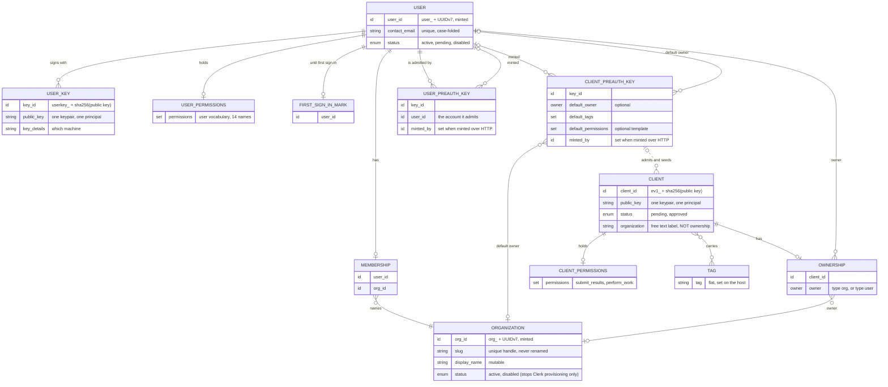

The owner is one shape on a device, a campaign and a vault resource:
`{"type": "org", "org_id": …}` or `{"type": "user", "user_id": …}`
(`crates/pipette-core/src/organization.rs`). A device may have none; a campaign
and a vault resource always have one, which may name an account or an
organization since deleted ([§4](#4-ownership-stored-against-derived)).

### 3.2. What they own and run

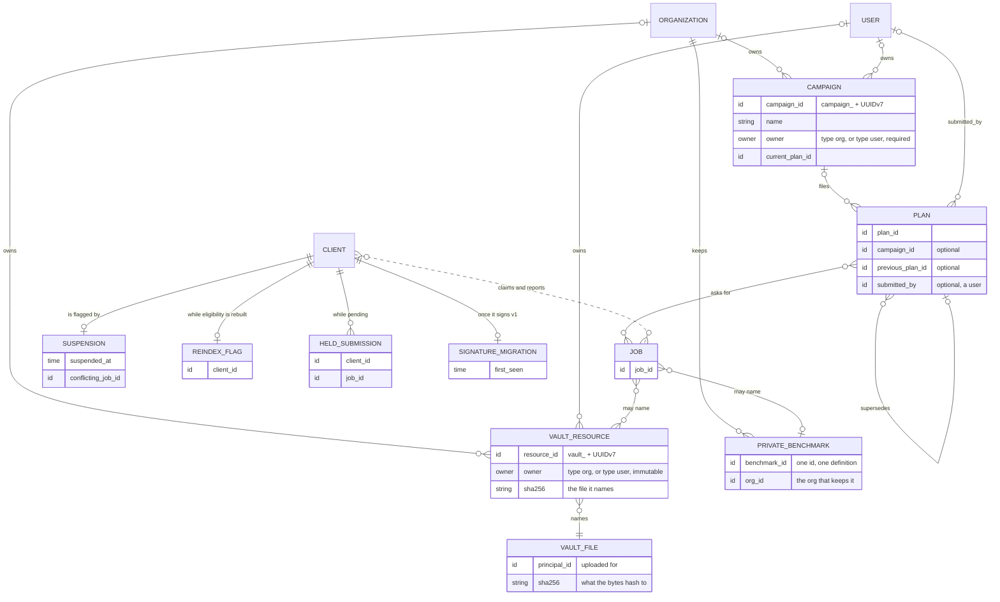

## 4. Ownership: stored against derived

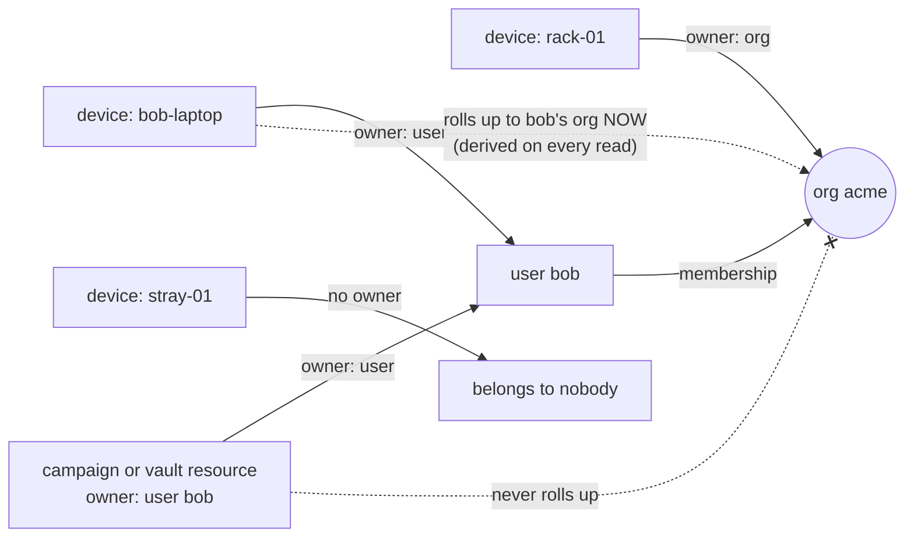

| When this happens | Devices the account owns | Campaigns and vault resources it owns |
|---|---|---|
| The account moves from org A to org B | follow it: they now roll up to B, fetch B's artifacts and lose A's | stay personal, reach neither org's administrators |
| The account leaves every org | roll up to nobody: only `manage_any_clients` reaches them | unchanged |
| The account is disabled | keep working: disabling stops the account, not the machines it owns | its campaigns are also its organization's administrators' to rename, delete, hand over and cancel the plans of; its vault resources are unchanged: only a server-wide grant reaches them, but its own devices still read and fetch them |
| The account is deleted (on the host) | refused while it owns one; `--detach` clears them first | refused while it owns one: hand each campaign over or delete it, and delete each vault resource, which cannot change hands |
| The organization is deleted | refused while it owns one directly; once its members are detached, theirs roll up to nobody | refused while it owns one, as for an account |
| A campaign is handed to another owner | unaffected | its plans go with it, with no write to any plan |
| A vault resource needs another owner | unaffected | not possible: upload again under a new id |

Deletes that are refused while something still points at the object:

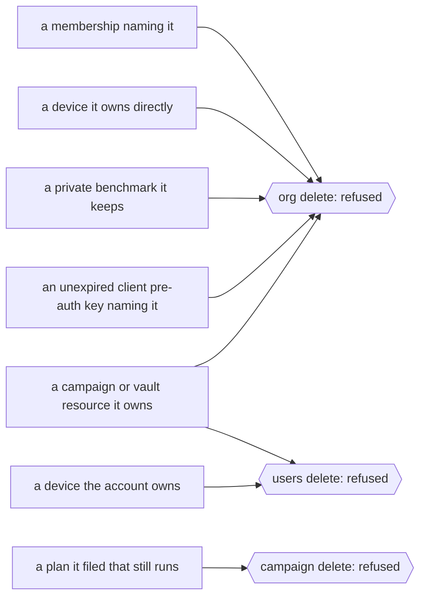

Not refused: the pre-auth keys that name an account, or an expired client
pre-auth key naming an organization. A key left naming a deleted principal
registers nothing; revoke it on the host. Source:
[`orgs delete`](cli.md),
[Organizations: Memberships and ownerships](api/orgs.md#memberships-and-ownerships),
`crates/pipette-pipeline/src/org.rs`.

## 5. Permissions

Two vocabularies, one per principal kind, and no name is grantable to both. An
arrow reads "includes".

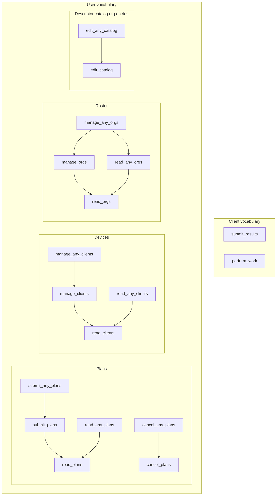

The groups an operator grants by one word. ● is what the group stores; ○
arrives by implication, and goes when the name implying it is revoked. A group
is normalized before it is written, and nothing records that a set came from
one.

| Permission | `org_member` | `org_admin` | `server_admin` |
|---|:-:|:-:|:-:|
| `submit_plans` | ● | ● | ○ |
| `read_plans` | ○ | ○ | ○ |
| `cancel_plans` | ● | ● | ○ |
| `read_clients` | ● | ○ | ○ |
| `manage_clients` | | ● | ○ |
| `read_orgs` | | ○ | ○ |
| `manage_orgs` | | ● | ○ |
| `submit_any_plans` | | | ● |
| `read_any_plans` | | | ● |
| `cancel_any_plans` | | | ● |
| `read_any_clients` | | | ● |
| `manage_any_clients` | | | ● |
| `read_any_orgs` | | | ○ |
| `manage_any_orgs` | | | ● |
| `edit_catalog` | ● | ● | ○ |
| `edit_any_catalog` | | | ● |

What each bare verb reaches, and what its `_any_` form adds, is
[Users: What each name opens](api/users.md#what-each-name-opens). Source:
`crates/pipette-core/src/user_permission.rs`.

### 5.1. The order every request is judged in

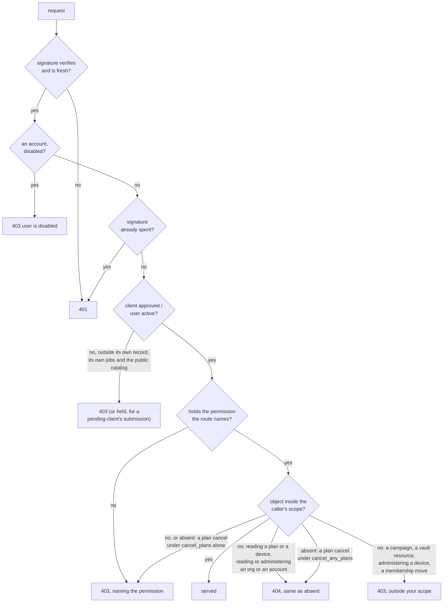

The host CLI skips all of this: shell access to the server is already the
authority. [§8.6](#86-how-one-signed-request-is-checked) walks the same gate
step by step, and
[Users: Status, then permission](api/users.md#status-then-permission) is the
refusal contract.

## 6. A worked example

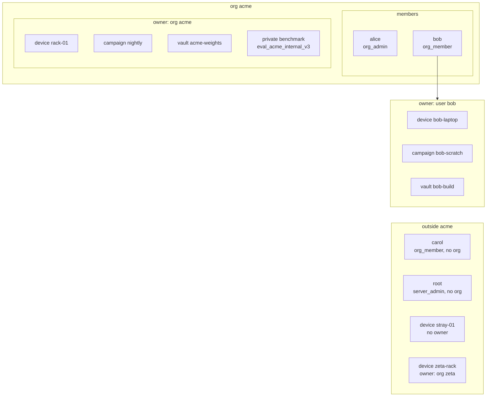

What each account reaches. **R** reads, **W** administers (create, change,
delete), **-** is refused or reads as absent.

| Object | alice | bob | carol | root |
|---|:-:|:-:|:-:|:-:|
| acme's roster: the org, its accounts, their grants | RW | - | - | RW |
| campaign `nightly` (the object) | RW | R | - | RW |
| the plans `nightly` filed | RW | R | - | RW |
| campaign `bob-scratch` and its plans | - | RW | - | RW |
| vault `acme-weights` (record and bytes) | RW, and may name it in a plan | R, and may name it in a plan | - | RW |
| vault `bob-build` | - | RW, and may name it in a plan | - | RW |
| `eval_acme_internal_v3` definition | RW, and may name it in a plan | R, and may name it in a plan | - | RW |
| fleet listing | R | R | R | R |
| device `rack-01`, `bob-laptop` | RW | R | R | RW |
| device `stray-01` (unowned) | R | R | R | RW |
| device `zeta-rack` | R | R | R | RW |

alice's `org_admin` is everything inside acme: she files into `nightly`, reads
and cancels its plans, onboards a colleague as an `org_member`
([§8.3](#83-an-org-admin-onboards-a-colleague)), and grants `rack-01` its
`perform_work` herself
([§8.8](#88-a-device-joins-self-registration-then-adoption-by-the-server)). It
stops at acme's edge: bob's own campaign and vault stay his, and `zeta-rack`
and the unowned `stray-01` are a server admin's.

What each device reaches, once approved and holding `perform_work`:

| Object | `rack-01` | `bob-laptop` | `stray-01` | `zeta-rack` |
|---|:-:|:-:|:-:|:-:|
| vault `acme-weights` bytes | yes | yes, through bob's membership | no | no |
| vault `bob-build` bytes | no | yes | no | no |
| `eval_acme_internal_v3` definition and corpus | yes | yes | no | no |
| claim a job naming that benchmark | yes | yes | yes if it matches, then refused the definition | same |

## 7. Decisions per object

### 7.1. Devices: who may administer one, and where it may be put down

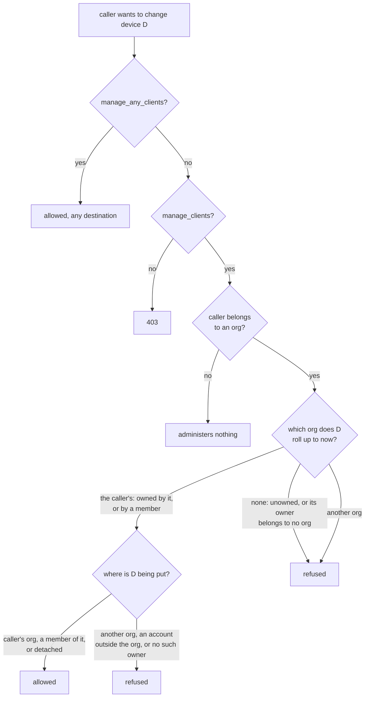

So an org admin reaches only the devices that roll up to its own organization;
a device in none is a server admin's, and an organization onboards through its
own client pre-auth keys. Source:
[Device administration](api/devices.md).

### 7.2. Roster: organizations and accounts

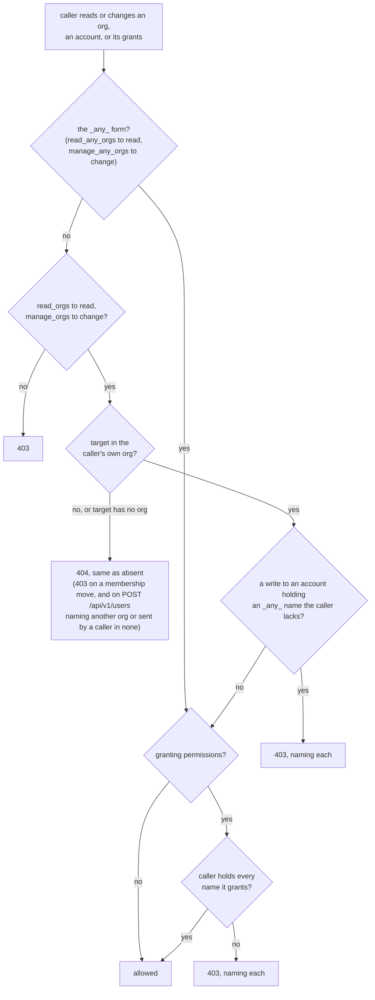

Creating an organization takes `manage_any_orgs` alone; only the CLI
deletes one. An
account's keys and pre-auth keys take `manage_orgs` (scoped) or
`manage_any_orgs`, never a read grant. Source: [Organizations](api/orgs.md),
[Users: The rules that make delegation safe](api/users.md#the-rules-that-make-delegation-safe).

### 7.3. Campaigns and vault resources: one ownership rule, read twice

| | Campaign | Vault resource |
|---|---|---|
| **Read**, user-owned | the owner, with `read_plans` or `manage_orgs` | the owner, on no grant |
| **Read**, org-owned | every member, with `read_plans` or `manage_orgs` | every member, on no grant |
| **Read**, any | `read_any_plans`; the record alone on `manage_any_orgs` | `manage_any_orgs` (not `read_any_orgs`) |
| **Administer**, user-owned | the owner, with `submit_plans` | the owner, on no grant |
| **Add to**, org-owned | every member: a revision with `submit_plans`, a cancel with `cancel_plans` | every member uploads, on no grant |
| **Administer**, org-owned | `manage_orgs` and membership: rename, hand over, delete | `manage_orgs` and membership: delete |
| **Administer**, any | `manage_any_orgs` | `manage_any_orgs` |
| **Change owner** | `PUT …/owner`, authority at both ends | never: a resource is immutable |
| **Out of scope reads as** | `403` | `403` |

A campaign revision that replaces the head (a variant edit, document revision,
re-run or recalculation) also needs `cancel_plans` and `read_clients`. A member
can give a campaign or a vault upload to its organization on membership alone,
and then cannot administer it.

Where an object may be handed (a campaign's new owner, or the owner a vault
upload names):

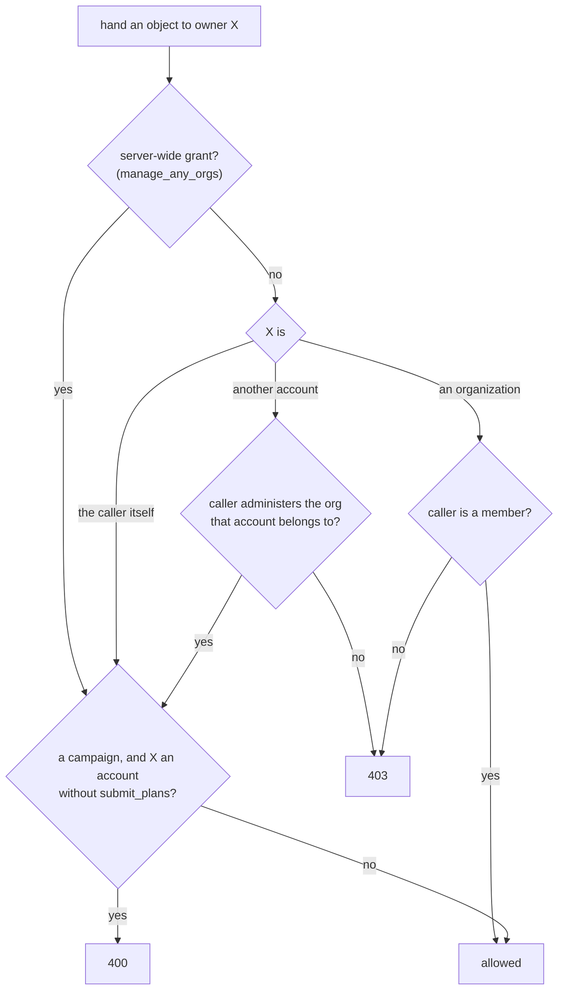

Source: `crates/pipette-httpapi/src/owner.rs`,
`crates/pipette-httpapi/src/campaign_access.rs`,
`crates/pipette-httpapi/src/vault_access.rs`.

### 7.4. Vault: may this device have the bytes

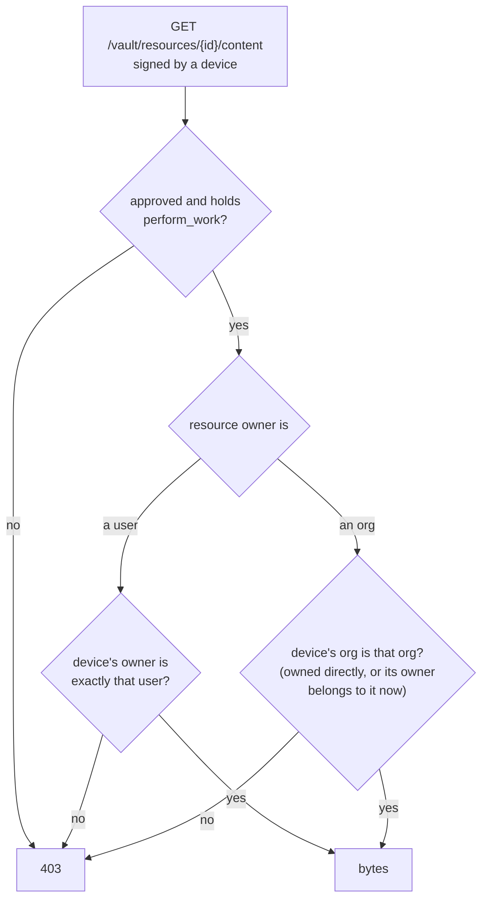

An unowned device fails both branches, so a machine that registered itself and
was never claimed reaches nothing. A colleague's personal resource stays out of
reach of the org's rack machines. The rule never reads the owner account's
status, so a disabled account's devices still fetch its resources.

Naming a resource in a plan takes reach: a filer names its own resources and
its organization's, and `submit_any_plans` names any. Ingestion refuses one
outside that reach with the `400` an absent resource gets, so the refusal names
no owner. Within the reach it checks that the resource still has its file and
matches the named owner and any pinned digest. The fetch above is the second
gate. Source: [plan-ingestion.md §6.2](plan-ingestion.md#62-ingestion-time),
[Vault: Who may do what](api/vault.md#who-may-do-what).

### 7.5. Private benchmarks: gated at the definition, not at the claim

| | Who |
|---|---|
| Read the definition | active members, approved devices that roll up to the org; `read_any_orgs` for the `/api/v1/orgs/{org_id}/benchmarks` routes |
| Fetch the corpus (`GET /datasets/{id}`) | approved devices that roll up to the org and hold `perform_work`; no account |
| Create, replace, delete | `manage_orgs` and membership, or `manage_any_orgs` |
| Name it in a plan | a filer who belongs to the org, or `submit_any_plans` |
| Claim a job that names it | any device the job's clauses match: eligibility ignores organizations |

[§8.12](#812-a-private-benchmark-runs) walks it. Source:
[benchmarks.md §1.1](benchmarks.md#11-private-benchmarks),
[Organizations: Private benchmarks](api/orgs.md#private-benchmarks).

## 8. How it works: sequences

The same cast as [§6](#6-a-worked-example). `mgmt` is the server; a note over it
says what it checks or writes at that step. The host CLI talks to no server: it
acts on the server's data directly, shown as `the data, directly`. Request
bodies, status codes and errors are in [httpapi.md](httpapi.md).

### 8.1. Standing up a server: the first server admin

No route can create the first server admin: the two routes that need no caller
leave an account `pending` or holding only `org_member`. The host operator does
it on the server host.

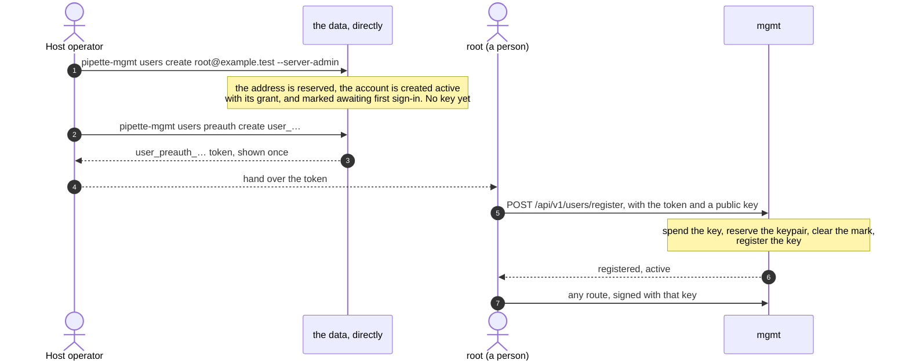

### 8.2. A new organization and its administrator

Every step below runs over the signed API or the console.

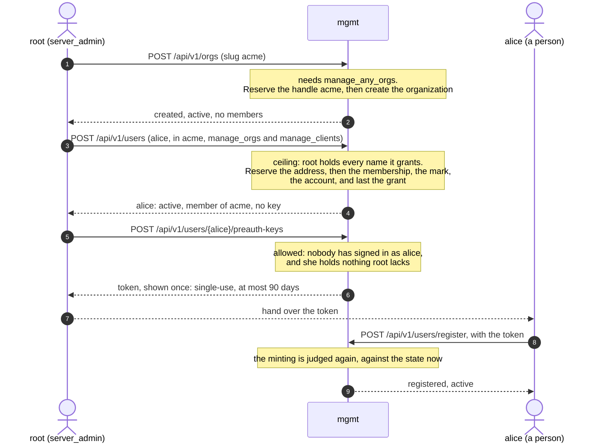

### 8.3. An org admin onboards a colleague

Delegation with no server admin in the loop. Three rules keep it safe: the
**scope** (her own organization), the **ceiling** (only names she holds), and
**onboard, never take over** (a pre-auth key only for an account nobody has
signed in as). Here alice holds `org_admin`.

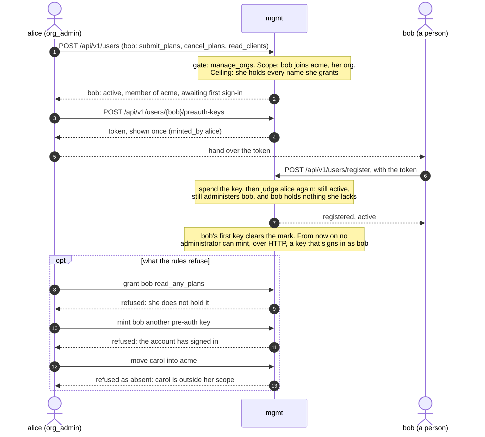

Bob adds his other machines himself, signed by a key he already holds. If he
loses every key, the host operator mints the way back in. Source:
[Users: Account administration](api/users.md#account-administration).

### 8.4. An account that asks for itself

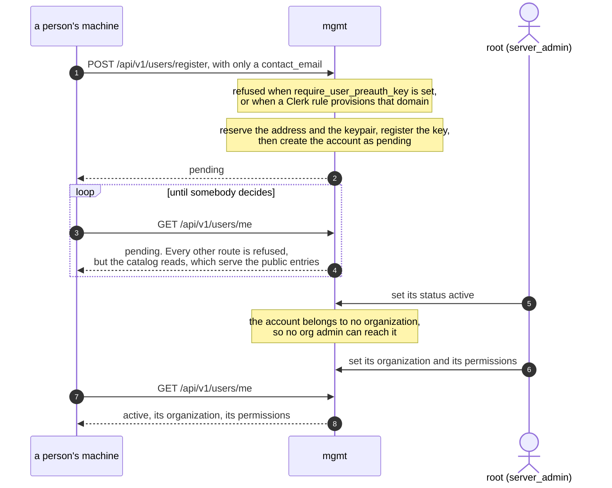

The key that asked is the account's from the start. On the host the same
decision is `users approve <user_id> --org-member`, then
`users set-org <user_id> <org>`. Source:
[`POST /api/v1/users/register`](api/users/register_user_key.md).

### 8.5. Signing in through Clerk

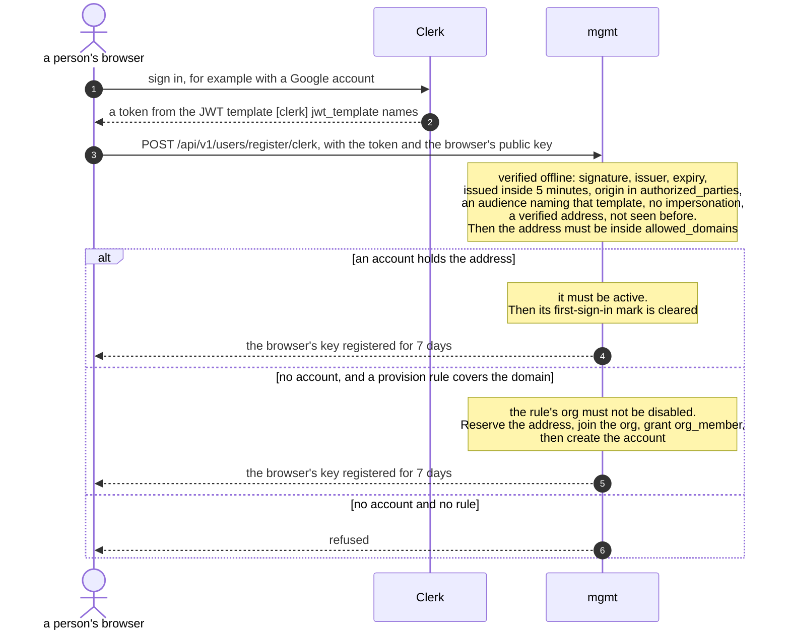

Clerk vouches for addresses, so it reaches every account whose address it can
verify. Offboard with `disable`: a deleted account at a provisioned domain is
created afresh at the next sign-in. Source:
[authentication.md §5.12](authentication.md#signing-in-through-clerk).

### 8.6. How one signed request is checked

An account, on any API route:

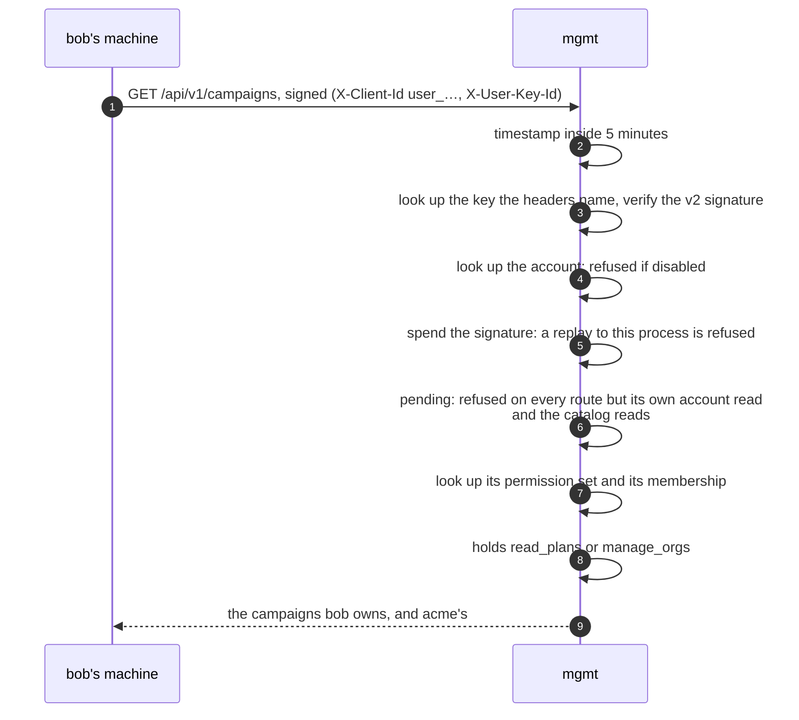

A device, asking for work:

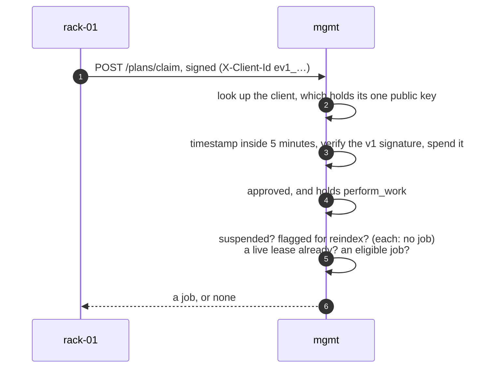

Nothing is cached: a revoked grant, a disabled account and a revoked key all
take effect on the next request. Source: `crates/pipette-httpapi/src/auth.rs`.

### 8.7. Signing in to the app with a key

The browser never signs with the reader's own key for long: it registers one of
its own.

```mermaid
sequenceDiagram
    autonumber
    actor R as bob's browser
    participant M as mgmt

    R->>R: the private key, read from id_ed25519; a fresh key made for this browser
    R->>M: GET /api/v1/users/me, v2-signed with his key, naming only the key
    Note over M: the key's holder is the account. Verify, refuse a disabled account,<br/>spend the signature
    M-->>R: the account
    R->>M: POST /api/v1/users/me/keys, signed with his key: the browser's public key, 7 days
    M-->>R: registered
    Note over R: his key is forgotten. The browser's, kept non-extractable in IndexedDB,<br/>signs every request after this, and sign-out revokes it
```

A key the browser cannot reach, such as an ssh-agent's, registers the browser's
key from a terminal instead: sign `POST /api/v1/users/me/keys` with that key
([Users: Calling the API yourself](api/users.md#calling-the-api-yourself)). Source:
[authentication.md §5.12](authentication.md#512-signing-in-from-a-browser).

### 8.8. A device joins: self-registration, then adoption by the server

```mermaid
sequenceDiagram
    autonumber
    participant D as a new device
    participant M as mgmt
    actor R as root (server_admin)
    actor A as alice (org_admin of acme)

    D->>M: POST /clients/register, with its key and device profile
    Note over M: reserve the keypair, grant submit_results,<br/>drop any leftover owner and tags, create the client as pending
    M-->>D: pending
    D->>M: POST /plans/claim
    M-->>D: refused: not approved
    A->>M: approve the device
    M-->>A: refused: outside her organization
    R->>M: approve the device
    Note over M: manage_any_clients: an unowned device is the server's
    M-->>R: approved
    R->>M: set its owner to acme
    Note over M: picked up from nobody, put down in acme
    D->>M: POST /plans/claim
    M-->>D: refused: no perform_work
    A->>M: grant the device perform_work
    Note over M: manage_clients, and only because<br/>the device is now her org's
    M-->>A: perform_work, submit_results
    D->>M: POST /plans/claim
    M-->>D: a job, or none
```

The work right is hers to grant once the device is acme's, and it reaches the
shared queue: the device claims any job it matches, not only acme's. Source:
[httpapi.md §2.2](httpapi.md#22-post-clientsregister),
[Device administration: Device permissions](api/devices.md#device-permissions).

### 8.9. A device joins: with a pre-auth key

The lab path: one key, minted once, admits a rack already owned, tagged and
granted.

```mermaid
sequenceDiagram
    autonumber
    actor Op as Host operator
    participant St as the data, directly
    participant D as a new device
    participant M as mgmt

    Op->>St: pipette-mgmt clients preauth create --multi-use<br/>--owner-org acme --tag lab --permission perform_work
    Note over St: the owner is resolved now and kept by id
    St-->>Op: client_preauth_… token, shown once
    Op-->>D: provision the token
    D->>M: POST /clients/register, with the token
    Note over M: read the key without spending it: refused if it is<br/>unknown, expired or spent. Then reserve the keypair<br/>and consume the key: refused if its owner is gone
    Note over M: grant the template, set the owner and the tags,<br/>then create the client as approved
    M-->>D: approved
    Note over M: the seeded tag flags it for reindex
    D->>M: POST /plans/claim
    M-->>D: no job until the next queue-maintenance run clears the flag
    D->>M: POST /plans/claim
    M-->>D: a job, or none
```

An org admin mints the owner-only form of that key without the host. The device
then arrives approved and owned by her organization, holding `submit_results`;
she grants its work right as in
[§8.8](#88-a-device-joins-self-registration-then-adoption-by-the-server). The
key registers nothing once she no longer administers the organization's devices.
Source: [authentication.md §3.2](authentication.md#32-pre-auth-keys),
[Device administration: Client pre-auth keys](api/devices.md#client-pre-auth-keys).

### 8.10. A private artifact, end to end

```mermaid
sequenceDiagram
    autonumber
    actor B as bob (member of acme)
    participant M as mgmt
    participant L as bob-laptop (owner: user bob)
    participant K as rack-01 (owner: org acme)

    B->>M: PUT /api/v1/vault/blobs/{bob's user id}/{sha256}, the file
    Note over M: scope first: the principal is bob himself.<br/>Kept only if the bytes hash to the digest
    M-->>B: stored
    B->>M: POST /api/v1/vault/resources, naming the file
    Note over M: find the file uploaded for bob, check its first bytes,<br/>create one resource per file. Owner: user bob
    M-->>B: the resource, and its plan entry
    B->>M: file a campaign whose plan names that entry
    L->>M: POST /plans/claim
    M-->>L: a job whose model is /vault/resources/vault_…/content
    L->>M: GET /api/v1/vault/resources/vault_…
    Note over M: approved, holds perform_work,<br/>and its owner is exactly the resource's owner
    M-->>L: the resource: sha256, bytes
    L->>M: GET /vault/resources/vault_…/content
    M-->>L: the bytes. The device checks the digest
    K->>M: GET /vault/resources/vault_…/content
    M-->>K: refused: another owner's resource
```

For a team's artifact, an administrator uploads for the organization's id
instead, and every device that rolls up to the organization fetches it. Source:
[Vault](api/vault.md).

### 8.11. A campaign: create, revise, hand over

```mermaid
sequenceDiagram
    autonumber
    actor B as bob (org_member, member of acme)
    participant M as mgmt
    actor A as alice (org_admin of acme)

    B->>M: POST /api/v1/campaigns, a plan document
    Note over M: needs submit_plans. The owner defaults to bob.<br/>Plan P1 is filed first, then the campaign pointing at it
    M-->>B: the campaign, current plan P1
    B->>M: POST /api/v1/campaigns/{id}/plans, a revised document
    Note over M: bob administers it. P2 records previous_plan_id P1,<br/>then the campaign moves onto P2. P1 is superseded, not cancelled
    M-->>B: P2
    B->>M: hand the campaign to acme
    Note over M: judged at both sides: it is his to give,<br/>and a member may give his own campaign to his org
    M-->>B: handed over, with every plan it filed
    B->>M: POST /api/v1/campaigns/{id}/plans
    M-->>B: P3: a member holding submit_plans files into his org's campaign
    B->>M: rename the campaign
    M-->>B: refused: administering an org's campaigns needs manage_orgs
    A->>M: rename the campaign
    M-->>A: renamed: manage_orgs and membership
```

A variant edit, a document revision, a re-run or a recalculation files a
revision **and** cancels the plan it replaces. Source:
[Campaigns](api/campaigns.md).

### 8.12. A private benchmark runs

```mermaid
sequenceDiagram
    autonumber
    participant U as bob (member of acme)
    participant M as mgmt
    participant In as rack-01 (acme's)
    participant Out as zeta-rack (another org's)

    U->>M: file a plan naming eval_acme_internal_v3
    Note over U,M: allowed: the filer belongs to acme<br/>(or holds submit_any_plans)
    Out->>M: POST /plans/claim
    M-->>Out: job (eligibility ignores organizations)
    Out->>M: GET /benchmarks/eval_acme_internal_v3
    M-->>Out: not found
    Out->>M: report a retriable failure
    Note over M: job returns to the queue,<br/>zeta-rack is denied it
    In->>M: POST /plans/claim
    M-->>In: job
    In->>M: GET /benchmarks/… and GET /datasets/…
    M-->>In: definition and corpus
    In->>M: POST /benchmarks (result)
```

The vault gates an organization's artifacts the same way: at the fetch, not at
the claim.

### 8.13. A crash-looping device is suspended

```mermaid
sequenceDiagram
    autonumber
    participant D as rack-01
    participant M as mgmt
    actor A as alice (org_admin of acme)

    D->>M: POST /plans/claim
    alt it already holds exactly one live lease
        M-->>D: that same job again: a lost response, so the claim is idempotent
    else it holds more than one: a crash loop piled them up
        Note over M: suspend it, recording when and one conflicting job
        M-->>D: no job, the same answer as no work
    end
    A->>M: GET /api/v1/clients, where the device shows as suspended
    A->>M: POST /api/v1/clients/{client_id}/unsuspend
    Note over M: clears the flag alone, and touches no lease
    D->>M: POST /plans/claim
    alt two or more of its leases are still live
        M-->>D: no job: suspended again
    else at most one
        M-->>D: that job again, or the next one
    end
```

While suspended, the device's heartbeats and reclaims are refused with `403`,
so its leases lapse. A claim, heartbeat or reclaim that leaves it a second live
lease, as racing claims can, suspends it the same way.

The device needs no change: it keeps polling, and resumes once the flag is gone
and at most one of its leases is live. Source:
[queue.md](queue.md#claiming-a-job).

### 8.14. Offboarding an account

```mermaid
sequenceDiagram
    autonumber
    actor A as alice (org_admin of acme)
    participant M as mgmt
    actor B as bob

    A->>M: disable bob
    B->>M: any signed request
    M-->>B: refused: user is disabled
    B->>M: the app's next call, signed with his browser's key
    M-->>B: refused, which the app draws in place of the page
    Note over M: his plans stay attributed to an account that still resolves.<br/>His devices keep working, his vault resources included
    A->>M: re-home bob-laptop to acme
    Note over M: re-home or detach each device he owns
    A->>M: hand bob-scratch to acme
    Note over A,M: a disabled member's campaign is its administrator's to cancel and hand over.<br/>A vault resource is its owner's alone and never changes owner:<br/>it is uploaded again for the new one
    Note over A,M: no route deletes an account.<br/>The host's `users delete` is for one made in error, and refuses<br/>while it owns a device, a campaign or a vault resource
```

A delete removes the account first, then its keys and their keypair
reservations, its address reservation, its permission set, its membership and
its first-sign-in mark. Pre-auth keys naming it stay: revoke them on the host.
Source: `crates/pipette-pipeline/src/user_admin.rs`.
